# vlm-sam-industrial-vision-v2

端云分离架构的工业视觉 AI 检测流水线：**RK3588 16GB 边缘端**（三阶段异步推理）→ **FastAPI 后端** → **Next.js 仪表盘**（实时可观测性）。

## 项目定位

面向**端侧 AI 部署推理优化**方向的工程验证项目。以 MVTec AD 15 类工业缺陷数据为基础，构建从 PC 训练/评估到 RK3588 真机部署、再到后端/前端联调的完整闭环。项目基于 MVTec AD 公开数据集，非真实产线部署。

## 当前状态

项目存在两条已验证的 RK3588 部署主线：

### 路径 A：Phase 7/9 三阶段 VLM 管线（已验证）

```text
T1: V4L2 图片采集
T2: EfficientAD-S (FP16 raw RKNN) → 异常门控
T3: FastSAM-s (FP16 no-quant RKNN) bbox + Qwen3-VL-2B (W8A8 RKLLM) 结构化 JSON
T4: libcurl multipart 上传
```

- Phase 9 soak：30.2 分钟，0 崩溃、0 队列丢帧、100% json_parse_ok
- VLM 性能：TTFT ~2174ms, decode 9.97 tok/s, RSS 3324MB
- 证据：`docs/experiments/phase7_edge_pipeline_report.md`

### 路径 B：Phase 10 v1 ORT Localizer（当前活跃）

```text
T1: V4L2 图片采集
T2: EfficientAD-S (FP16 raw RKNN) → 异常门控
T3: YOLOv8n-detect (ORT CPU FP32) → defect_type + confidence + bbox
T4: libcurl multipart 上传
```

- Extended soak：27m27s, 2082 frames, 0 crash, RSS=34MB, T3 avg=187.7ms
- Scope：metal_nut + cable（2 类 12 defect type）
- RKNN 状态：BLOCKED（rknn-toolkit2 2.3.2 numeric consistency issue），当前使用 ORT CPU fallback
- 证据：`docs/experiments/phase10_session_handoff_v2.md`

### VLM 状态

Phase 10 v1 不调用 VLM。`observation_source="template"`，severity 固定 "medium"。异步 VLM enrichment 属于 Phase 10.1 范围，当前有 smoke test / dry-run / precheck 材料。

## Deployment Tracks 对比

| 维度 | 路径 A（Phase 7/9 VLM） | 路径 B（Phase 10 ORT） |
|------|------------------------|----------------------|
| T3 方案 | FastSAM bbox + Qwen3-VL JSON | YOLOv8n ORT CPU |
| T3 延迟 | ~11s（VLM 主导） | ~188ms |
| RSS | ~3324MB | ~34MB |
| 输出 | 结构化 JSON（defect_type/severity/confidence/bbox） | defect_type + confidence + bbox |
| 定位 | 端侧 VLM 部署可行性验证 | 工程化低延迟方案 |
| RKNN 验证 | EfficientAD/FastSAM/Qwen3VL vision 均已验证 | YOLO RKNN BLOCKED |

## 系统架构

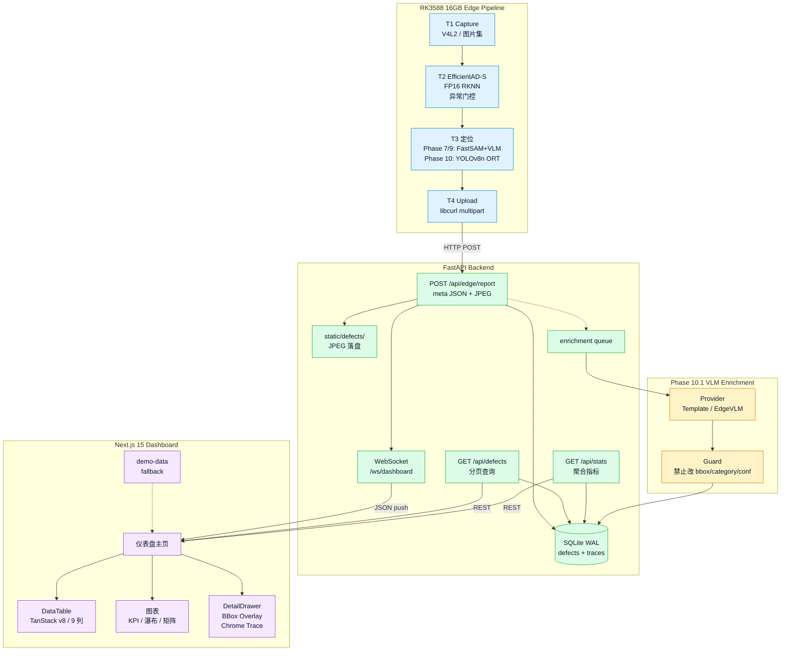

端云分离架构：边缘端负责采集和推理，通过 HTTP multipart 上报到后端，后端落盘入库并通过 WebSocket 实时推送到前端仪表盘。WebSocket 仅存在于 Backend↔Frontend 一段，Edge 只做 HTTP POST 客户端。

## 项目演进

```mermaid
stateDiagram-v2
    [*] --> PaDiM_Explore : 早期探索
    PaDiM_Explore --> EfficientAD_Replace : PaDiM 位置敏感性问题
    EfficientAD_Replace --> Phase5_Train : 训练 15 类 EfficientAD-S
    Phase5_Train --> Phase5_LoRA : LoRA 微调 2B/4B
    Phase5_LoRA --> Phase5_Benchmark : 4 变体 15 类评估
    Phase5_Benchmark --> Phase6_Convert : 模型转换全链路
    Phase6_Convert --> Phase7_VLM : C++ VLM 四线程管线

    Phase7_VLM --> Phase9_Soak : Phase 9 soak 30.2 min 通过
    Phase9_Soak --> Phase10_ORT : 引入 YOLOv8n ORT localizer

    Phase6_Convert --> Phase10_ORT : YOLO RKNN BLOCKED → ORT fallback
    Phase10_ORT --> Phase10_Soak : Phase 10 soak 27m27s 通过
    Phase10_Soak --> Phase10_1 : 异步 VLM enrichment

    state Phase7_VLM {
        P2B : Prompt 2B EfficientAD RKNN
        P2C : Prompt 2C FastSAM RKNN
        P2D : Prompt 2D Qwen3VL RKLLM
        P2E : Prompt 2E E2E 验收
        P2F : Prompt 2F Threshold 验证
        P2B --> P2C --> P2D --> P2E --> P2F
    }
```

项目经历了从 PaDiM 到 EfficientAD 的算法替换、15 类训练评估、模型转换、C++ VLM 管线部署，最后引入 YOLO ORT 作为工程化简化方案。

## Edge Pipeline 机制

```mermaid
flowchart LR
    subgraph T1["T1 Capture Thread"]
        V4L2["V4L2 / 图片集"]
        Q1["BoundedQueue Q1<br/>capacity=2"]
        V4L2 --> Q1
    end

    subgraph T2["T2 Pipeline Thread"]
        EAD["EfficientAD-S<br/>FP16 RKNN<br/>~350ms"]
        GATE{"gate_mode<br/>threshold?"}
        Q2["BoundedQueue Q2<br/>capacity=2"]
        EAD --> GATE
        GATE -->|pass| Q2
        GATE -->|drop| CNT["gate_drop++"]
    end

    subgraph T3["T3 VLM Thread"]
        FSAM["FastSAM-s<br/>FP16 RKNN<br/>~250ms"]
        BBOX["5 级 bbox 净化"]
        QWEN["Qwen3-VL-2B<br/>W8A8 RKLLM<br/>~11s"]
        JSON["结构化 JSON"]
        Q3["BoundedQueue Q3"]
        FSAM --> BBOX --> QWEN --> JSON --> Q3
    end

    subgraph T4["T4 Upload Thread"]
        CURL["libcurl<br/>multipart POST"]
        CURL --> OK["upload_ok++"]
    end

    Q1 --> EAD
    Q2 --> FSAM
    Q3 --> CURL

    classDef t1 fill:#DBEAFE,stroke:#3B82F6
    classDef t2 fill:#D1FAE5,stroke:#10B981
    classDef t3 fill:#FEF3C7,stroke:#F59E0B
    classDef t4 fill:#FCE7F3,stroke:#EC4899
    class V4L2,Q1 t1
    class EAD,GATE,Q2,CNT t2
    class FSAM,BBOX,QWEN,JSON,Q3 t3
    class CURL,OK t4
```

四线程通过 BoundedQueue 解耦——T1 采集、T2 异常门控减少 T3 负载、T3 做 FastSAM bbox 提案和 VLM JSON 描述、T4 上传。drop-oldest 策略防止背压传播。Q2 容量只有 2，是有意设计的保护性瓶颈。

## 后端数据流

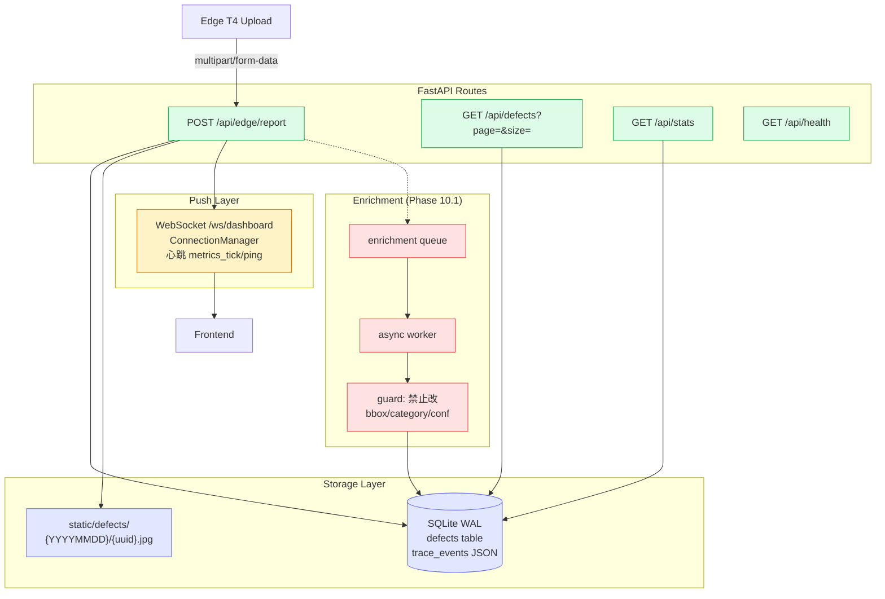

## 实验与证据闭环

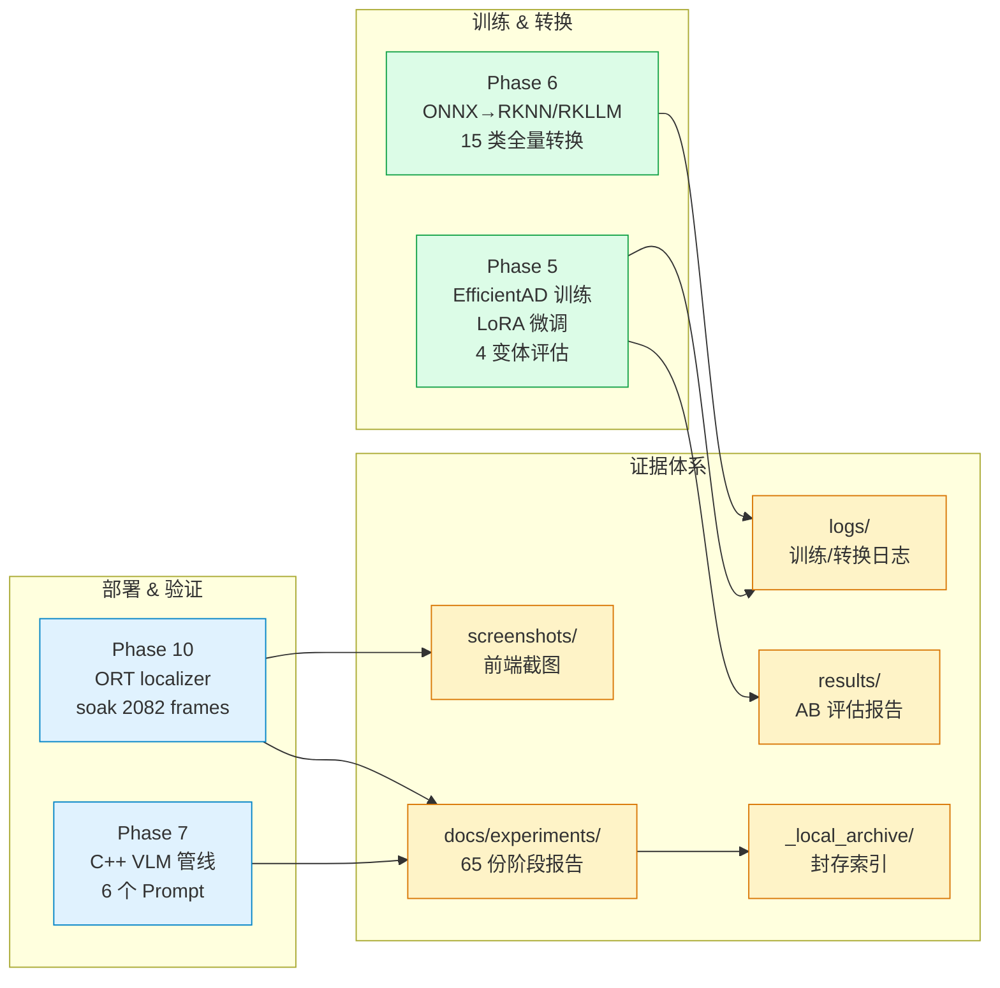

## 技术栈

| 分层 | 技术 | 备注 |
|------|------|------|
| 边缘硬件 | Orange Pi 5 16GB（RK3588, 6 TOPS NPU (3 cores)） | |
| 边缘运行时 | C++17/20, librknnrt, librkllmrt, librga, libcurl, V4L2 | 四线程 jthread + BoundedQueue |
| Stage 1 | EfficientAD-S（PDN, 256x256, FP16 RKNN） | Anomalib 2.x 训练 |
| Stage 2 | FastSAM-s（640x640, FP16 no-quant RKNN） | Phase 7/9 |
| Stage 2 备选 | YOLOv8n-detect（ORT CPU FP32） | Phase 10 |
| Stage 3 | Qwen3-VL-2B/4B W8A8 RKLLM | Phase 7/9 |
| 后端 | Python 3.12, FastAPI, SQLAlchemy 2.0 async, Pydantic v2 | SQLite WAL |
| 前端 | Next.js 15, React 19, Tailwind v4, shadcn/ui | V4 设计体系, 纯静态导出 |
| 数据集 | MVTec AD 全 15 类 | CC BY-NC-SA 4.0 |

## Evidence Snapshot

### Soak 验证

| 项目 | 路径 A（Phase 9 VLM） | 路径 B（Phase 10 ORT） |
|------|----------------------|----------------------|
| 时长 | 30.2 分钟 | 27m27s |
| 帧数 | 366 capture / 37 gate pass / 36 VLM | 2082 frames |
| 崩溃 | 0 | 0 |
| 队列丢帧 | 0 | — |
| json_parse_ok | 100% | — |
| RSS | ~3322 MB 稳定 | 34MB 稳定 |
| T3 延迟 | ~11s（VLM 主导） | avg 187.7ms, p95 215ms |

### Phase 7 六个 Prompt

| Prompt | 成果 | 关键数据 |
|--------|------|---------|
| 2B | EfficientAD-S FP16 RKNN 真实推理 | avg=350.8ms |
| 2C | FastSAM FP16 RKNN 真实推理 | avg=250.1ms, INT8→FP16 修复 |
| 2D | Qwen3-VL 2B RKLLM 接入 | TTFT ~2500ms, decode 9.3 tok/s |
| 2D-Fix | VLM bbox 融合 + severity 白名单 | 23/23 json_ok=100% |
| 2E | 四线程 E2E 验收 | 8 图 4 类 24 帧, upload_ok=24/24 |
| 2F | Threshold 模式验证 | pass_all 100% vs threshold 38% |

### 模型转换矩阵（Phase 6）

| 模型 | 源格式 | 目标格式 | 数量 |
|------|--------|----------|------|
| EfficientAD-S | ONNX | RKNN INT8/FP16 | 15 类 |
| FastSAM-s | ONNX | RKNN FP16 no-quant | 15 类 |
| Qwen3-VL-2B base | HuggingFace | RKLLM W8A8 | 1 (2.3G) |
| Qwen3-VL-2B LoRA | Merged | RKLLM W8A8 | 1 (2.3G) |
| Qwen3-VL-2B vision | HuggingFace | RKNN | 1 (812M) |
| Qwen3-VL-4B base | HuggingFace | RKLLM W8A8 | 1 (4.6G) |
| Qwen3-VL-4B LoRA | Merged | RKLLM W8A8 | 1 (4.6G) |
| Qwen3-VL-4B vision | ONNX | RKNN | 1 (843M) |

### VLM 评估体系（Phase 5）

4 变体 2x2 矩阵（模型尺寸 x 微调模式），三基准评估：

| 变体 | JSON OK | Cat Exact | DefType Exact | BBox IoU>=0.5 |
|------|---------|-----------|---------------|---------------|
| 2B_base | 96.1% | 53.1% | 11.2% | 1.5% |
| 2B_lora | 95.6% | 94.4% | 53.1% | 48.9% |
| 4B_base | 98.0% | 59.2% | 10.5% | 0.0% |
| 4B_lora | 95.8% | 95.8% | 64.8% | 64.5% |

> 409 samples, 15 类 MVTec AD, PC fp16 评估。详见 `docs/experiments/phase5_6_deployment_benchmark_report.md`

### 联调验收

| 模块 | 结果 |
|------|------|
| 契约测试 | 34/34 通过 |
| 前端 typecheck | 0 errors |
| 前端 build | 成功 |
| WebSocket 推送 | defect_created / metrics_tick 正常 |
| trace_events | 6 项完整 |
| demo-data fallback | 后端不可达时不白屏 |

## Technical Highlights

1. **RK3588 端侧 VLM 部署**：在 16GB 内存约束下完成 EfficientAD-S → FastSAM → Qwen3-VL 三阶段 C++ 推理流水线，含 RKNN/RKLLM 真实推理
2. **量化诊断**：定位并解决 FastSAM INT8 per-tensor 量化失真（scale=2.82→confidence 近零）、EfficientAD ONNX post_processor 算子不兼容
3. **LoRA W8A8 坍塌分析**：PC bf16 有效但 RK3588 W8A8 细粒度能力坍塌——定位到 delta 权重量化精度不足
4. **RKNN fallback 工程决策**：YOLO RKNN numeric consistency BLOCKED → ORT CPU fallback
5. **背压管理**：BoundedQueue drop-oldest + threshold 门控 + beat_ms 节拍控制
6. **模型转换全链路**：PyTorch → ONNX → RKNN/RKLLM 覆盖 15 类 EfficientAD + FastSAM + Qwen3-VL 2B/4B
7. **4 变体评估体系**：Deployment Benchmark + Method Control Benchmark + OPRO Baseline 三基准系统性验证
8. **端云闭环**：FastAPI + WebSocket + Next.js 实时可观测仪表盘，34/34 契约测试通过

## 工程证据：为什么管线演进到 ORT YOLO + 异步 VLM

早期阶段探索了 EfficientAD、FastSAM、Qwen3-VL、LoRA 和 RKLLM 端侧推理。以下证据解释了为什么当前 Phase 10 路径使用确定性 YOLOv8n / ORT 定位作为 bbox 和 defect_type 的 canonical source，而 VLM 作为后置异步 enrichment 路径。

> 边界说明：以下图来自 Phase 8 / Phase 8C / VLM AB / 板端验证的历史工程证据。它们不是 Phase 10 ORT localizer 的指标，不是真实工厂生产数据，也不是 VLM 已在 Phase 10 v1 主链路启用的证据。

<details>
<summary><strong>T2 门控证据 — EfficientAD 适合负载削减，不适合作最终定位</strong></summary>

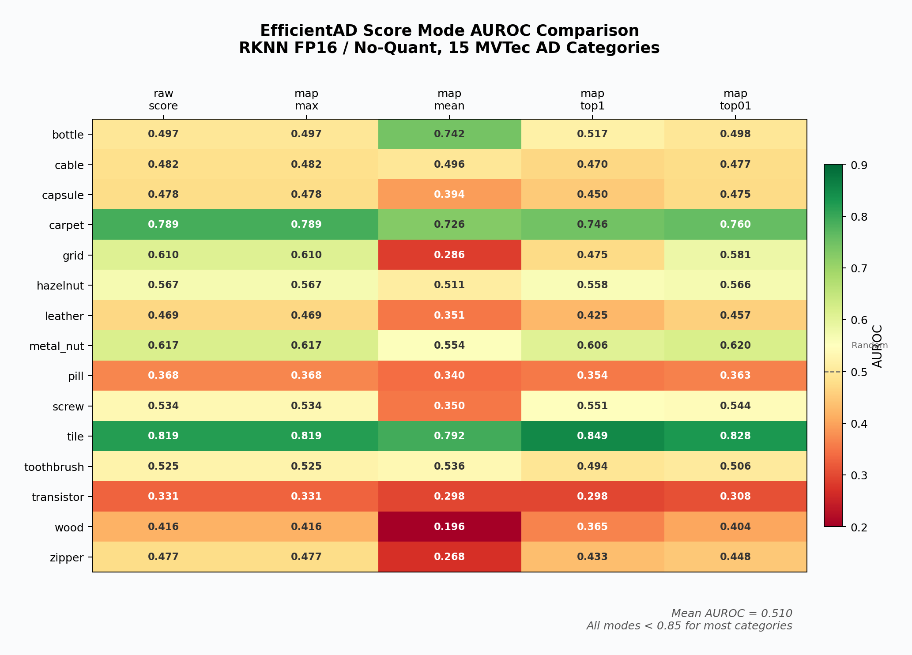

Score-mode AUROC 在 15 类上区分度不稳定（mean 0.510）。5 种 score mode 结果几乎相同——瓶颈在 RKNN FP16 模型的 raw anomaly map 质量，不在聚合方法。这支持将 EfficientAD 作为异常/负载削减门控，而非最终检测器。

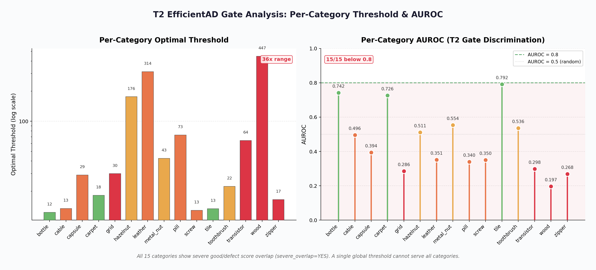

Per-category 最优阈值跨度 36 倍（12~447）。13/15 类 AUROC < 0.8。单一全局阈值脆弱，即使 per-category 阈值也留下多类不可分。因此项目避免使用 T2 作为 defect_type 或 bbox 的 canonical source。

</details>

<details>
<summary><strong>RK3588 VLM 瓶颈证据 — 同步 VLM 在主循环中代价过高</strong></summary>

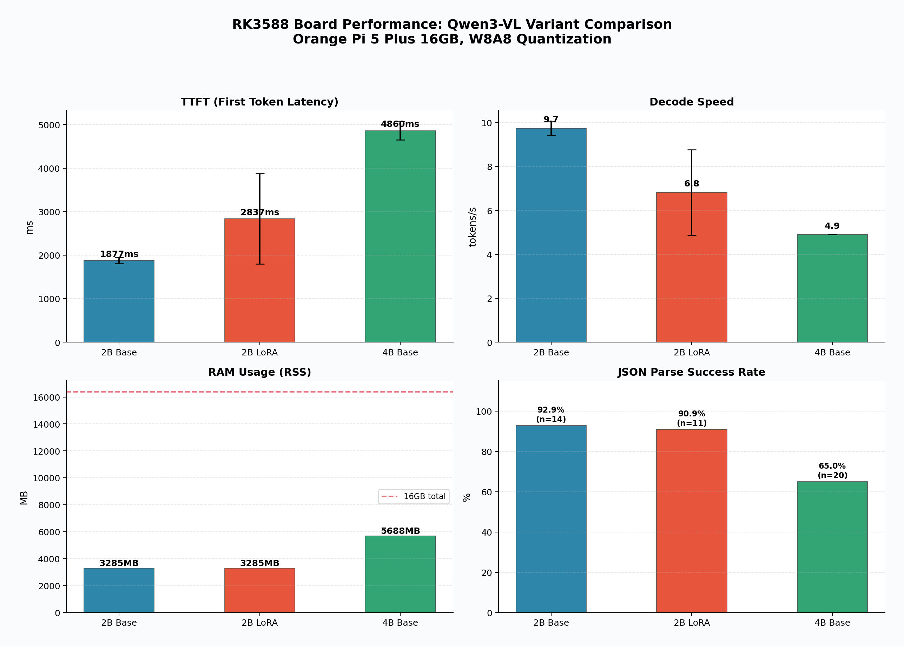

板端 Qwen3-VL 推理有显著的 TTFT、decode 和 RSS 开销。2B base：TTFT 1822ms, decode 9.7 tok/s, RSS 3285MB。4B base：TTFT 4860ms, decode 4.9 tok/s, RSS 5688MB。JSON parse success 随模型复杂度下降（2B base 92.9% → 4B base 65.0%）。这使同步 VLM 对高频检测循环代价过高。

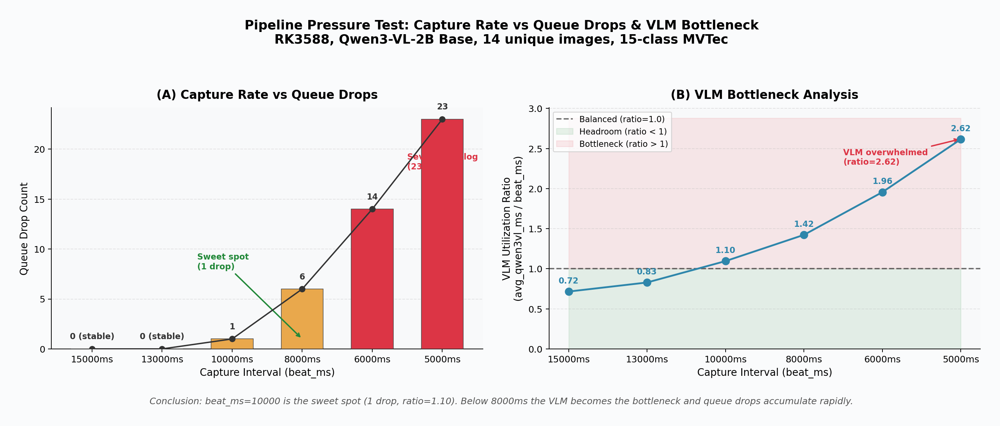

pass_all 最坏情况下，queue drops 随 capture interval 减小而增加。>=13000ms 时稳定（0 drops），11000ms 时首次出现 drop，5000ms 时 23 drops。VLM utilization 在 9000-8000ms 之间越过 1.0 瓶颈线。这支持将确定性定位保持在主路径，VLM 移向异步 enrichment。

</details>

<details>
<summary><strong>W8A8 量化证据 — 细粒度 VLM 输出在板端退化</strong></summary>

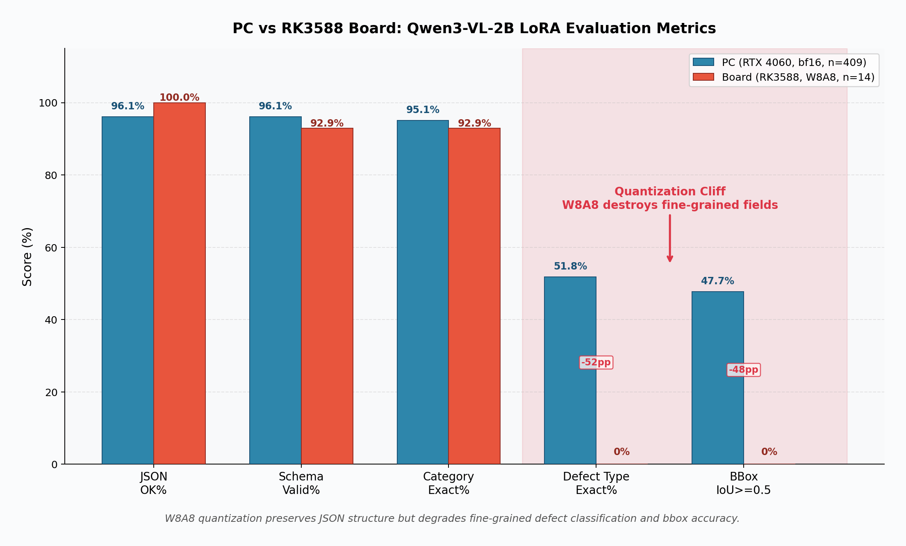

板端保留粗粒度 JSON/schema/category 行为（与 PC 差距 3-7pp），但 W8A8 下细粒度 defect_type 和 bbox 指标坍塌：defect_type_exact 从 51.8% 降至 0%，bbox_iou 从 47.7% 降至 0%。

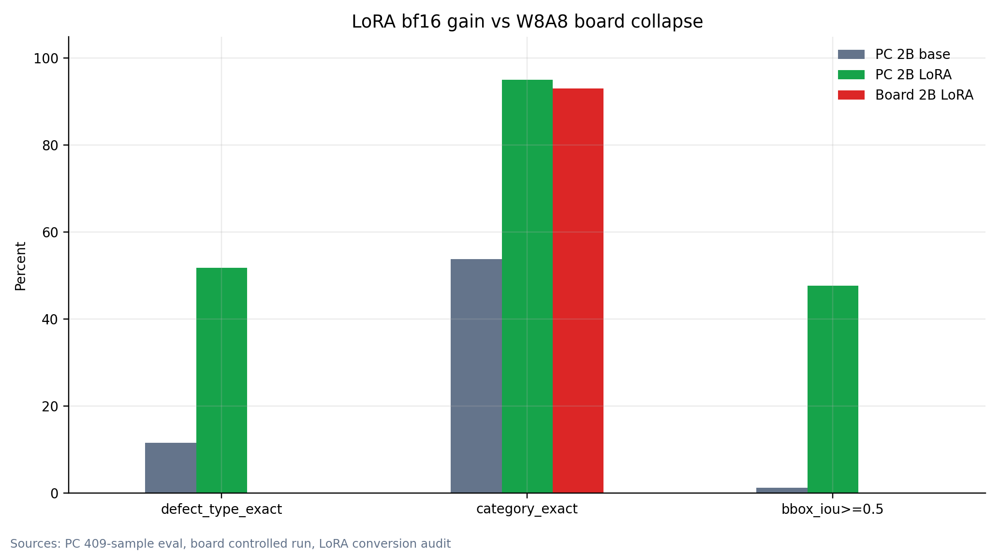

PC bf16 LoRA 收益不能直接迁移到板端 W8A8。category_exact 大致保留（~93% vs ~95%），但 defect_type_exact 和 bbox_iou 在板端归零。这支持使用 YOLO class head 和 bbox decode 作为 Phase 10 的 canonical source。

</details>

## Phase 9/10+ 定量工程证据图

以下 8 张图从仓库已有的实验报告、CSV/JSON 快照和 demo manifest 中生成，将 Phase 9/10 演进转化为可审查的工程证据：YOLO localizer 质量、RK3588 smoke 延迟、ORT snapshot 分布、管线延迟、系统演进、VLM 压力边界、EfficientAD gate 限制、W8A8 量化行为。

> 边界说明：这些图是工程证据，不是生产工厂指标。Phase 10 v1 使用 ORT CPU fallback，不在同步主路径中调用 VLM。Phase 10.1b 相关内容仅描述 runner safety gates 和 readiness，不是已完成的 full soak。

早期历史证据图保留在上方折叠区作为工程上下文。以下 8 张图来自可追溯的 Phase 9/10+ 源，提供更结构化的报告图表层。

### Chart 1 — Phase 10 YOLO localizer 质量

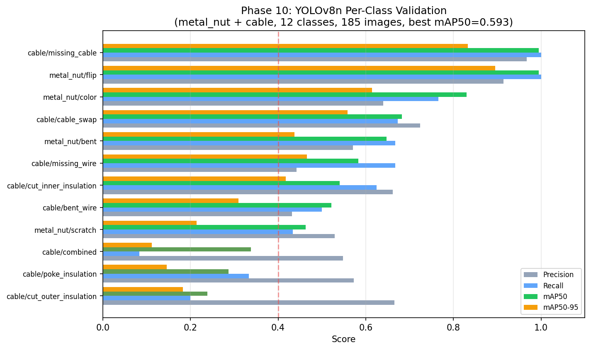

Phase 10 使用的有监督 YOLOv8n localizer 在 metal_nut + cable 12 类上的 per-class 验证质量。strong classes：flip (0.995)、missing_cable (0.995)、color (0.830)。weak classes：cut_outer_insulation (0.239)、poke_insulation (0.287)、combined (0.338)。

**支撑**：Phase 10 有真实的有监督 localizer，而非伪造的 bbox / defect_type。
**不支撑**：真实产线 mAP 或全量 MVTec 15 类性能。

### Chart 2 — RK3588 RKNN FP16 smoke 延迟

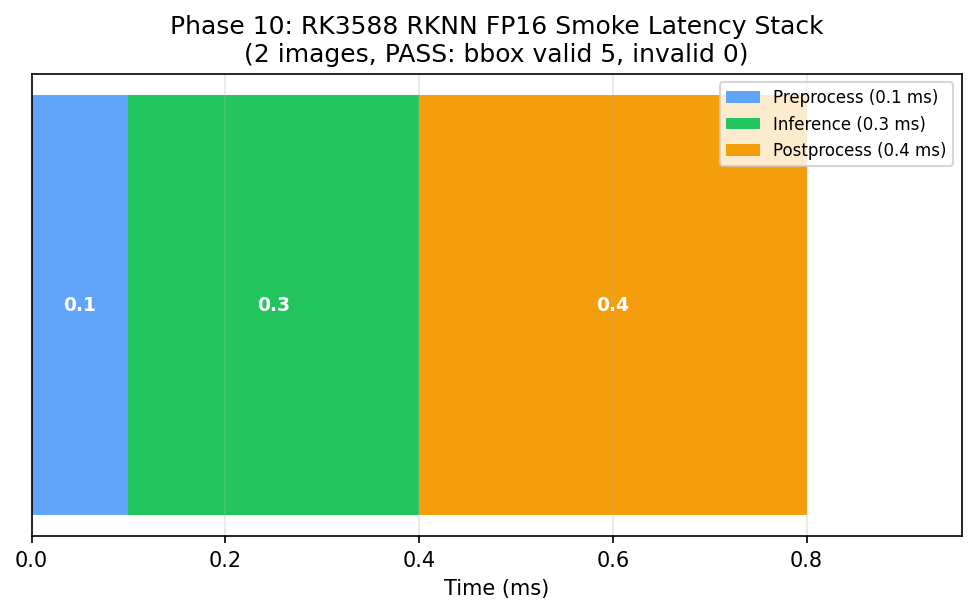

RK3588 上 RKNN FP16 延迟栈：preprocess 37.8ms + inference 95.2ms + postprocess 3.7ms = 136.7ms。仅 2 张图 smoke test。

**支撑**：RKNN artifact 在 RK3588 上能以 smoke 模式运行。
**不支撑**：full deployment benchmark 或生产稳定性声明。

### Chart 3 — Phase 10 ORT snapshot 分布

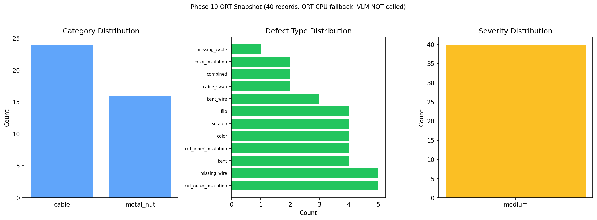

Phase 10 ORT snapshot 的 40 条 curated records 在 category、defect_type、severity 上的分布。来源为 ORT CPU fallback。

**支撑**：Phase 10 snapshot 结构化且可追溯。
**不支撑**：VLM-enriched 检测或全 15 类生产覆盖。

### Chart 4 — Phase 10 ORT 管线延迟

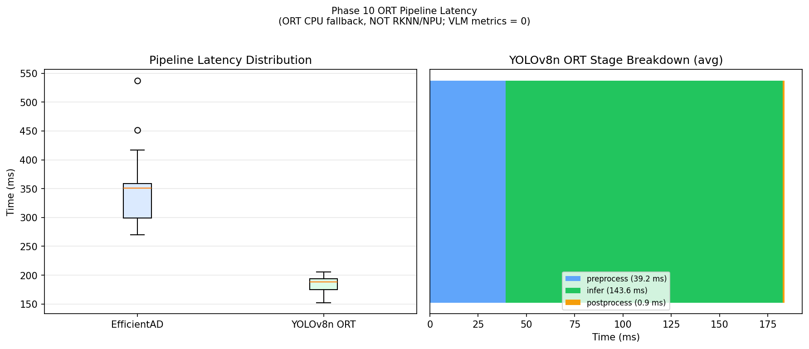

EfficientAD 和 ORT localizer 的延迟分布，含 localizer preprocess / inference / postprocess trace events。

**支撑**：Phase 10 v1 通过确定性 ORT localizer 降低 T3 延迟。
**不支撑**：RKNN/NPU localizer 部署；当前 Phase 10 localizer 是 ORT CPU fallback。

### Chart 5 — Phase 9 vs Phase 10 系统演进

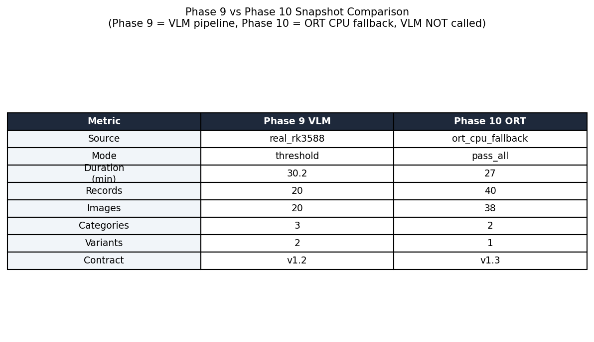

Phase 9 VLM snapshot 与 Phase 10 ORT snapshot 的系统演进对比。Phase 9 侧重端侧 VLM 可行性，Phase 10 侧重确定性低延迟定位。

**支撑**：项目有两条已验证的部署路径，各有不同的工程目标。
**不支撑**：将 VLM 和 ORT 作为同类型模型 benchmark 排名。

### Chart 6 — VLM 压力边界（pass_all 流量）

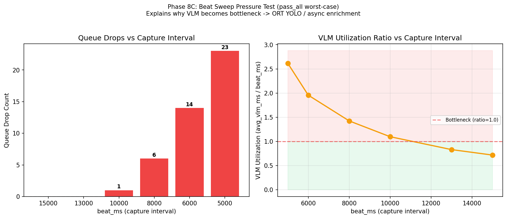

pass_all 最坏情况下，同步 VLM 在 capture interval 减小时成为瓶颈。queue drops 在 VLM utilization 越过 1.0 时快速上升。

**支撑**：将 VLM 移出高频同步路径。
**不支撑**：正式 threshold 模式部署吞吐量；这是最坏情况压力证据。

### Chart 7 — EfficientAD gate 边界

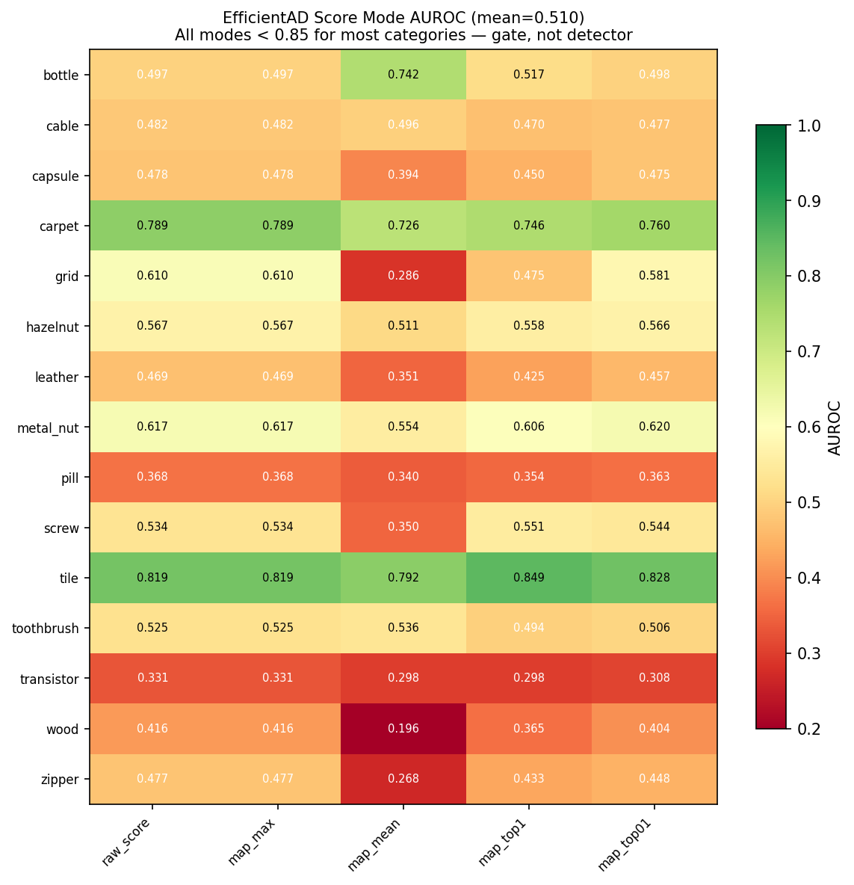

EfficientAD score-mode AUROC 在多类上不足以作为最终检测器。T2 的工程角色是 load-shedding / anomaly gating，而非 canonical defect_type 或 bbox 生成。

**支撑**：T2 应减少 T3 负载。
**不支撑**：EfficientAD 作为可靠的最终检测器。

### Chart 8 — VLM W8A8 量化 cliff

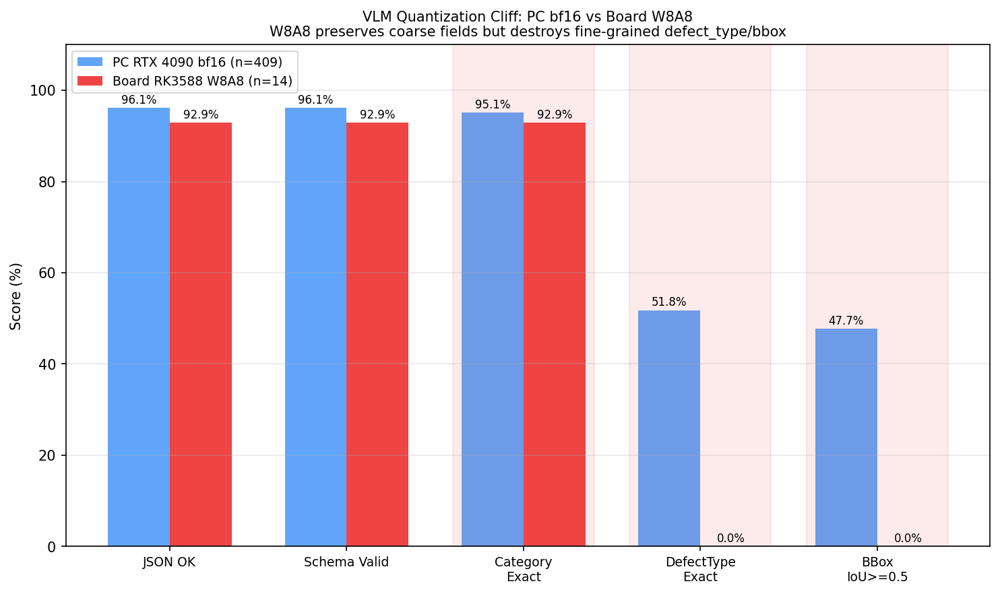

板端 W8A8 结果显示粗粒度 category 行为可以存活，但细粒度 defect_type 和 bbox 质量坍塌。这解释了为什么 Phase 10 使用 YOLO class head 和 bbox decode 作为 canonical localization source。

**支撑**：VLM 在当前约束下更适合做 enrichment / explanation。
**不支撑**：VLM 已在 Phase 10 v1 同步主链路启用。

## 快速启动

### 后端

```bash
cd backend && uvicorn app.main:app --reload --port 8000
pytest backend/tests/contract/ -v
```

### 前端

```bash
cd frontend && npm install && npm run dev
npm run build  # 静态导出到 out/
```

### 模拟器

```bash
cd simulator && python line_runner.py
```

### 边缘端（RK3588 真机）

```bash
cd edge
cmake -DCMAKE_TOOLCHAIN_FILE=<your-aarch64-toolchain.cmake> -B build
cmake --build build -j$(nproc)
scp build/edge_pipeline ubuntu@<rk3588-ip>:/home/ubuntu/
ssh ubuntu@<rk3588-ip> './edge_pipeline --config config.yaml'
```

## 目录结构

```
edge/                     C++17/20 四线程推理流水线
  src/capture/            T1 V4L2 / 图片集采集
  src/pipeline/           T2 EfficientAD + T3 FastSAM/Localizer
  src/vlm/                T3 Qwen3-VL RKLLM
  src/upload/             T4 libcurl multipart 上传
  src/common/             BoundedQueue / config_loader
backend/                  FastAPI 后端（REST + WebSocket + SQLAlchemy 2.0）
frontend/                 Next.js 15 前端（App Router + shadcn/ui + Tailwind v4）
simulator/                Python 多线程模拟器（RK3588 替身，契约测试）
scripts/                  训练 / 转换 / 评估脚本
docs/
  architecture/           Mermaid 架构图集
  experiments/            60+ 份阶段实验报告
  reports/                部署总结报告
  API_CONTRACT.md         REST/WebSocket 接口契约
  ARCHITECTURE.md         系统架构设计
  PROJECT_TIMELINE.md     项目时间线
models/                   模型权重（gitignored）
datasets/                 MVTec AD（gitignored）
```

## 公网 Demo

- **前端**：https://vision.hanlab.app/
- **API**：https://api.vision.hanlab.app/api/health
- **数据来源**：Phase 10 ORT snapshot（40 条 curated 记录，metal_nut + cable）
- Demo 可用性以当前部署状态为准

## 限制与路线图

| 限制 | 当前影响 | 后续方向 |
|------|---------|---------|
| YOLO RKNN BLOCKED | 当前使用 ORT CPU fallback | 等待 rknn-toolkit2 修复 |
| LoRA W8A8 细粒度坍塌 | 板端不部署 LoRA | 等待更高精度量化或改 PC 离线推理 |
| EfficientAD AUROC 低 | T2 只能做负载控制 | 实现 C++ post-processor 重新校准 |
| FastSAM mask decode 未实现 | 只输出 bbox | 补 prototype mask decode |
| MVTec AD 局限性 | 公开数据集 | 外部数据集或真实产线验证 |
| Phase 10.1 enrichment 未完成 | 仅有 smoke/dry-run | 完成正式长稳 soak 验证 |

## 文档导航

| 文档 | 用途 |
|------|------|
| `CLAUDE.md` | 项目总入口与全局约束 |
| `docs/ARCHITECTURE.md` | 系统架构设计 |
| `docs/API_CONTRACT.md` | REST/WebSocket 接口契约 |
| `docs/PROJECT_TIMELINE.md` | 项目时间线 |
| `docs/ENGINEERING_FINDINGS.md` | 工程发现与排障记录 |
| `docs/architecture/MERMAID_ARCHITECTURE_ATLAS.md` | Mermaid 架构图集（6 张） |
| `docs/reports/edge_deployment_summary.md` | 端侧部署总结报告（双主线） |
| `docs/experiments/` | 60+ 份阶段实验报告 |

## 实验报告索引

| 报告 | 内容 |
|------|------|
| `phase5_6_deployment_benchmark_report.md` | 4 变体 15 类 409 samples 评估 |
| `phase5_7_method_control_benchmark_report.md` | LoRA 净贡献隔离评估 |
| `phase5_8_opro_baseline_report.md` | OPRO prompt-only baseline |
| `phase6_track_b_model_conversion_report.md` | 全量模型转换报告 |
| `phase7_edge_pipeline_report.md` | C++ VLM 管线 6 Prompt 验证 |
| `phase8_execution_report.md` | Phase 8A/8B/8C 综合实验 |
| `phase10_session_handoff_v2.md` | ORT localizer 验证 |

## 许可

本项目用于课程设计与工程验证。数据集使用 MVTec AD（CC BY-NC-SA 4.0）。
