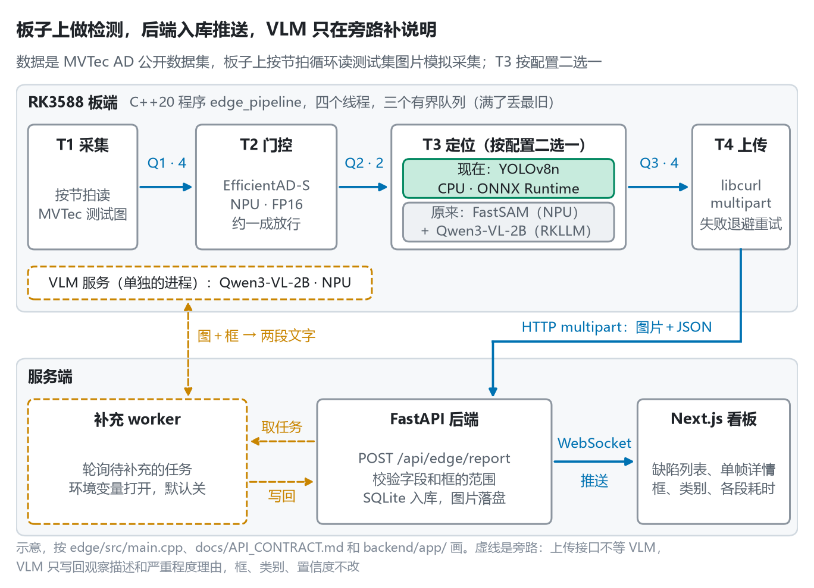
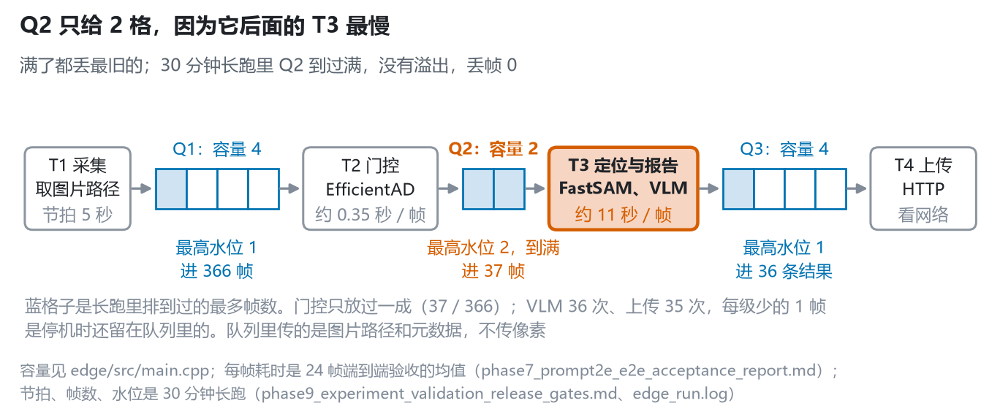
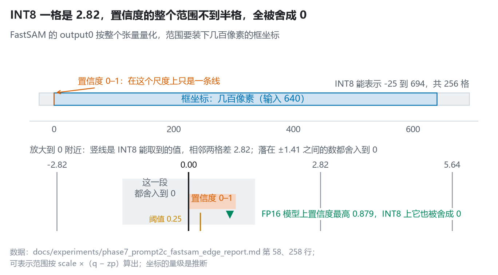
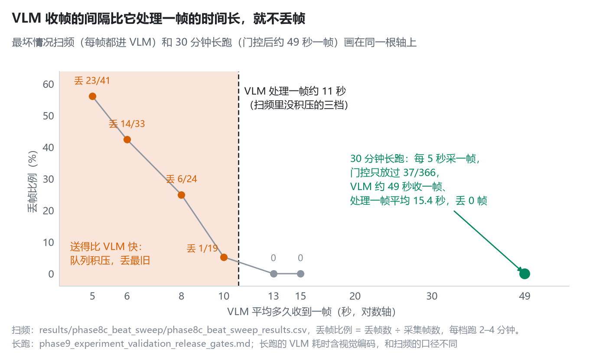
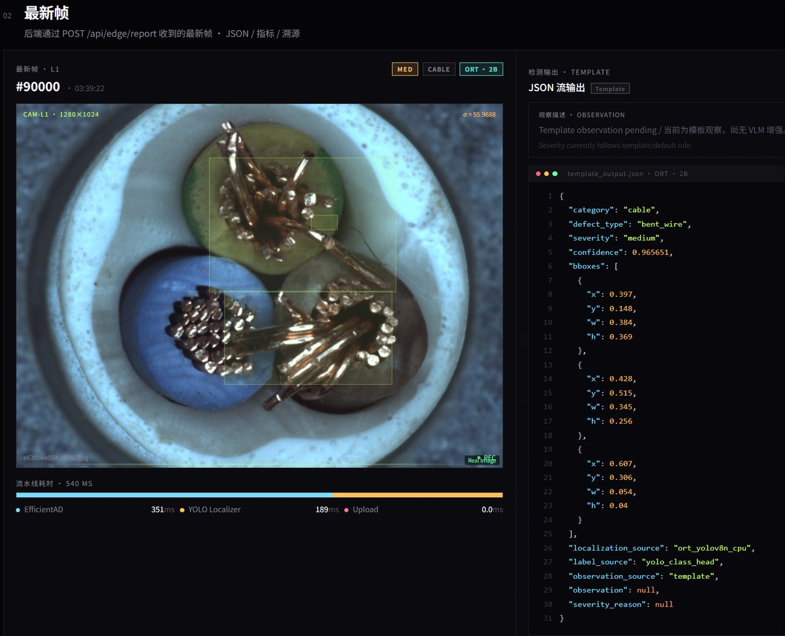

# 基于 RK3588 的工业缺陷视觉检测系统

在 MVTec AD 公开数据集上做的端云分离缺陷检测：RK3588 上跑一条 C++20 写的四线程流水线（采集、门控、定位、上传），FastAPI 后端校验入库、用 WebSocket 推送，Next.js 看板展示。板子上没接相机，按节拍循环读测试集图片模拟采集，下面的数字都是这个条件下测的，不是产线指标。项目的第一版是 i.MX6ULL 上的 V4L2 采集端，推理放在 PC 上，不在这个仓库里。

<picture>
  <source media="(prefers-color-scheme: dark)" srcset="docs/figures/architecture_dark.png">
  
</picture>

| 部分 | 结果 | 条件 | 记录 |
|---|---|---|---|
| [C++ 流水线](#1-c-边缘推理引擎) | 连续运行 **30 分钟 0 崩溃、0 丢帧** | 节拍 5 秒，按类别阈值门控；采集 366 帧，37 帧过门控，VLM 36 次；常驻内存稳定在 3,322 MB | [报告](docs/experiments/phase9_experiment_validation_release_gates.md) · [日志](results/phase9_threshold_soak/raw/edge_run.log) |
| [FastSAM 量化排障](#2-模型转换与精度排障) | INT8 下每帧 **0 个**候选框；改 FP16 后最高置信度 **0.879**，走兜底的帧 30/30 → 0/31 | output0 整个张量共用一个 scale（2.82），置信度被舍成 0 | [报告](docs/experiments/phase7_prompt2c_fastsam_edge_report.md) |
| [节拍压测](#3-压测与架构调整) | 13 秒不丢，**10 秒开始丢**，5 秒丢 23/41；临界点约 11 秒 | 每帧都进 VLM，14 张固定图；11 秒是 VLM 的平均耗时，推算的，没跑这一档 | [汇总](results/phase8c_beat_sweep/phase8c_beat_sweep_summary.md) · [CSV](results/phase8c_beat_sweep/phase8c_beat_sweep_results.csv) |
| [主链路换 YOLOv8n](#3-压测与架构调整) | 定位一帧 **187.7 ms**（p95 215.0）；27 分 27 秒、2,082 帧 0 崩溃 | ONNX Runtime，CPU FP32；只训了 metal_nut、cable 两类 | [记录](docs/experiments/phase10_session_handoff_v2.md) |

目录：[1. C++ 边缘推理引擎](#1-c-边缘推理引擎) · [2. 模型转换与精度排障](#2-模型转换与精度排障) · [3. 压测与架构调整](#3-压测与架构调整) · [4. 两条部署路径](#4-两条部署路径) · [5. 后端和看板](#5-后端和看板) · [6. 局限与回头看](#6-局限与回头看) · [7. 仓库结构和运行](#7-仓库结构和运行)

## 1. C++ 边缘推理引擎

代码在 [edge/](edge/)，C++20，CMake 构建，在板子上编译。按耗时拆成四个线程，几段耗时差了几个数量级，串在一个线程里，VLM 一卡，采集和上传全停：

- **T1 采集**：按节拍从 MVTec 测试集里取一张图的路径，几乎不花时间；
- **T2 门控**：EfficientAD-S 在 NPU 上算异常分，过了这一类的阈值才往后送，长跑里只放过一成；
- **T3 定位**：原来是 FastSAM 出候选框、Qwen3-VL 出结构化报告，一帧十秒以上；后来换成 YOLOv8n，两百毫秒左右（[第 3 节](#3-压测与架构调整)）。用哪个由配置里的 `localizer_backend` 决定（[main.cpp](edge/src/main.cpp#L172-L205)）；
- **T4 上传**：libcurl 把图片和 JSON 元数据用 multipart 传给后端；超时、连不上、408、429、5xx 时退避重试，最多 5 次。

**有界队列**（[bounded_queue.hpp](edge/include/edge/common/bounded_queue.hpp)）：deque 加 mutex 和 `condition_variable_any`。push 时满了先丢队头最旧的一帧、丢帧计数加一；push 从不阻塞，背压不会传回采集，检测场景要的是新画面。pop 的等待带上 `stop_token`，叫停时直接返回空的 `optional`，线程看到空就退出。队列里传的是图片路径和元数据，不传像素。

<picture>
  <source media="(prefers-color-scheme: dark)" srcset="docs/figures/pipeline_queues_dark.png">
  
</picture>

容量按位置定：Q1、Q3 给 4 格，吸收解码、上传的短时抖动；Q2 后面是最慢的 T3，排得越长，轮到时画面越旧，所以只给 2 格。这几个数是经验值，没有扫过。

**退出**：Ctrl+C 的信号处理函数里只写一个原子标志，加锁、打印这些都不是异步信号安全的；主线程每 200 ms 看一眼，看到就走出作用域，四个 `std::jthread` 按声明的逆序析构，每个先 `request_stop` 再 `join`，提前返回也不会漏掉 join。采集线程的节拍睡眠切成 50 ms 一段，每段查一次 `stop_token`。

**NPU 调用**：RKNN C API 加载时 `rknn_init`、`rknn_query` 查输入输出的形状、类型和量化参数，每帧 `rknn_inputs_set`、`rknn_run`、`rknn_outputs_get`、`rknn_outputs_release`。`rknn_context` 包在一个只能移动的 RAII 类里（[unique_rknn.hpp](edge/include/edge/common/unique_rknn.hpp)），析构时 `rknn_destroy`。EfficientAD 一类一个模型，共 15 个，换类别时先销毁旧的再加载新的，同一类连续来就复用。全局统计计数用 relaxed 原子操作，各占一个 64 字节的 cache line。

**30 分钟长跑**（[报告](docs/experiments/phase9_experiment_validation_release_gates.md)、[日志](results/phase9_threshold_soak/raw/edge_run.log)）：节拍 5 秒，T3 走 FastSAM 加 2B 的 Qwen3-VL（W8A8），一共 30.2 分钟。采集 366 帧，37 帧过门控，VLM 36 次、输出的 JSON 全部能解析，上传成功 33 次、失败 2 次（HTTP 400，不在重试范围内）；三个队列丢帧都是 0，Q2 最高水位 2；VLM 单次平均 15,419 ms；进程常驻内存稳定在 3,322 MB，最后打出 `clean exit`。两点限制：

- 采集按类别顺序走，30 分钟只走完 bottle、cable、capsule 三类，carpet 只到第 1 帧；
- 0 丢帧只统计“队列满了丢最旧”；停机时 Q2 剩 1 帧、Q3 剩 1 条结果没处理就丢了，没有算进去。

## 2. 模型转换与精度排障

| 模型 | 来源 | 转换 | 板上精度 | 大小 |
|---|---|---|---|---|
| EfficientAD-S × 15 | Anomalib 训练 20 轮，一类一个 | ONNX（截掉后处理）→ RKNN | FP16 | — |
| FastSAM-s | 官方 COCO 预训练权重 | ONNX → RKNN；INT8 失败后改 FP16 | FP16 | 26 MB（INT8 版 14 MB） |
| Qwen3-VL-2B 语言模型 | 基座和 LoRA 微调合并后的各一份 | rkllm-toolkit 1.2.3 | W8A8 | 2.3 GB |
| Qwen3-VL-2B 视觉编码器 | 同上 | ONNX → RKNN | FP16 | 812 MB |

RKNN 模型用 rknn-toolkit2 2.3.2 转换（[转换报告](docs/experiments/phase6_track_b_model_conversion_report.md)）。4B 也转了，只做了冒烟，主线用 2B。两个视觉模型的 INT8 都试过、都不能用，FP16 是退回来的结果；FastSAM 整段才 250 ms 左右，瓶颈在 VLM，先保正确。

**FastSAM 转 INT8 后检不出框**（[报告](docs/experiments/phase7_prompt2c_fastsam_edge_report.md)）

- **现象**：板上每一帧，8,400 个 anchor 里没有一个置信度过 0.25，全部走 top-5 兜底。
- **定位**：打出输出属性，output0（`[1, 37, 8400]`）是 INT8，zero point −119、scale 2.82，整个张量共用。反量化是 scale ×（q − zp），相邻两个值差 2.82；这个张量里装着几百像素的框坐标，范围被撑到 −25 到 694，0 到 1 的置信度不到半格，全被舍成 0。换校准集也没用，范围是坐标决定的，后来换成 15 类约 300 张的校准集重转，结果一样。
- **工具为什么没报警**：rknn-toolkit2 的精度分析按整个张量算余弦相似度，output0 是 0.99875。坐标占了绝大部分数值，置信度那个通道全毁了，对余弦几乎没有影响；同一行的欧氏距离其实有 2526.9（这份转换日志没有提交）。所以精度对齐要按通道看，最后还要看任务指标，比如过阈值的框有几个。
- **修复**：这个模型不量化，改 FP16。同一套 4 个类别的小样本跑两遍，INT8 版 30 帧全部走兜底，FP16 版 31 帧一帧都没有；置信度最高 0.879，过阈值的候选 24 个。30 分钟长跑里 FastSAM 一直是 FP16，36 帧兜底 0 次。

<picture>
  <source media="(prefers-color-scheme: dark)" srcset="docs/figures/fastsam_int8_dark.png">
  
</picture>

**EfficientAD**

- Anomalib 导出的 ONNX 带着后处理：一个 Greater 节点拿 INT8 张量和 FLOAT 阈值比，RKNN 运行时不支持；后处理里的 Clip 还把好图坏图的分数都挤到 0.9 到 1 之间。导出脚本把后处理整个截掉，只留原始异常图和它的最大值（[export_efficientad_raw_onnx.py](scripts/export_efficientad_raw_onnx.py)），阈值在 C++ 里按类别比。
- INT8 以后异常图的分布饱和，好图坏图分不开，改 FP16。FP16 版和 PC 上的 ONNX 比，15 类 AUROC 最大差 0.024，转换这一步对上了（[标定汇总](results/phase8_threshold_calibration/summary.md)）。
- 板上用 1,725 张测试图标定，15 类 AUROC 平均只有 0.53，只有 tile 过 0.8（[各类对比](results/phase8_threshold_calibration/score_mode_comparison.md)）。所以它只当门控，阈值取每类正常图分数的第 95 百分位，用来减少往后送的帧。为什么这么低，见[第 6 节](#6-局限与回头看)。

**Qwen3-VL 上板**（[报告](docs/experiments/phase7_prompt2d_qwen3vl_edge_report.md)）

- 板上的 RKLLM 运行库是 1.2.1，模型是 1.2.3 的工具转的，旧版拒绝加载，升级了运行库。
- 视觉编码器输入 448 × 448，4 个输出各是 196 × 2048。图像 token 数是 196，不是 196 × 4，4 是多层特征的份数，对照官方多模态示例的源码改对。
- JSON 写不完：最早让它输出嵌套的框对象，在 token 上限内写不完；框改成二维数组、整段压成一行，报告估计省六成左右的 token，上限调到 500。
- 4B 的视觉输出是 28 × 28 的网格，要把相邻 2 × 2 的四格合成一个 token。原来直接 reshape，拼进去的是同一行连续的 4 格；改成先 reshape 成 (14, 2, 14, 2, 1024) 再 permute，补了 5 个单元测试（[修复记录](docs/experiments/phase9_edge_runtime_model_fixes.md)）。

## 3. 压测与架构调整

**节拍压测**（[汇总](results/phase8c_beat_sweep/phase8c_beat_sweep_summary.md)）：24 帧端到端验收里，VLM 一帧平均 11,350 ms，EfficientAD 350.8 ms，FastSAM 250.1 ms（[验收报告](docs/experiments/phase7_prompt2e_e2e_acceptance_report.md)）。为了知道 VLM 能扛多快的节拍，把门控设成全放行，每一帧都进 VLM，测最坏情况；门控正常工作时放过多少由来的图决定，控制不了。14 张固定图（7 类各 2 张），抖动设成 0，只改采集间隔，六档每档跑 2 到 4 分钟：

| 节拍 | 15 秒 | 13 秒 | 10 秒 | 8 秒 | 6 秒 | 5 秒 |
|---|---|---|---|---|---|---|
| 采集帧数 | 16 | 17 | 19 | 24 | 33 | 41 |
| 丢帧 | 0 | 0 | 1 | 6 | 14 | 23 |
| VLM 均值 ÷ 节拍 | 0.71 | 0.83 | 1.10 | 1.42 | 1.96 | 2.62 |

丢帧全在 Q2。比值超过 1 开始丢，超过 1.5 丢得很多。没积压的三档里 VLM 平均 10.7 到 11.0 秒，间隔比它短就会积压，所以临界点约 11 秒，这一档没有跑过。节拍越短 VLM 越慢（平均 10,735 → 13,083 ms）：按 CSV 拆，5 秒那档输出 token 平均多了约 13%（69 → 78），decode 慢了约 6%（9.8 → 9.2 token/s），大半是回答变长；剩下的可能是 EfficientAD 和 VLM 同时用 NPU，没有单独验证。每档只有十几次 VLM，没有重复跑。

<picture>
  <source media="(prefers-color-scheme: dark)" srcset="docs/figures/drop_vs_interval_dark.png">
  
</picture>

30 分钟长跑不丢帧，是因为门控筛掉了九成，VLM 平均约 49 秒才收到一帧，比它处理一帧的时间长得多。

**VLM 在板上也分不清细分的缺陷类型**：固定 14 张图（7 类各一张正常、一张缺陷），板上 W8A8 的 2B 在 7 张缺陷图上缺陷类型一张都没对，6 张只回了笼统的 anomaly（[对照重跑](results/phase8_vlm_ab/board_2b_lora_controlled_rerun_summary.md)）；基座模型在同一批图上也是 0/7（[A/B](results/phase8_vlm_ab/board_2b_base_vs_lora_ab_v2.md)）。PC 上 LoRA 微调后，409 条测试样本的缺陷类型准确率是 53.1%，同一个 prompt 下基座是 0（[对照](docs/experiments/phase5_7_method_control_benchmark_report.md)），上板以后没了。原因只能当判断：怀疑 8 bit 量化抹掉了 LoRA 的增量，但板上只有 7 张缺陷图，板上的 prompt 写了类别名、和 PC 上的也不一样，这些因素没有排除。另外，FastSAM 给的是物体的候选框，不是缺陷框。

**调整**：慢、又不准，于是把定位交给专门训的检测模型，VLM 移出主链路。

- **YOLOv8n**：有监督，框和缺陷类型一起出。训练数据用 MVTec 自带的缺陷 mask 转成框，先只做了 metal_nut、cable 两类 12 种缺陷，185 张图（训练 126、验证 59），验证集 mAP50 0.593、mAP50-95 0.432（[训练记录](docs/experiments/phase10_training_run_1.md)）。这是有监督的结果，不能和 MVTec 上无监督方法的指标比。
- **为什么跑在 CPU 上**（[诊断](docs/experiments/phase10_rknn_fp16_diagnostic.md)）：转成 RKNN FP16 后，同一张图的 8,400 个 anchor 逐通道和 ONNX 比相关系数：框中心 0.995、0.996，宽高 0.699、0.651，12 个类别通道在 −0.001 到 0.81 之间，类别基本是乱的。换 opset（20 被拒，19 和 12 能转但一样错）、换 airockchip 的多输出导出，都是同一类错误。正确性优先，先用 ONNX Runtime 在 CPU 上跑 FP32。
- **C++ 怎么调**：没接 ONNX Runtime 的 C++ 接口，T3 起一个常驻的 Python 子进程（[localizer_worker.cpp](edge/src/pipeline/localizer_worker.cpp)、[ort_localizer.py](scripts/phase10/ort_localizer.py)）：两根管道接它的 stdin、stdout，每帧写一行图片路径、读回一行 JSON；读带 5 秒超时，超时就杀掉子进程、给这一帧出兜底结果、再重启。这个脚本在板上验证过，不用为 ONNX Runtime 重新链库，代价是多一次管道往返（当时估计 10 ms 左右，没单独测）。
- **VLM 异步补充**：上传接口先写库、马上返回，不调 VLM；补充 worker 轮询待补充的任务，经一个包装脚本请求板上的 RKLLM 服务（视觉编码器和语言模型都在 NPU 上）。VLM 只准返回观察描述和严重程度理由两段文字，回来先过校验，框、类别、置信度它返回了也不收。功能由环境变量打开，默认关（[配置](backend/app/services/enrichment_config.py)）。真机冒烟（[报告](docs/experiments/phase10_1b_real_rk3588_edge_vlm_smoke_report.md)）：5 次真推理，有效调用 4/4 输出合法 JSON，VLM 中位约 12 秒，上传接口中位 24 ms；VLM 返回了不该改的字段的那一次被校验拦下。200 次上传的长跑跑到第 38 次叫停，原因是压测脚本随机挑图、乱填类别和框，不是被测系统的问题，修好脚本以后没有重跑（[说明](docs/experiments/phase10_1b_5d_soak_blocker_note.md)）。这部分只做到冒烟。

## 4. 两条部署路径

| | 原来：FastSAM ＋ Qwen3-VL | 现在：YOLOv8n |
|---|---|---|
| T3 做什么 | FastSAM（NPU，FP16）出物体候选框，VLM（RKLLM，W8A8）出 JSON：类别、缺陷类型、严重程度、框 | 直接出框、缺陷类型、置信度 |
| T3 一帧 | FastSAM 250.1 ms ＋ VLM 11,350 ms（24 帧验收）；长跑里 VLM 平均 15,419 ms | 187.7 ms（p95 215.0，p99 228.4），只算子进程里的预处理、推理、后处理 |
| 内存 | 3,322 MB（整个进程） | C++ 主进程 34 MB；ONNX Runtime 在子进程里，那部分没记 |
| 长跑 | 30.2 分钟，366 帧，0 崩溃、0 丢帧，上传 2 次 HTTP 400 | 27 分 27 秒，2,082 帧，0 崩溃，0 次 HTTP 400 |
| 覆盖的类别 | 配置了 15 类，实际走到前 3 类 | metal_nut、cable |
| 记录 | [长跑报告](docs/experiments/phase9_experiment_validation_release_gates.md) | [交接记录](docs/experiments/phase10_session_handoff_v2.md)，原始日志和那次的配置不在仓库里 |

两次长跑的类别、时长、配置都不一样，只能各自说明稳不稳，不能当同条件对比。YOLOv8n 用的 185 张图就是这两类测试集里的全部缺陷图（按 MVTec 官方划分推算），长跑又循环读这些图，所以只能说明稳和快，不能说明准。

## 5. 后端和看板

后端是 FastAPI（[backend/](backend/)）：`POST /api/edge/report` 收 multipart（图片加一段 JSON 元数据），校验字段和框的范围，存进 SQLite、图片落盘，再通过 WebSocket `/ws/dashboard` 推给看板。接口定义在 [API_CONTRACT.md](docs/API_CONTRACT.md)，有一套契约测试（[backend/tests/contract/](backend/tests/contract/)，运行方法见[第 7 节](#7-仓库结构和运行)）。看板是 Next.js（[frontend/](frontend/)），显示缺陷列表、单帧详情和各段耗时，框是 YOLOv8n 出的、FastSAM 的候选框还是兜底占位，分开标出来。[simulator/](simulator/line_runner.py) 是一个代替板子往后端发数据的 Python 模拟器，联调用。



单帧详情：一张 cable 的缺陷图，YOLOv8n 出的框、类别和置信度，下面是门控和定位的耗时；JSON 里 `observation` 是空的，这条记录没经过 VLM 补充。上传耗时显示 0，因为这一项要等发出去以后才知道，填不进这次上报。

## 6. 局限与回头看

**局限**

- 公开数据集，板子上循环读测试集图片，没接相机。`CaptureFrame` 给 dma-buf 留了 fd、宽高、格式几个字段，还没实现；RGA 的库链接了，代码里没调用，解码和缩放都在 CPU 上。
- YOLOv8n 转 RKNN 数值不对，现在跑在 CPU 上，只训了两类。
- 板上 VLM 的结论只有 7 张缺陷图，prompt 和 PC 上不一致。
- EfficientAD 在板上区分度低，只当门控。
- 30 分钟长跑只走到前三类；VLM 异步补充只做到冒烟。

**回头看会怎么改**（方案，都没做）

| 问题 | 改法 |
|---|---|
| EfficientAD 训练完在 PC 上用 Anomalib 自己评测，bottle 1.0，15 类里 10 类在 0.9 以上；导出以后 ONNX 和板上一样低。Anomalib 的 EfficientAD 在网络里自己做 ImageNet 归一化，[评测脚本](scripts/evaluate_efficientad_raw_scores.py#L52-L53)和[转换配置](scripts/convert_efficientad_rknn.py#L53-L54)在外面又做了一次，很可能归一化做了两遍 | 预处理只除以 255，先在 PC 上重跑 ONNX 评测，确认以后重新转换、重新标定阈值 |
| FastSAM 只能用 FP16 | 混合量化：置信度分支、框解码这几层留 FP16，其余 INT8；不行就把 output0 拆成框、置信度、掩码系数三个输出，各自量化 |
| YOLOv8n 上不了 NPU | 先核转换配置的预处理；再用 rknn-toolkit2 的逐层精度分析，找第一层对不上的算子；在 neck 和检测头之间切开，前半段放 NPU，检测头留在 CPU |
| 一帧过了门控，同一张 PNG 要完整解码 4 次；输出属性每帧都 query 一次；预处理没有分段计时 | 解码一次，后面传 buffer，拿尺寸只读文件头；属性在加载模型时查一次；解码和缩放分开计时，再决定值不值得换 RGA |
| 退出时按逆序析构，T4 先停，Q2、Q3 里剩的直接丢掉 | 排空式关闭：从 T1 起一级一级关，每级处理完自己的队列再退，配一个总的截止时间 |
| T3 的 Python 子进程：管道一次读一个字节，fork 之后在子进程里构造 `std::string`，杀子进程用阻塞的 `waitpid` | 换成 ONNX Runtime 的 C++ 接口，在进程里直接跑 |
| 接真相机 | V4L2 用 MMAP 采集并导出 dma-buf，RGA 缩放和 NPU 输入都按 fd 传，省掉 CPU 拷贝 |

复盘代码时还查出三处小缺陷：stb 解码出的像素 buffer 是 `malloc` 分配的，交给 `unique_ptr<uint8_t[]>` 以后用 `delete[]` 释放（ASan 查出）；Python 子进程崩掉后再写管道，SIGPIPE 会把整个程序杀掉；起子进程的出错分支漏关管道 fd。修复在提交 eeb0525（不在 main 上），只在 x86 上用 ASan 对比过、aarch64 交叉编译通过，没上板。上面的长跑数字都是修之前的代码测的。

## 7. 仓库结构和运行

```text
vlm-sam-industrial-vision-v2/
├── edge/           板端 C++20 流水线（src/、include/、configs/）
├── backend/        FastAPI 后端，tests/contract/ 是契约测试
├── frontend/       Next.js 看板
├── simulator/      代替板子发数据的 Python 模拟器
├── scripts/        训练、导出、转换、评测脚本
│   └── phase10/    YOLOv8n 的数据转换、RKNN 转换、ORT 定位
├── docs/
│   ├── API_CONTRACT.md   后端接口契约
│   ├── experiments/      实验报告（phase 是开发时的阶段编号）
│   └── figures/          README 的图和生成脚本
└── results/        扫频 CSV、长跑日志、阈值标定、VLM 对照
```

**后端和契约测试**（Python 3.12，在仓库根目录）：

```bash
pip install -e ".[dev]"
uvicorn backend.app.main:app --port 8000
make contract-test
```

**看板**：

```bash
cd frontend && npm install && npm run dev
```

**板端**：板子是 Orange Pi 5（16 GB），Ubuntu 22.04，在板上用 GCC 11.4 编译。CMake 在 `/usr/lib` 找 librknnrt、librkllmrt、librga，还要装 libcurl。模型、数据集不在仓库里，[edge/config.yaml](edge/config.yaml) 里的模型路径、图片目录和 `backend_url` 要按自己的环境改。

```bash
cmake -S edge -B edge/build
cmake --build edge/build -j4
./edge/build/edge_pipeline edge/config.yaml
```

README 的图用 `python3 docs/figures/make_figures.py` 重新生成，每张图的数据出处写在脚本里。

**主要实验记录**：[30 分钟长跑](docs/experiments/phase9_experiment_validation_release_gates.md) · [四线程端到端验收](docs/experiments/phase7_prompt2e_e2e_acceptance_report.md) · [模型转换](docs/experiments/phase6_track_b_model_conversion_report.md) · [FastSAM INT8 排障](docs/experiments/phase7_prompt2c_fastsam_edge_report.md) · [节拍扫频](results/phase8c_beat_sweep/phase8c_beat_sweep_summary.md) · [板上 VLM 对照](results/phase8_vlm_ab/board_2b_lora_controlled_rerun_summary.md) · [YOLOv8n 转 RKNN 的数值诊断](docs/experiments/phase10_rknn_fp16_diagnostic.md) · [VLM 异步补充的真机冒烟](docs/experiments/phase10_1b_real_rk3588_edge_vlm_smoke_report.md)

## 数据

MVTec AD，许可 CC BY-NC-SA 4.0，仅限非商业用途。仓库不含数据集和模型权重。
