# Mermaid 架构图集

> 所有图保持 Mermaid 可解析、可复制、可在 GitHub 渲染。不生成 PNG/SVG。
> 主体中文；图内模块名、目录名、API 路径、模型名、Phase 名保留英文或代码原名。

---

## 图 1：全局系统架构图

**这张图解决什么问题**：把 Edge / Backend / Frontend / VLM Enrichment 四大模块的边界和数据流一次性讲清楚。

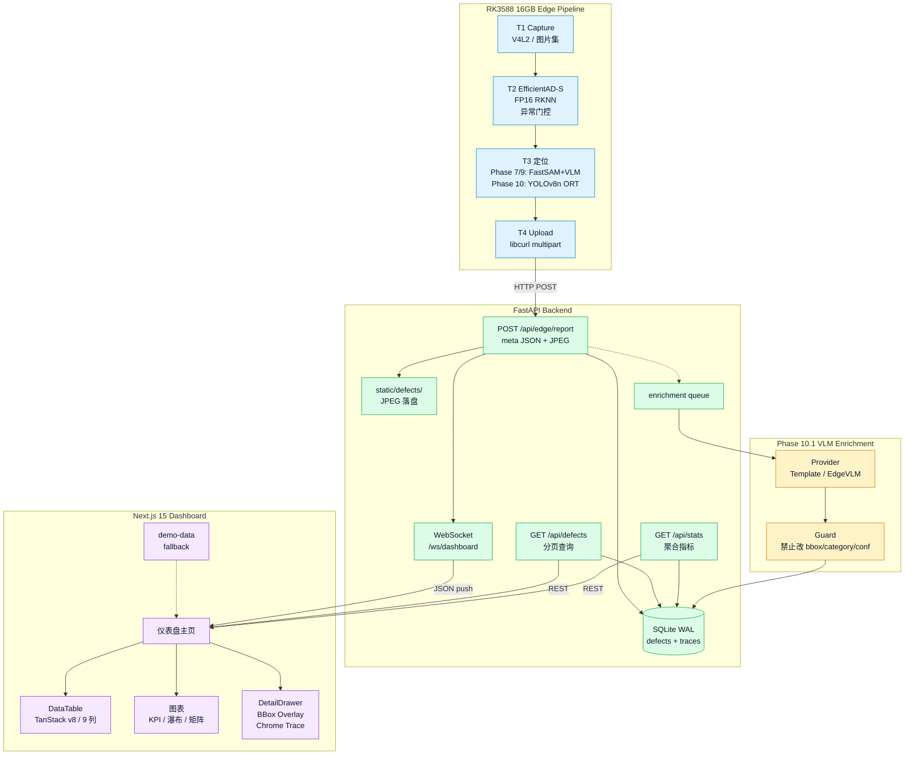

**工程说明**：端云分离架构——边缘端负责采集和推理，通过 HTTP multipart 上报到后端，后端落盘入库并通过 WebSocket 实时推送到前端仪表盘。VLM enrichment 是 Phase 10.1 的异步补充层。

**边界说明**：WebSocket 仅存在于 Backend↔Frontend 一段；Edge 只做 HTTP POST 客户端。Phase 10.1 enrichment 尚未完成 full soak 验证。

---

## 图 2：项目演进时间线

**这张图解决什么问题**：展示从早期探索到当前双主线的技术演进路径。

```mermaid
stateDiagram-v2
    [*] --> PaDiM_Explore : 早期探索
    PaDiM_Explore --> EfficientAD_Replace : PaDiM 位置敏感性问题
    EfficientAD_Replace --> Phase5_Train : 训练 15 类 EfficientAD-S
    Phase5_Train --> Phase5_LoRA : LoRA 微调 2B/4B
    Phase5_LoRA --> Phase5_Benchmark : 4 变体 15 类评估
    Phase5_Benchmark --> Phase6_Convert : 模型转换全链路
    Phase6_Convert --> Phase7_VLM : C++ VLM 四线程管线

    Phase7_VLM --> Phase9_Soak : Phase 9 soak 30.2 min 通过
    Phase9_Soak --> Phase10_ORT : 引入 YOLOv8n ORT localizer

    Phase6_Convert --> Phase10_ORT : YOLO RKNN BLOCKED → ORT fallback
    Phase10_ORT --> Phase10_Soak : Phase 10 soak 27m27s 通过
    Phase10_Soak --> Phase10_1 : 异步 VLM enrichment

    state Phase7_VLM {
        P2B : Prompt 2B EfficientAD RKNN
        P2C : Prompt 2C FastSAM RKNN
        P2D : Prompt 2D Qwen3VL RKLLM
        P2E : Prompt 2E E2E 验收
        P2F : Prompt 2F Threshold 验证
        P2B --> P2C --> P2D --> P2E --> P2F
    }
```

**工程说明**：项目经历了从 PaDiM 到 EfficientAD 的算法替换、15 类训练评估、模型转换、C++ VLM 管线部署，最后引入 YOLO ORT 作为工程化简化方案。两条路径都已在 RK3588 上验证通过，基于 MVTec AD 公开数据集。

---

## 图 3：Edge Pipeline 机制图（Phase 7/9 VLM 版本）

**这张图解决什么问题**：详细展示三阶段 VLM 管线的四线程模型、BoundedQueue 解耦和数据流。

```mermaid
flowchart LR
    subgraph T1["T1 Capture Thread"]
        V4L2["V4L2 / 图片集"]
        Q1["BoundedQueue Q1<br/>capacity=2"]
        V4L2 --> Q1
    end

    subgraph T2["T2 Pipeline Thread"]
        EAD["EfficientAD-S<br/>FP16 RKNN<br/>~350ms"]
        GATE{"gate_mode<br/>threshold?"}
        Q2["BoundedQueue Q2<br/>capacity=2"]
        EAD --> GATE
        GATE -->|pass| Q2
        GATE -->|drop| CNT["gate_drop++"]
    end

    subgraph T3["T3 VLM Thread"]
        FSAM["FastSAM-s<br/>FP16 RKNN<br/>~250ms"]
        BBOX["5 级 bbox 净化"]
        QWEN["Qwen3-VL-2B<br/>W8A8 RKLLM<br/>~11s"]
        JSON["结构化 JSON"]
        Q3["BoundedQueue Q3"]
        FSAM --> BBOX --> QWEN --> JSON --> Q3
    end

    subgraph T4["T4 Upload Thread"]
        CURL["libcurl<br/>multipart POST"]
        CURL --> OK["upload_ok++"]
    end

    Q1 --> EAD
    Q2 --> FSAM
    Q3 --> CURL

    classDef t1 fill:#DBEAFE,stroke:#3B82F6
    classDef t2 fill:#D1FAE5,stroke:#10B981
    classDef t3 fill:#FEF3C7,stroke:#F59E0B
    classDef t4 fill:#FCE7F3,stroke:#EC4899
    class V4L2,Q1 t1
    class EAD,GATE,Q2,CNT t2
    class FSAM,BBOX,QWEN,JSON,Q3 t3
    class CURL,OK t4
```

**工程说明**：四个线程通过 BoundedQueue 解耦——T1 采集、T2 异常门控减少 T3 负载、T3 做 FastSAM bbox 提案和 VLM JSON 描述、T4 上传。drop-oldest 策略防止背压传播。

**事实来源**：`docs/experiments/phase7_edge_pipeline_report.md`、CLAUDE.md Phase 7 部分

---

## 图 4：后端数据流图

**这张图解决什么问题**：展示后端 API 路由、数据库、图片存储、WebSocket 推送和 Enrichment 队列的关系。

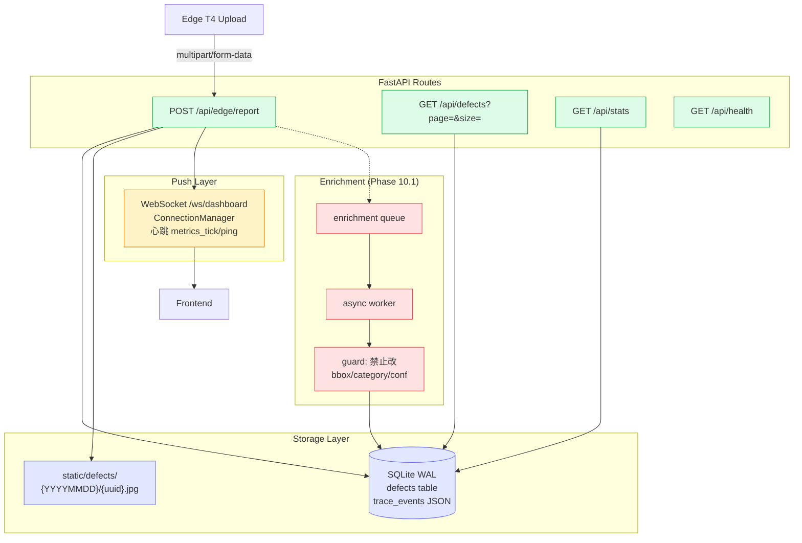

**事实来源**：`backend/app/routers/`、`docs/API_CONTRACT.md`

---

## 图 5：前端展示与 demo fallback 图

**这张图解决什么问题**：展示 Next.js 前端的数据来源（后端 API / demo-data fallback）和 V4 设计体系组件。

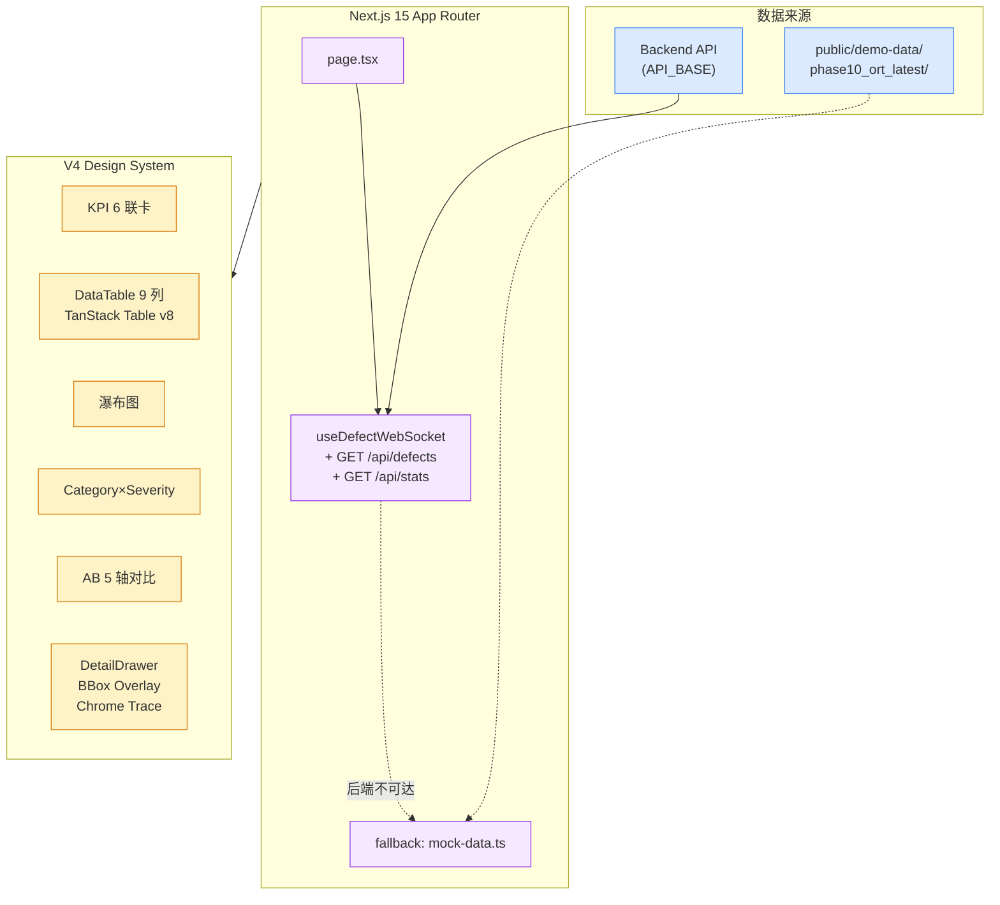

---

## 图 6：实验与证据闭环图

**这张图解决什么问题**：展示项目从训练、转换、部署到证据归档的完整闭环。

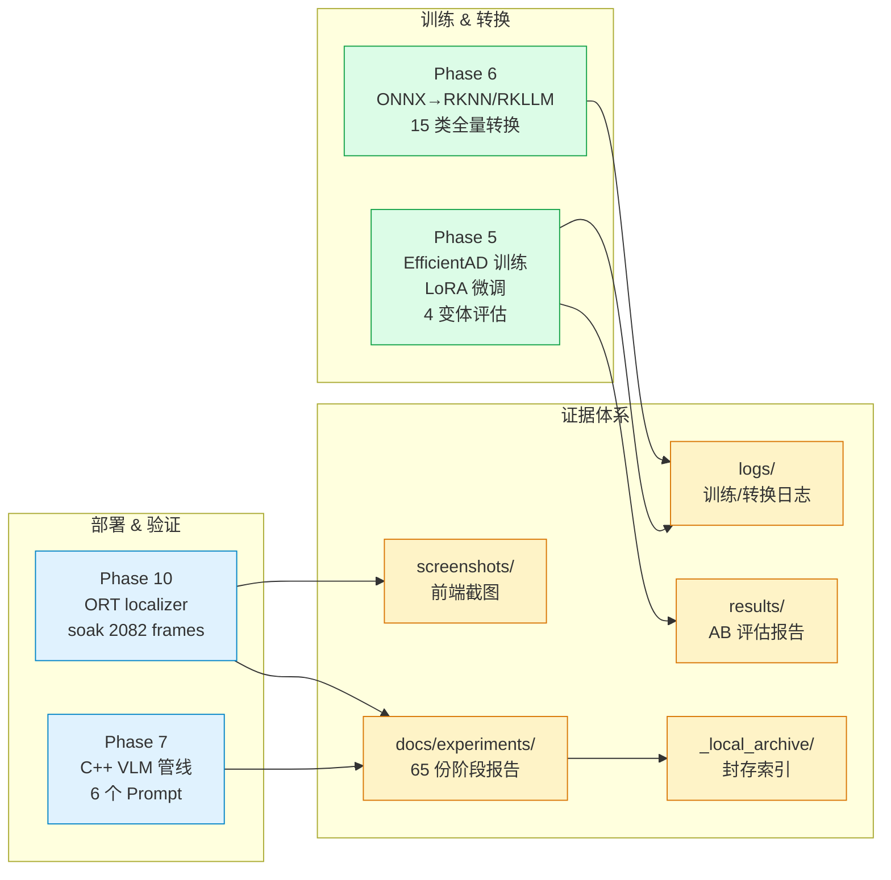

**边界说明**：Phase 7/9 VLM 管线和 Phase 10 ORT localizer 均为验证性部署，基于 MVTec AD 公开数据集，非真实产线。

---

## 附录：架构决策背后的工程证据图

> Boundary: These figures are historical engineering evidence from Phase 8 / Phase 8C / VLM AB / board validation. They explain why the current pipeline moved toward deterministic YOLO/ORT localization and VLM-as-enrichment. They are not Phase 10 ORT localizer metrics, not production factory metrics, and not evidence that VLM is enabled in the Phase 10 v1 main path.

### A. EfficientAD 是 gate，不是最终检测器

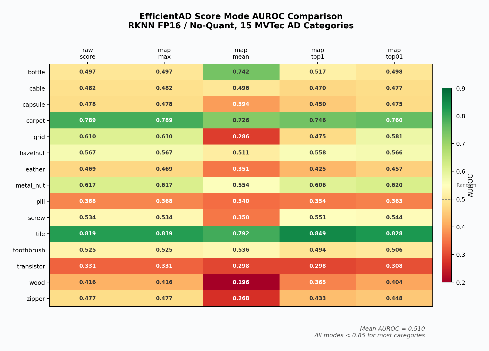

Score-mode AUROC 在 15 类上区分度不稳定（mean 0.510），5 种 score mode 结果几乎相同。Architecture implication: EfficientAD 应作为 T2 负载削减门控，不应作为 defect_type / bbox 的 canonical source。

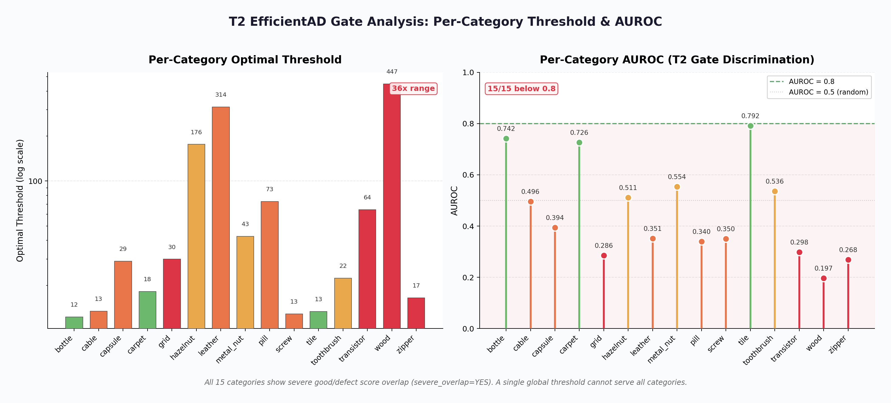

Per-category 最优阈值跨度 36 倍（12~447），13/15 类 AUROC < 0.8。Architecture implication: 单一全局阈值脆弱，per-category 阈值是必须的，但即使如此多类仍不可分——T2 定位为 load shedding gate。

### B. 同步 VLM 在主循环中代价过高

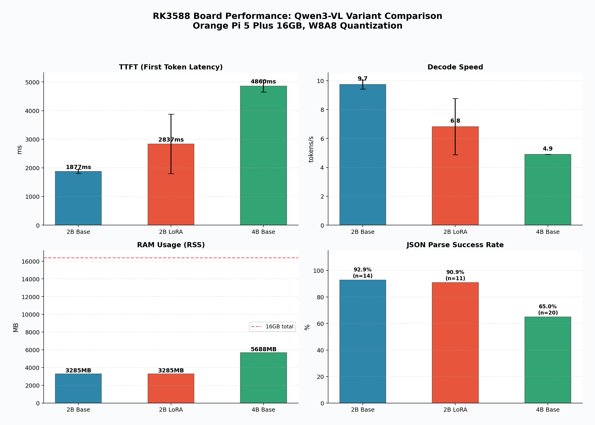

板端 Qwen3-VL 推理有显著的 TTFT、decode 和 RSS 开销。2B base TTFT 1822ms / decode 9.7 tok/s / RSS 3285MB；4B base TTFT 4860ms / decode 4.9 tok/s / RSS 5688MB。Architecture implication: 同步 VLM 对高频检测循环代价过高，应后置为异步 enrichment。

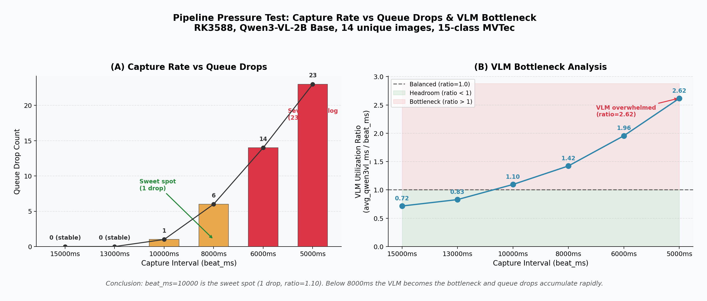

pass_all 最坏情况下，beat_ms < 8000ms 时 queue drops 快速增长。VLM utilization 在 9000-8000ms 之间越过 1.0 瓶颈线。Architecture implication: 主路径应保持确定性定位，VLM 应移向异步 enrichment。

### C. W8A8 量化损害细粒度 VLM 输出

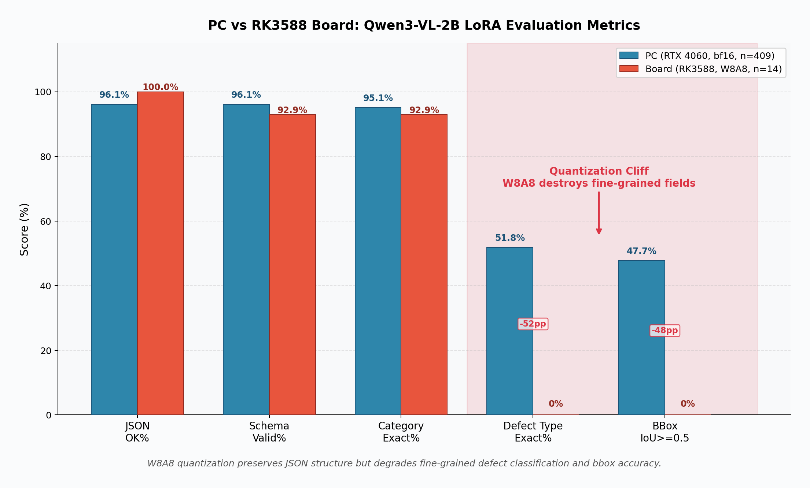

板端保留粗粒度 JSON/schema/category 行为（与 PC 差距 3-7pp），但 defect_type_exact 从 51.8% 降至 0%，bbox_iou 从 47.7% 降至 0%。Architecture implication: W8A8 量化对回归类输出（bbox 坐标、细粒度分类）是灾难性的，Phase 10 应使用 YOLO 的 class head 和 bbox decode。

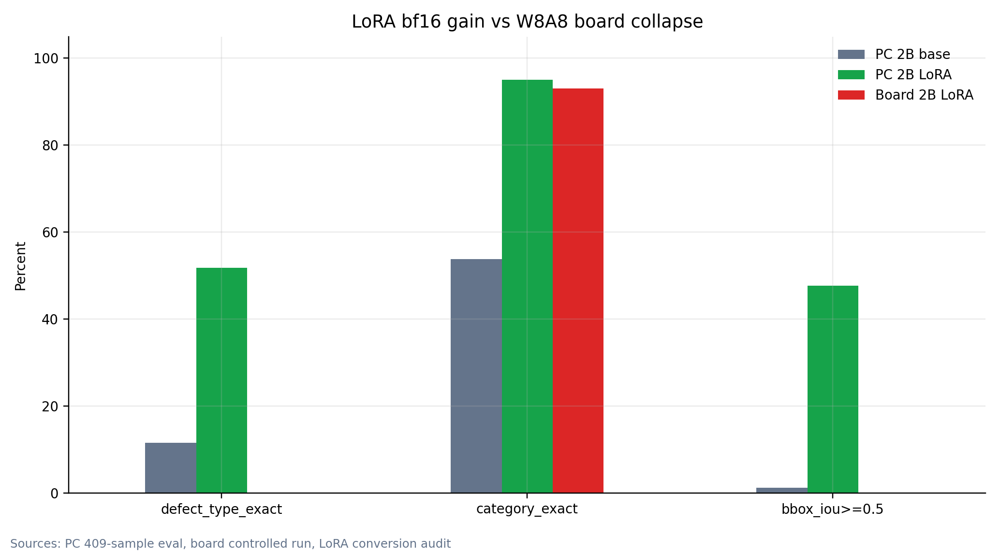

PC bf16 LoRA 收益不能迁移到板端 W8A8。category_exact 保留（~93% vs ~95%），但 defect_type_exact 和 bbox_iou 归零。Architecture implication: LoRA delta 权重量化精度不足是 W8A8 的根本限制，支持使用 YOLO localizer 作为 Phase 10 canonical source。

---

## 量化证据图：架构决策背后的 Phase 9/10+ 数据

以下 8 张图从仓库已有的实验报告、CSV/JSON 快照和 demo manifest 中生成，为架构决策提供可量化的证据支撑。

> 边界说明：这些图是工程证据，不是生产工厂指标。Phase 10 v1 使用 ORT CPU fallback，不在同步主路径中调用 VLM。

### A. Localizer 质量与运行时

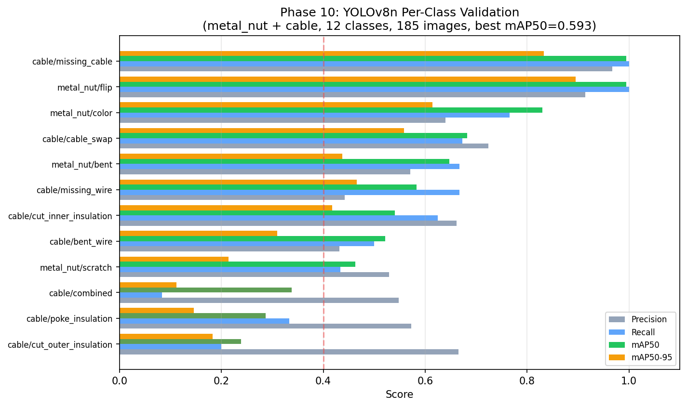

Phase 10 YOLOv8n per-class 验证：metal_nut + cable 12 类，best mAP50=0.593。strong classes（flip/missing_cable）和 weak classes（cut_outer_insulation/poke_insulation）差异明显。Architecture implication: Phase 10 使用有监督 localizer，有真实的 per-class 验证结果。

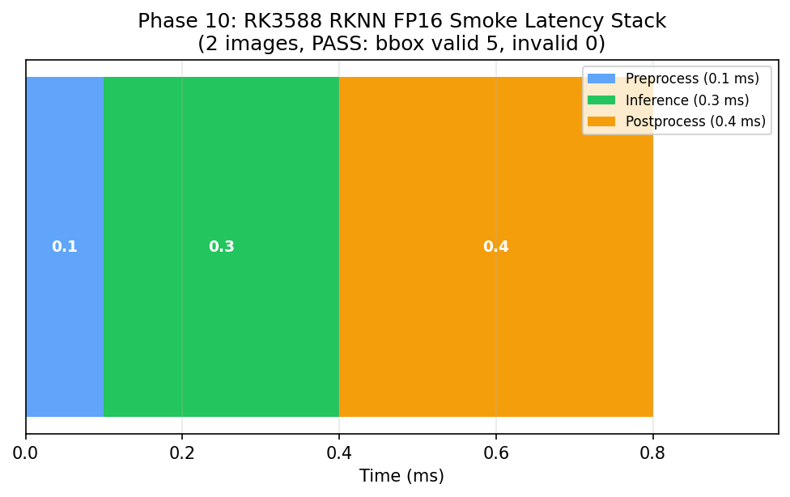

RK3588 RKNN FP16 smoke 延迟栈：preprocess 37.8ms + inference 95.2ms + postprocess 3.7ms = 136.7ms。Architecture implication: RKNN artifact 能在 RK3588 上运行，但仅 smoke test，RKNN numeric consistency 仍 BLOCKED，当前主线是 ORT CPU fallback。

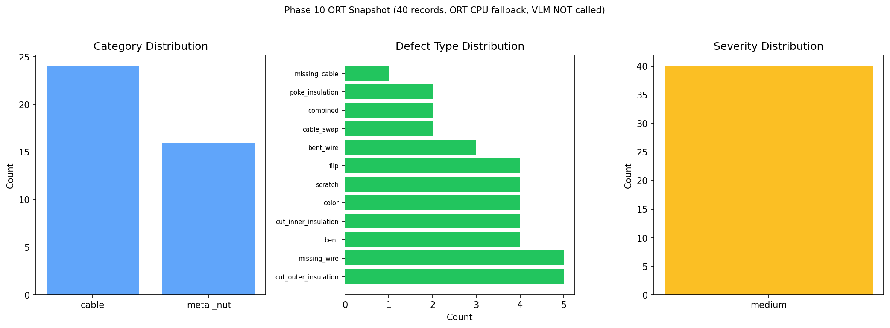

Phase 10 ORT snapshot 分布：40 条 records，cable + metal_nut，ORT CPU fallback。Architecture implication: 公开 demo 数据可追溯且有边界。

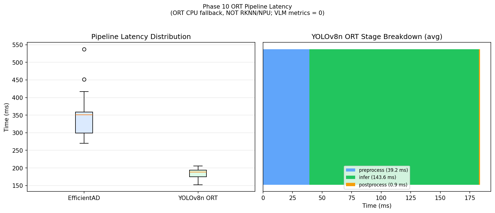

ORT pipeline 延迟：EfficientAD ~350ms，YOLOv8n ORT ~188ms。Architecture implication: Phase 10 主链路是确定性 localizer，VLM metrics 为 0（未调用）。

### B. 系统演进

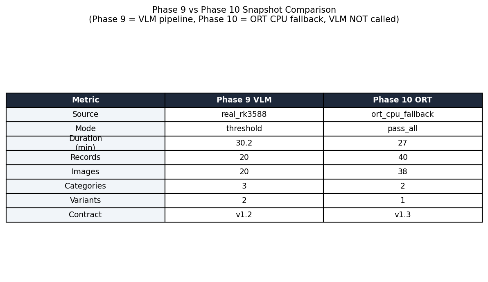

Phase 9 VLM pipeline 与 Phase 10 ORT localizer 的系统演进对比。Architecture implication: 两条路径目标不同——Phase 9 证明端侧 VLM 可行性，Phase 10 证明低延迟确定性定位。

### C. 历史约束：塑造架构的证据

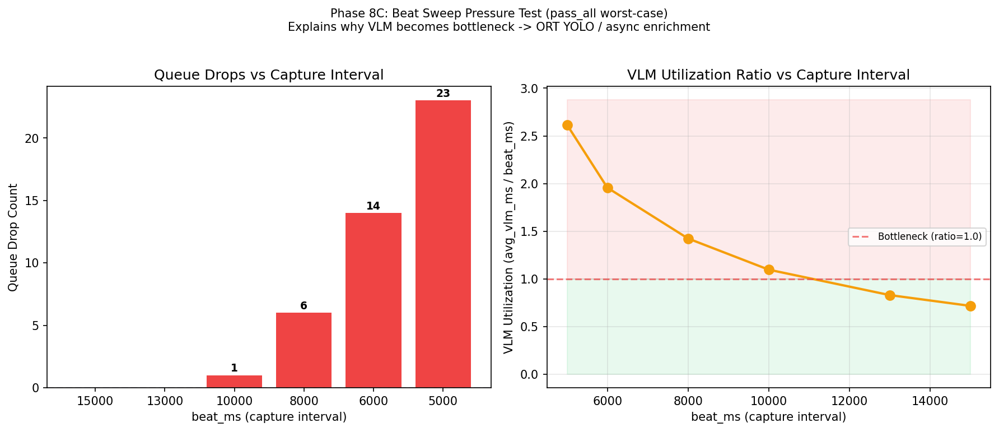

Phase 8C beat sweep 压力测试：pass_all 最坏情况下 VLM 成为瓶颈。Architecture implication: 同步 VLM 在高频循环中代价过高，支持将 VLM 后置为异步 enrichment。

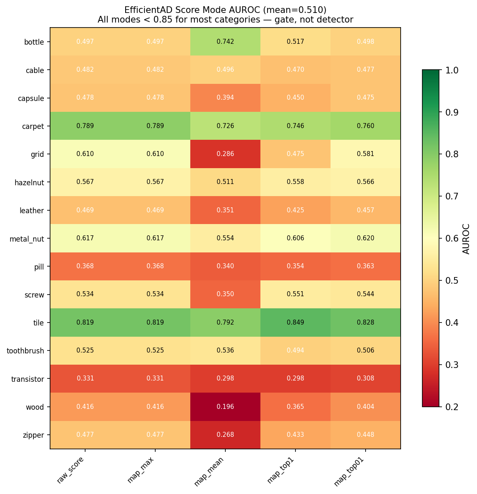

EfficientAD 15 类 score mode AUROC（mean 0.510）。Architecture implication: T2 定位为 load-shedding gate，不是最终 precision detector。

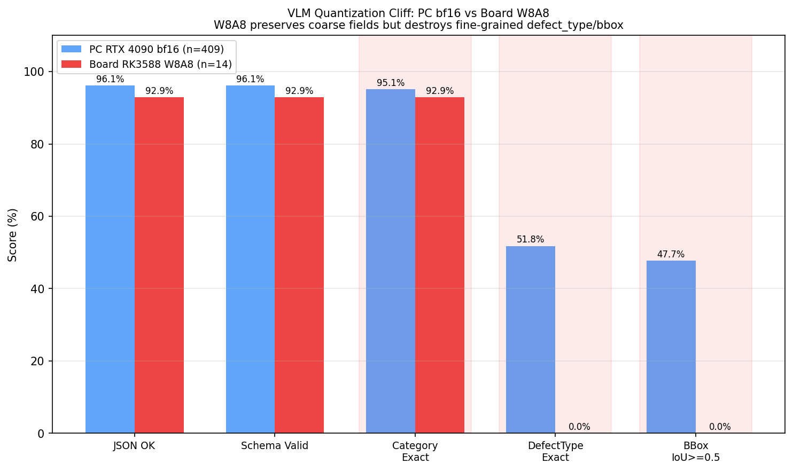

W8A8 量化 cliff：粗粒度 category 保留，细粒度 defect_type/bbox 坍塌。Architecture implication: bbox / defect_type / confidence 以 YOLO localizer 为 canonical source，VLM 作为 enrichment。
