# 端云分离工业视觉 AI 检测系统：项目报告

> **项目**：`vlm-sam-industrial-vision-v2`
> **硬件**：Orange Pi 5 / RK3588 / 16GB RAM
> **数据集**：MVTec AD 15 类工业缺陷（CC BY-NC-SA 4.0）
> **报告日期**：2026-05-28

## 1. 项目背景

工业视觉缺陷检测在从实验室走向端侧部署时，面临的不仅是模型精度问题，更是一个系统工程问题：模型转换、硬件量化、推理引擎集成、通信协议、实时可观测性和故障降级都会影响最终可用性。

本项目以 RK3588 16GB（Orange Pi 5）为目标硬件，围绕 MVTec AD 15 类工业缺陷数据集，构建了从 PC 端训练评估到 RK3588 真机部署、再到后端/前端联调的完整端侧 AI 部署闭环。

**项目基于 MVTec AD 公开数据集，非真实工厂生产部署。**

## 2. 问题定义

**输入**：工业产品图片（MVTec AD 15 类：bottle, cable, capsule, carpet, grid, hazelnut, leather, metal_nut, pill, screw, tile, toothbrush, transistor, wood, zipper）

**输出**：结构化缺陷事件 JSON（defect_type / severity / confidence / bbox / observation），通过 HTTP 上报到云端后端并实时展示。

**约束**：
- 推理在 RK3588 边缘设备上完成（非云端 GPU）
- 16GB RAM 限制下运行三个模型
- 延迟和稳定性优先于绝对精度
- 端云分离架构，通过 HTTP multipart 上传

## 3. 双部署主线

项目实现了两条已验证的 RK3588 部署路径：

### 3.1 路径 A：Phase 7/9 三阶段 VLM 管线

```text
T1: V4L2 图片采集
T2: EfficientAD-S (FP16 raw RKNN) → 异常门控
T3: FastSAM-s (FP16 no-quant RKNN) bbox + Qwen3-VL-2B (W8A8 RKLLM) 结构化 JSON
T4: libcurl multipart 上传
```

Phase 9 soak 30.2 分钟通过，0 崩溃、0 队列丢帧、100% json_parse_ok。VLM 性能：TTFT ~2174ms, decode 9.97 tok/s, RSS 3324MB。

### 3.2 路径 B：Phase 10 v1 ORT Localizer

```text
T1: V4L2 图片采集
T2: EfficientAD-S (FP16 raw RKNN) → 异常门控
T3: YOLOv8n-detect (ORT CPU FP32) → defect_type + confidence + bbox
T4: libcurl multipart 上传
```

Extended soak 27m27s, 2082 frames, 0 crash, RSS=34MB, T3 avg=187.7ms。RKNN 状态 BLOCKED（rknn-toolkit2 2.3.2），当前使用 ORT CPU fallback。

### 3.3 为什么两条路径

| 维度 | 路径 A（VLM） | 路径 B（ORT） |
|------|--------------|--------------|
| T3 方案 | FastSAM bbox + Qwen3-VL JSON | YOLOv8n ORT CPU |
| T3 延迟 | ~11s（VLM 主导） | ~188ms |
| RSS | ~3324MB | ~34MB |
| 输出 | 结构化 JSON（defect_type/severity/confidence/bbox） | defect_type + confidence + bbox |
| 定位 | 端侧 VLM 部署可行性验证 | 工程化低延迟方案 |
| VLM 调用 | 是 | Phase 10 v1 不调用 |

路径 A 证明了 VLM 在 RK3588 上的端侧部署可行性，路径 B 作为工程化简化方案用更低延迟做定位。

## 4. 系统架构

### 4.1 全局架构

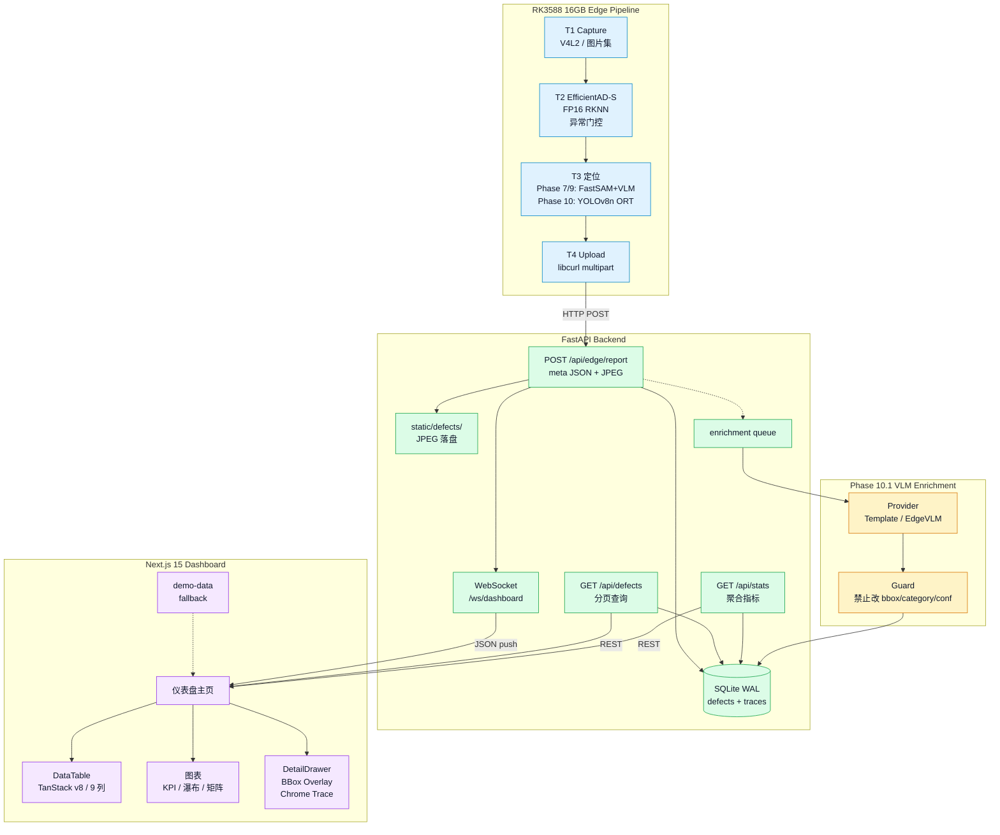

端云分离架构：Edge 负责采集和推理，通过 HTTP multipart 上报 Backend，Backend 落盘入库并通过 WebSocket 推送 Frontend。WebSocket 仅存在于 Backend↔Frontend，Edge 只做 HTTP POST 客户端。

### 4.2 Edge Pipeline 四线程模型

```mermaid
flowchart LR
    subgraph T1["T1 Capture Thread"]
        V4L2["V4L2 / 图片集"]
        Q1["BoundedQueue Q1<br/>capacity=2"]
        V4L2 --> Q1
    end

    subgraph T2["T2 Pipeline Thread"]
        EAD["EfficientAD-S<br/>FP16 RKNN<br/>~350ms"]
        GATE{"gate_mode<br/>threshold?"}
        Q2["BoundedQueue Q2<br/>capacity=2"]
        EAD --> GATE
        GATE -->|pass| Q2
        GATE -->|drop| CNT["gate_drop++"]
    end

    subgraph T3["T3 VLM Thread"]
        FSAM["FastSAM-s<br/>FP16 RKNN<br/>~250ms"]
        BBOX["5 级 bbox 净化"]
        QWEN["Qwen3-VL-2B<br/>W8A8 RKLLM<br/>~11s"]
        JSON["结构化 JSON"]
        Q3["BoundedQueue Q3"]
        FSAM --> BBOX --> QWEN --> JSON --> Q3
    end

    subgraph T4["T4 Upload Thread"]
        CURL["libcurl<br/>multipart POST"]
        CURL --> OK["upload_ok++"]
    end

    Q1 --> EAD
    Q2 --> FSAM
    Q3 --> CURL

    classDef t1 fill:#DBEAFE,stroke:#3B82F6
    classDef t2 fill:#D1FAE5,stroke:#10B981
    classDef t3 fill:#FEF3C7,stroke:#F59E0B
    classDef t4 fill:#FCE7F3,stroke:#EC4899
    class V4L2,Q1 t1
    class EAD,GATE,Q2,CNT t2
    class FSAM,BBOX,QWEN,JSON,Q3 t3
    class CURL,OK t4
```

四线程通过 BoundedQueue 解耦，drop-oldest 策略防止背压传播。Q2 容量只有 2，是有意设计的保护性瓶颈——T3 VLM 延迟 ~11s，当 VLM 慢于输入节拍时优先丢旧帧。

## 5. 工程难点与排障

### 5.1 量化失真诊断

项目遇到了三类量化问题，每类都需要定位不同层面的根因：

| 问题 | 现象 | 根因 | 解决方案 |
|------|------|------|----------|
| FastSAM INT8 | confidence 近零，raw candidates=0 | per-tensor scale=2.82 压缩输出范围 | FP16 no-quant RKNN（26MB） |
| EfficientAD ONNX | RKNN 转换失败 | Anomalib post_processor Greater 算子不支持 | raw tensor bypass |
| LoRA W8A8 | PC bf16 有效，RK3588 defect_type_exact 归零 | LoRA delta 权重量化精度不足 | 当前主推 2B base + 工程化 prompt |
| YOLO RKNN | 数值一致性不通过 | rknn-toolkit2 2.3.2 已知问题 | ORT CPU FP32 fallback |

### 5.2 LoRA W8A8 量化坍塌分析

这是项目中最值得展开的量化诊断案例：

- **PC 端**：2B LoRA bf16 推理，defect_type_exact 51.8%，category_exact 95.1%，bbox_iou>=0.5 47.7%
- **RK3588 端**：同一 LoRA 模型经 merge-then-convert 后 W8A8 推理，defect_type_exact 归零，category_exact ~93%
- **根因**：LoRA rank=32 的 delta 权重幅值相对 base 权重小 1-2 个数量级，W8A8 量化 step size 按 base 权重分布校准，对 delta 精度不足
- **结论**：不是训练失败，不是转换错误，而是 W8A8 硬件量化对增量学习的根本精度限制

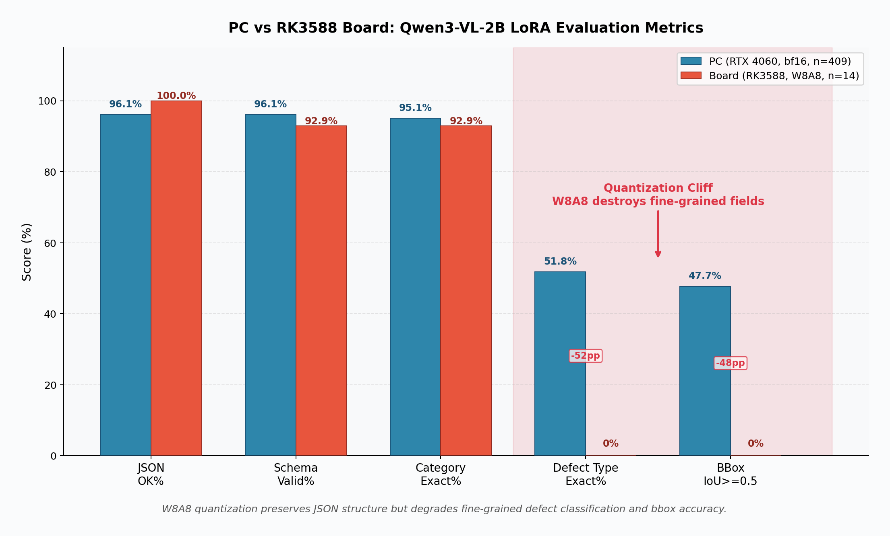

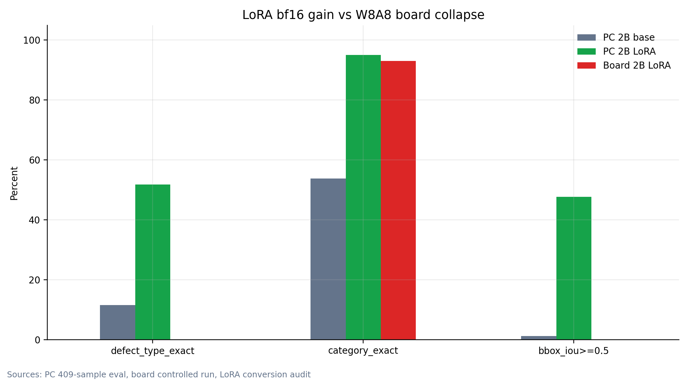

### 5.3 EfficientAD 门控定位

EfficientAD 在 RK3588 FP16/no-quant 上的 score mode AUROC 和 per-category threshold 分析表明：T2 适合作负载削减门控，不适合作最终检测器。

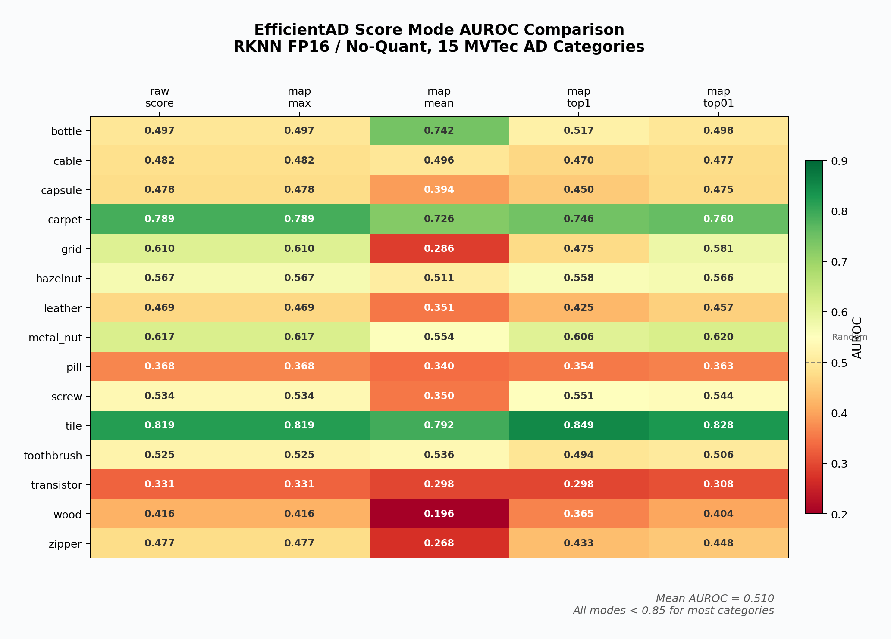

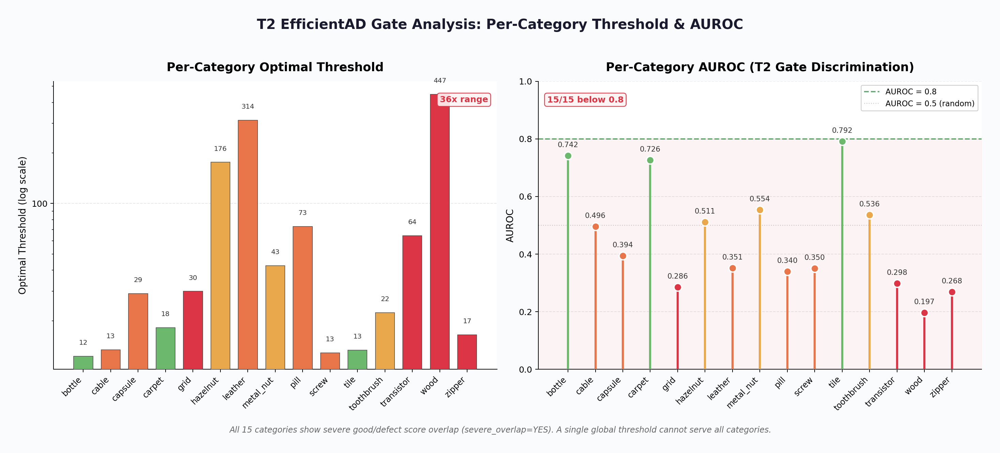

### 5.4 VLM 板端成本与背压

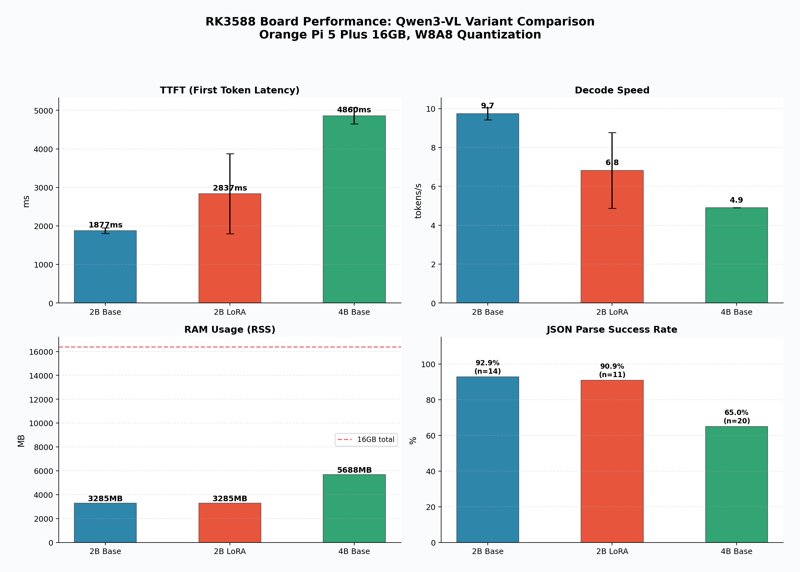

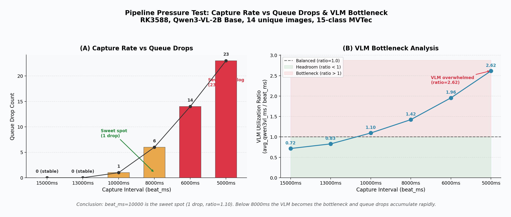

### 5.5 Phase 9/10+ 定量证据图

以下 8 张图从仓库已有的实验报告、CSV/JSON 快照和 demo manifest 中生成，为工程决策提供可量化的证据。

> 边界说明：这些图是工程证据，不是生产工厂指标。Phase 10 v1 使用 ORT CPU fallback，不在同步主路径中调用 VLM。

#### A. Localizer 质量与运行时

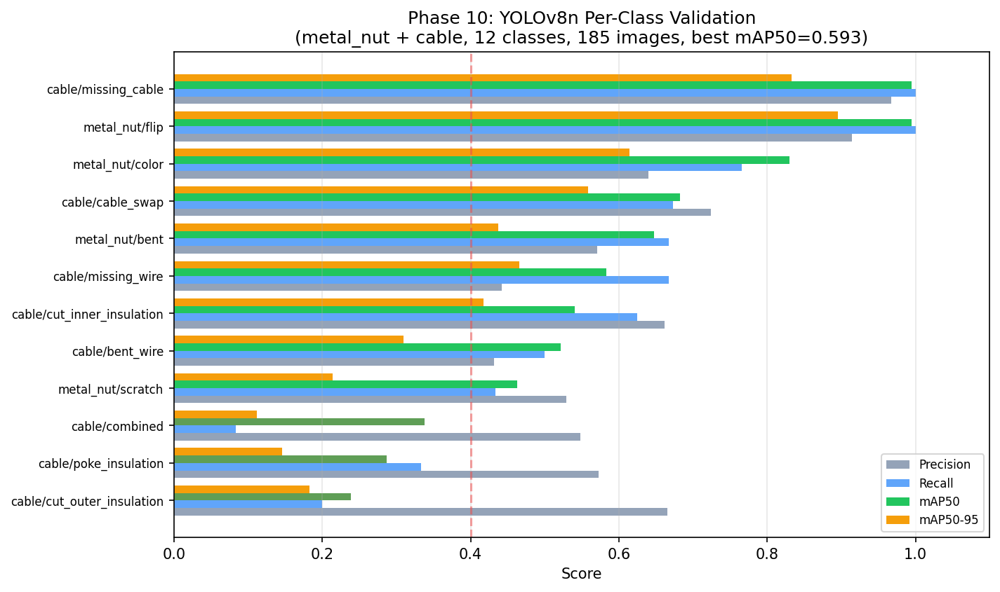

Phase 10 YOLOv8n 有监督 localizer 在 metal_nut + cable 12 类上的 per-class 验证。strong classes（flip 0.995、missing_cable 0.995）可靠；weak classes（cut_outer_insulation 0.239、poke_insulation 0.287）反映小样本和视觉微妙缺陷的限制。

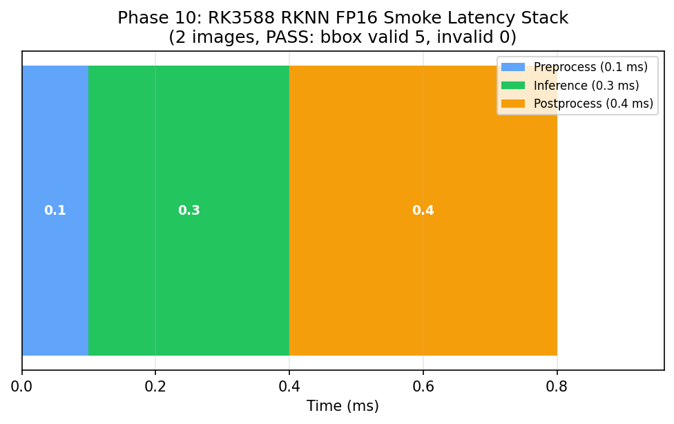

RK3588 RKNN FP16 smoke 延迟栈：preprocess 37.8ms + inference 95.2ms + postprocess 3.7ms = 136.7ms。仅 2 张图 smoke test，RKNN numeric consistency 仍 BLOCKED。

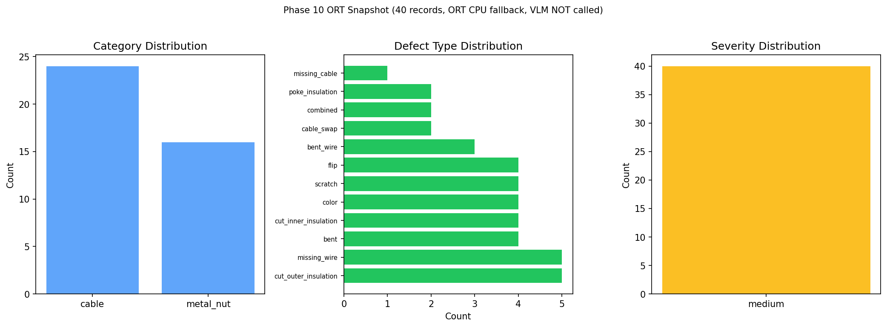

ORT snapshot 分布：40 条 curated records，cable + metal_nut，ORT CPU fallback。localization_source=ort_yolov8n_cpu，label_source=yolo_class_head。

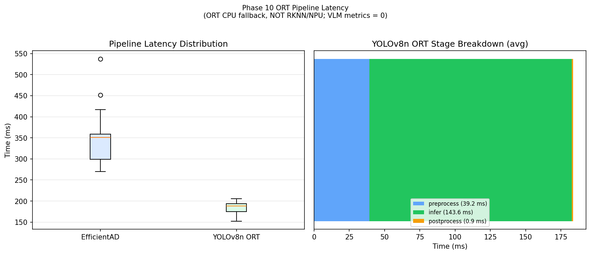

EfficientAD ~350ms，YOLOv8n ORT ~188ms。VLM metrics 为 0（未调用）。ORT CPU fallback，不是 RKNN/NPU benchmark。

#### B. 系统演进

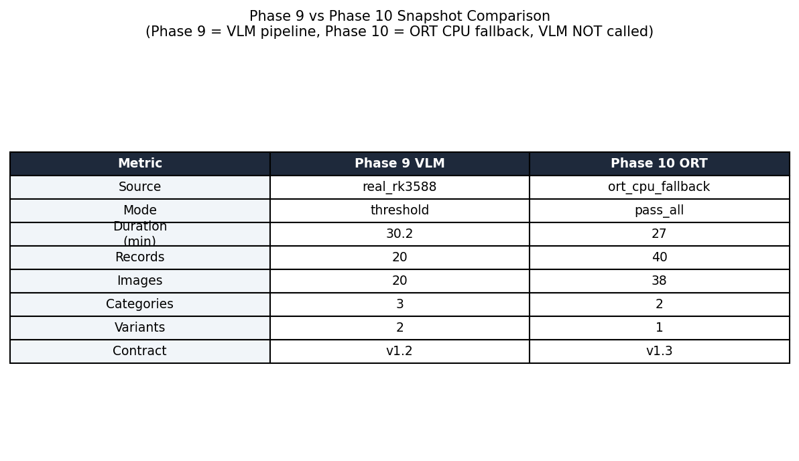

Phase 9 VLM pipeline 证明端侧 VLM 可行性；Phase 10 ORT localizer 证明低延迟确定性定位。两条路径目标不同，不是互相否定。

#### C. 为什么 VLM 不在同步主链路

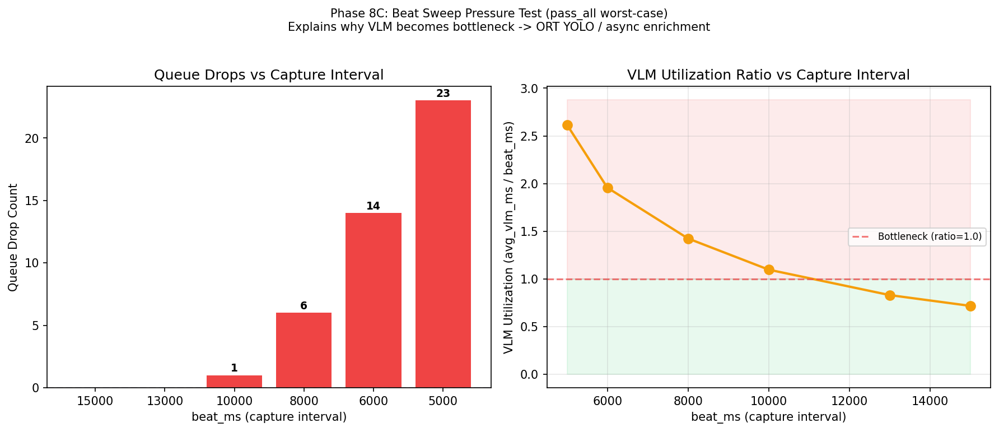

pass_all 最坏情况下，同步 VLM 在 capture interval < 8000ms 时成为瓶颈（5000ms 时 23 queue drops）。这解释了为什么将 VLM 移向异步 enrichment。

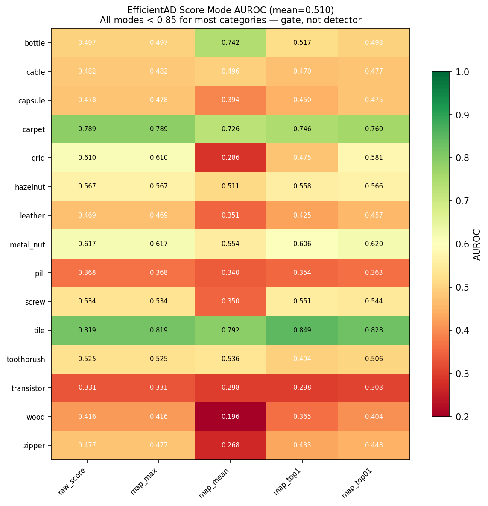

EfficientAD 15 类 mean AUROC=0.510，不足以作为最终检测器。T2 定位为 load-shedding gate。

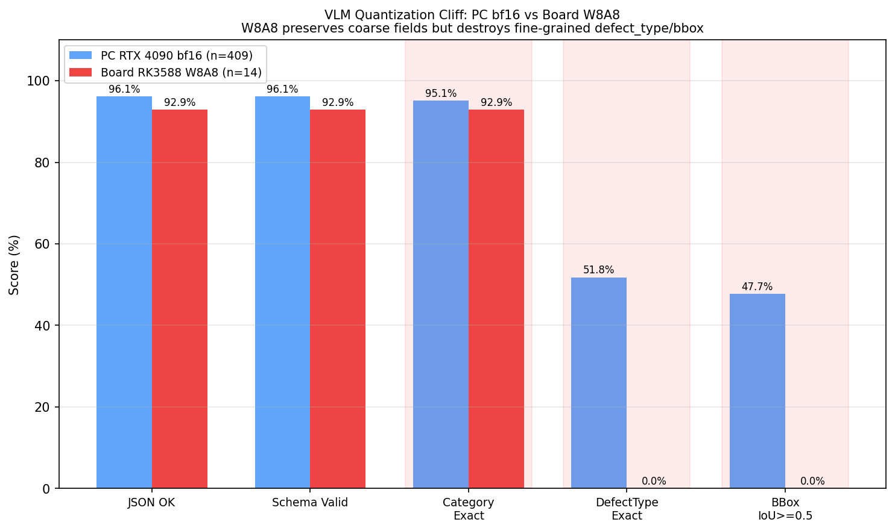

W8A8 量化 cliff：粗粒度 category 保留（~93%），细粒度 defect_type_exact 从 51.8% 降至 0%，bbox_iou 从 47.7% 降至 0%。因此 bbox/defect_type 以 YOLO localizer 为 canonical source，VLM 作为 enrichment。

### 5.6 背压管理

Phase 8C beat_ms 压力测试发现反压正反馈循环：beat=5000ms 时 VLM avg 增加 21.9%（10.7s → 13.1s），Q2 饱和下 NPU 资源竞争导致加速退化。设计公式：beat_ms >= VLM_avg_ms / 0.85（预留 15% buffer）。2B base pass_all 推荐 13000ms。

### 5.7 Python subprocess 策略

Phase 10 ORT localizer 通过 Python subprocess 与 C++ 通信（stdin/stdout JSON lines），避免了 C++ 直接链接 ORT 的复杂性。这是一个工程权衡——牺牲少量 IPC 开销换取开发效率和 ORT 生态兼容性。

## 6. 实验与证据

### 6.1 Soak 验证

| 测试 | 时长 | 帧数 | 崩溃 | 队列丢帧 | json_parse_ok | RSS |
|------|------|------|------|---------|---------------|-----|
| Phase 9 VLM soak | 30.2 min | 366 capture | 0 | 0 | 100% | ~3322 MB |
| Phase 10 ORT soak | 27m27s | 2082 | 0 | — | — | 34MB |

### 6.2 VLM 评估体系（Phase 5）

4 变体 2x2 矩阵（模型尺寸 x 微调模式），409 samples，15 类 MVTec AD：

| 变体 | JSON OK | Cat Exact | DefType Exact | BBox IoU>=0.5 |
|------|---------|-----------|---------------|---------------|
| 2B_base | 96.1% | 53.1% | 11.2% | 1.5% |
| 2B_lora | 95.6% | 94.4% | 53.1% | 48.9% |
| 4B_base | 98.0% | 59.2% | 10.5% | 0.0% |
| 4B_lora | 95.8% | 95.8% | 64.8% | 64.5% |

关键发现：LoRA 是决定性因素，不是单纯模型尺寸。OPRO Baseline 证明了仅靠 prompt 优化无法对齐工业 schema，LoRA-SFT 是必要的。

### 6.3 模型转换矩阵（Phase 6）

| 模型 | 源格式 | 目标格式 | 数量 | 状态 |
|------|--------|----------|------|------|
| EfficientAD-S | ONNX | RKNN INT8/FP16 | 15 类 | 完成 |
| FastSAM-s | ONNX | RKNN FP16 no-quant | 15 类 | 完成 |
| Qwen3-VL-2B base | HuggingFace | RKLLM W8A8 | 1 (2.3G) | 完成 |
| Qwen3-VL-2B LoRA | Merged | RKLLM W8A8 | 1 (2.3G) | 完成 |
| Qwen3-VL-2B vision | HuggingFace | RKNN | 1 (812M) | 完成 |
| Qwen3-VL-4B base | HuggingFace | RKLLM W8A8 | 1 (4.6G) | 完成 |
| Qwen3-VL-4B LoRA | Merged | RKLLM W8A8 | 1 (4.6G) | 完成 |
| Qwen3-VL-4B vision | ONNX | RKNN | 1 (843M) | 完成 |

### 6.4 Phase 7 C++ Pipeline 六个 Prompt

| Prompt | 工作内容 | 关键数据 |
|--------|---------|---------|
| 2B | EfficientAD-S FP16 RKNN 真实推理 | avg=350.8ms，发现 Greater 算子不兼容 |
| 2C | FastSAM FP16 RKNN 真实推理 | avg=250.1ms，INT8→FP16 修复 confidence 归零 |
| 2D | Qwen3-VL 2B RKLLM 接入 | TTFT ~2500ms, decode 9.3 tok/s, RSS 3321MB |
| 2D-Fix | VLM bbox 融合 + severity 白名单 | 23/23 json_ok=100% |
| 2E | 四线程 E2E 验收 | 8 图 4 类 24 帧，upload_ok=24/24 |
| 2F | Threshold 模式验证 | pass_all 100% vs threshold 38%，T3 压力下降 65% |

### 6.5 联调验收

| 模块 | 结果 |
|------|------|
| 契约测试 | 34/34 通过 |
| 前端 typecheck | 0 errors |
| 前端 build | 成功 |
| WebSocket 推送 | defect_created / metrics_tick 正常 |
| trace_events | 6 项完整 |
| demo-data fallback | 后端不可达时不白屏 |

## 7. Technical Highlights

1. **RK3588 端侧 VLM 部署**：在 16GB 内存约束下完成 EfficientAD-S → FastSAM → Qwen3-VL 三阶段 C++ 推理流水线，含 RKNN/RKLLM 真实推理
2. **量化诊断**：定位并解决 FastSAM INT8 per-tensor 量化失真、EfficientAD ONNX 算子不兼容、LoRA W8A8 细粒度坍塌
3. **RKNN fallback 工程决策**：YOLO RKNN numeric consistency BLOCKED → ORT CPU fallback
4. **背压管理**：BoundedQueue drop-oldest + threshold 门控 + beat_ms 节拍控制，发现并解决反压正反馈循环
5. **模型转换全链路**：PyTorch → ONNX → RKNN/RKLLM 覆盖 15 类 EfficientAD + FastSAM + Qwen3-VL 2B/4B
6. **4 变体评估体系**：Deployment Benchmark + Method Control Benchmark + OPRO Baseline 三基准系统性验证
7. **端云闭环**：FastAPI + WebSocket + Next.js 实时可观测仪表盘，34/34 契约测试通过
8. **工程文档**：60+ 份阶段实验报告，记录完整的排障、验证和决策过程

## 8. Limitations and Roadmap

### 当前限制

| 限制 | 当前影响 | 后续方向 |
|------|---------|---------|
| YOLO RKNN BLOCKED | 使用 ORT CPU fallback | 等待 rknn-toolkit2 修复 |
| LoRA W8A8 细粒度坍塌 | 板端不部署 LoRA | 等待更高精度量化或改 PC 离线推理 |
| EfficientAD AUROC 低 | T2 只能做负载控制 | 实现 C++ post-processor 重新校准 |
| FastSAM mask decode 未实现 | 只输出 bbox | 补 prototype mask decode |
| MVTec AD 局限性 | 公开数据集 | 外部数据集或真实产线验证 |
| Phase 10.1 enrichment | 仅有 smoke/dry-run | 完成正式长稳 soak 验证 |

### 路线图

- Phase 8：per-category threshold 校准（15 类）
- Phase 10.1：完成异步 VLM enrichment 集成
- 4B 模型完整验证、enable_thinking 评估
- 真实 SoC profiling 与多平台适配探索

## 9. 技术覆盖范围

| 能力维度 | 项目实践 |
|----------|---------|
| 模型移植 | PyTorch → ONNX → RKNN/RKLLM 15 类全量转换 |
| 量化优化 | INT8/FP16/W8A8 诊断与方案选择 |
| C++ 推理引擎 | 四线程 jthread + BoundedQueue + librknnrt/librkllmrt |
| 大模型端侧部署 | Qwen3-VL-2B W8A8 RKLLM 真机推理 |
| 性能分析 | soak telemetry, RSS, latency, Chrome Trace |
| LoRA 微调 | LLaMA-Factory 2B/4B 15 类 |
| 前后端闭环 | FastAPI + WebSocket + Next.js + 契约测试 |
| 工程文档 | 60+ 份实验报告 + API 契约 |

## 10. 证据索引

| 文档 | 内容 |
|------|------|
| `docs/reports/edge_deployment_summary.md` | 端侧部署总结报告（双主线） |
| `docs/architecture/MERMAID_ARCHITECTURE_ATLAS.md` | Mermaid 架构图集（6 张） |
| `docs/experiments/phase7_edge_pipeline_report.md` | C++ VLM 管线 6 Prompt 验证 |
| `docs/experiments/phase5_6_deployment_benchmark_report.md` | 4 变体 15 类 409 samples 评估 |
| `docs/experiments/phase5_7_method_control_benchmark_report.md` | LoRA 净贡献隔离评估 |
| `docs/experiments/phase5_8_opro_baseline_report.md` | OPRO prompt-only baseline |
| `docs/experiments/phase6_track_b_model_conversion_report.md` | 全量模型转换报告 |
| `docs/experiments/phase8_execution_report.md` | Phase 8A/8B/8C 综合实验 |
| `docs/experiments/phase10_session_handoff_v2.md` | ORT localizer 验证 |
| `docs/API_CONTRACT.md` | REST/WebSocket 接口契约 |
| `docs/ARCHITECTURE.md` | 系统架构设计 |
| `docs/ENGINEERING_FINDINGS.md` | 工程发现与排障记录 |
