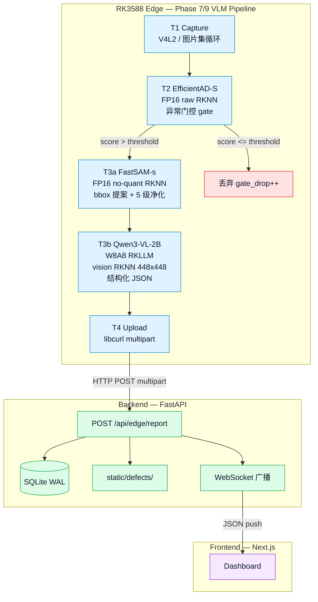
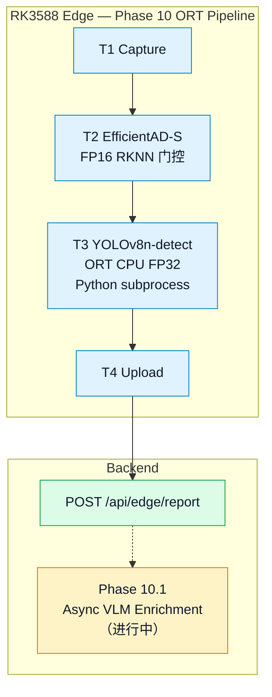
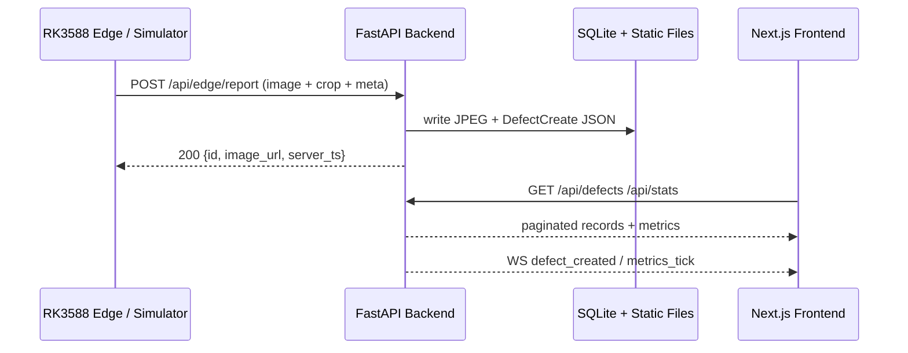
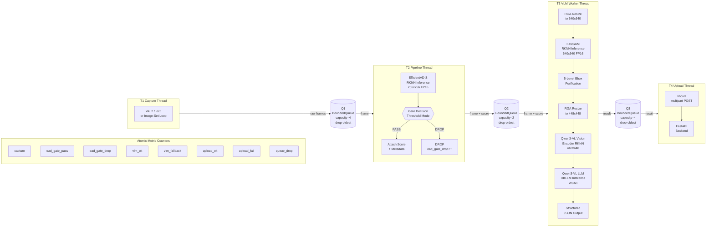

# RK3588 边缘 AI 工业视觉检测系统：工程部署总结

> **项目**：`vlm-sam-industrial-vision-v2`
> **硬件**：Orange Pi 5 / RK3588 / 16GB RAM
> **报告状态**：Phase 7/9 VLM + Phase 10 ORT 双主线版本
> **生成日期**：2026-05-28

## 1. 摘要

本项目在 RK3588 16GB 上构建了端侧三阶段工业视觉检测流水线，实现了两条已验证的部署路径：

**路径 A（Phase 7/8/9 VLM 管线）**：EfficientAD-S FP16 RKNN → FastSAM FP16 RKNN → Qwen3-VL-2B W8A8 RKLLM。Phase 9 soak 30.2 分钟通过，0 崩溃、0 队列丢帧、100% json_parse_ok。

**路径 B（Phase 10 v1 ORT Localizer）**：EfficientAD-S FP16 RKNN → YOLOv8n ORT CPU FP32 localizer。Extended soak 27m27s / 2082 frames / 0 crash。

端云分离架构：RK3588 C++ 端侧程序负责图像采集、异常门控、定位/描述、HTTP multipart 上传；FastAPI 后端负责接收、落盘、入库和 WebSocket 广播；Next.js 前端负责实时可观测仪表盘。API contract 以 `docs/API_CONTRACT.md` 为唯一权威。

系统定位为 RK3588 端侧部署验证项目，基于 MVTec AD 公开数据集，非真实产线部署。

## 2. 两条部署主线

### 2.1 路径 A：Phase 7/9 三阶段 VLM 管线



**状态**：已验证。Phase 7 六个 Prompt（2B~2F）完成 C++ 四线程全链路工程验证；Phase 9 soak 30.2 分钟通过。

**工程价值**：真实 RKNN/RKLLM 端侧推理、VLM 结构化输出解析、INT8 量化失真诊断、四线程背压管理。

### 2.2 路径 B：Phase 10 v1 ORT Localizer



**状态**：已验证。Extended soak 27m27s / 2082 frames / 0 crash / RSS=34MB。

**工程价值**：ONNX/ORT 推理、subprocess 策略、RKNN numeric consistency 诊断、ORT CPU fallback 工程决策。

### 2.3 两条路径的关系

| 维度 | 路径 A（Phase 7/9 VLM） | 路径 B（Phase 10 ORT） |
|------|------------------------|----------------------|
| T3 方案 | FastSAM bbox + Qwen3-VL JSON | YOLOv8n ORT CPU |
| 延迟 | T3 ~11s（VLM 主导） | T3 ~188ms |
| 内存 | RSS ~3324MB | RSS ~34MB |
| 输出 | 结构化 JSON（defect_type/severity/confidence/bbox） | defect_type + confidence + bbox |
| 定位 | 端侧 VLM 部署可行性验证 | 工程化低延迟方案 |
| RKNN 状态 | EfficientAD/FastSAM/Qwen3VL vision 均已验证 | YOLO RKNN BLOCKED（rknn-toolkit2 2.3.2） |

**为什么两条路径**：Phase 7/9 证明了 VLM 在 RK3588 上的端侧部署可行性（含 RKNN/RKLLM 推理、量化诊断、VLM JSON 解析）。Phase 10 引入有监督 YOLOv8n 作为工程化简化方案，用更低延迟和资源占用做定位。两条路径互补：VLM 管线展示技术深度，ORT localizer 展示工程判断。

## 3. 端云分离系统架构

### 3.1 全局拓扑

```mermaid
flowchart LR
  subgraph Edge["RK3588 C++ Edge Pipeline"]
    T1["T1 Capture / image_loop"]
    T2["T2 EfficientAD-S raw_score gate"]
    T3["T3 Localizer<br/>Phase 7/9: FastSAM+VLM<br/>Phase 10: YOLOv8n ORT"]
    T4["T4 libcurl Upload"]
    T1 --> Q1["Q1 cap=4 drop-oldest"] --> T2
    T2 --> Q2["Q2 cap=2 drop-oldest"] --> T3
    T3 --> Q3["Q3 cap=4 drop-oldest"] --> T4
  end

  subgraph Backend["FastAPI Backend"]
    API["POST /api/edge/report multipart/form-data"]
    DB["SQLite + static/defects/{YYYYMMDD}/{uuid}.jpg"]
    REST["GET /api/defects /api/stats"]
    WS["WebSocket /ws/dashboard"]
  end

  subgraph Frontend["Next.js Dashboard"]
    Overview["Overview realtime stream"]
    Profile["Profile trace timeline"]
    AB["AB Matrix metrics"]
  end

  T4 --> API --> DB
  DB --> REST --> Frontend
  DB --> WS --> Frontend
```



边缘端只作为 HTTP POST client，不运行 FastAPI、Flask、Streamlit、Gradio 或 WebSocket server。WebSocket 只存在于 backend 和 frontend 之间。所有图片上传使用 `multipart/form-data`，禁止 Base64。

### 3.2 API Contract 与数据流

`docs/API_CONTRACT.md` 定义 v1.2 contract，是边缘端、模拟器、后端、前端四端的**唯一权威接口**。任何字段变更必须先 bump contract 版本再改实现。

边缘端和模拟器上报同一个 `DefectCreate` schema：

| 字段 | 作用 |
|---|---|
| `category` | MVTec AD 15 类白名单 |
| `defect_type` / `severity` / `confidence` | VLM 或 ORT 结构化描述 |
| `anomaly_score` | EfficientAD raw score |
| `bboxes` | 归一化 [0,1] bbox，供前端 overlay |
| `pipeline_ms` | efficientad / fastsam / qwen3vl 分阶段延迟 |
| `vlm_metrics` | TTFT、decode_tps、RSS、json_parse_ok |
| `trace_events` | Chrome Trace 风格事件（v1.2 新增） |
| `variant` | 4 变体标识（2B_base / 2B_lora / 4B_base / 4B_lora） |



### 3.3 后端 FastAPI

后端使用 FastAPI + SQLAlchemy 2.0 async + aiosqlite，SQLite WAL 模式。核心路由：

| 路由 | 功能 |
|---|---|
| `POST /api/edge/report` | 接收 multipart 落盘图片到 `static/defects/{YYYYMMDD}/{uuid}.jpg`，元数据写入 SQLite |
| `GET /api/defects` | 分页查询，支持 category/severity/variant/since/until 过滤和排序 |
| `GET /api/stats` | 聚合统计：total、today_defects、today_high、by_category、by_severity、timeline、ab_compare、avg_pipeline_ms、category_severity_matrix |
| `GET /api/health` | 存活探针：status + uptime + db + ws_clients |
| `WS /ws/dashboard` | ConnectionManager 进程内单例，broadcast `defect_created` / `metrics_tick` / `ping` |

### 3.4 前端 Next.js Dashboard

前端使用 Next.js 15 App Router + React 19 + Tailwind v4 + shadcn/ui，`output: 'export'` 纯静态导出。

| 模块 | 技术栈 | 功能 |
|---|---|---|
| Overview | TanStack Table v8 + WebSocket + Sonner toast | 实时缺陷流水 DataTable（9 列） |
| Profile | 原生 SVG trace timeline | trace_events Chrome Trace 可视化，关键路径分析 |
| AB Matrix | 自定义矩阵组件 | 4 变体 2x2 对比：json_ok_rate、avg_ttft_ms、avg_decode_tps、avg_rss_mb |

后端不可达时自动 fallback 到 mock 数据，不白屏。

### 3.5 模拟器

`simulator/line_runner.py` 是 MVTec 数据集驱动的产线回放客户端，同时充当契约测试工具。与 C++ 边缘端对后端报文**完全相同**，靠 API contract 保证可替换性。

### 3.6 Phase 4 联调验收

Phase 4 轨道 A 已验证端云联调全链路：34/34 契约测试通过，`tsc --noEmit` 0 errors，`npm run build` 成功，trace_events 全链路验证通过。

## 4. RK3588 四线程端侧流水线

### 4.1 线程模型



端侧固定四线程模型：

| 线程 | 职责 | 关键约束 |
|---|---|---|
| T1 Capture | 采集或循环读取 MVTec 图像 | 不在板端运行 Python simulator |
| T2 EfficientAD | 计算 raw_score，threshold gate 控制 T3 负载 | T2 是 load shedding gate |
| T3 Localizer | Phase 7/9: FastSAM + Qwen3-VL；Phase 10: YOLOv8n ORT | VLM 输出必须 parseable compact JSON |
| T4 Upload | libcurl multipart 上传原图、crop 和 meta | 失败指数退避重试 |

队列全部为 `BoundedQueue<T>`，drop-oldest 语义。Q2 容量只有 2，是有意设计的保护性瓶颈。

## 5. Phase 7：C++ VLM 管线六个 Prompt

Phase 7 在 RK3588 上完成 C++ 四线程推理流水线从 Mock 到真实推理的全链路工程验证，覆盖 Prompt 2B ~ 2F 共 6 个子阶段。

### 5.1 Prompt 2B：EfficientAD-S FP16 RKNN

| 项目 | 结果 |
|------|------|
| 成果 | 从 MockPipelineWorker 替换为真实 EfficientAD-S RKNN 推理 |
| 发现 | Anomalib ONNX post_processor 包含 Greater INT8/FLOAT 类型不支持 |
| 方案 | raw ONNX → FP16/no-quant raw RKNN → C++ FP16 parse |
| 数据 | EfficientAD avg=350.8ms |
| 代表类验证 | bottle / metal_nut / pill / screw FP16/no-quant raw RKNN 通过 |

### 5.2 Prompt 2C：FastSAM FP16 RKNN

| 项目 | 结果 |
|------|------|
| 成果 | 从 MockVlmWorker 替换为真实 FastSAM RKNN 推理 |
| 发现 | INT8 per-tensor quantization scale=2.82 导致 confidence 近零（raw candidates=0，100% fallback） |
| 方案 | FP16/no-quant RKNN（do_quantization=False），conf 恢复 0.7~0.88，0% fallback |
| 数据 | FastSAM avg=250.1ms |
| bbox 净化 | 5 级：边界裁剪、面积过滤、IoU 去重、数量限制 |

### 5.3 Prompt 2D：Qwen3-VL 2B RKLLM

| 项目 | 结果 |
|------|------|
| 成果 | Qwen3-VL 2B base RKLLM 真实推理接入（替换 mock VLM JSON） |
| 链路 | vision encoder RKNN 448x448 → LLM RKLLM W8A8 |
| 数据 | vision ~2500ms, TTFT ~2500ms, decode 9.3 tok/s, RSS 3321MB |
| 排障 | RKLLM runtime 版本不匹配（v1.2.1→v1.2.3）、n_image_tokens 错误、JSON 截断 |

### 5.4 Prompt 2D-Fix：VLM bbox 融合与工程细节

| 项目 | 结果 |
|------|------|
| VLM bbox 解析 | 归一化（像素→[0,1]）与保守融合策略（FastSAM 优先，VLM bbox IoU>0.3 才替换） |
| severity 白名单 | low/medium/high（移除 critical） |
| LoRA 路径选择 | 2B base / 2B lora 通过 config 切换，4B 保留 TODO |
| 2B base smoke | 23/23 json_ok=1 (100%), 0 fallback, 0 critical, output_tokens 52-79 |
| 2B lora smoke | 13/13 json_ok=1, 1 fallback, output_tokens warning 1 (499>120) |

### 5.5 Prompt 2E：True E2E 验收

四线程全链路小样本验收：8 图 4 类（bottle/metal_nut/pill/screw），3 全周期 + 1 部分帧 = 24 帧成功。

| 指标 | 结果 |
|---|---|
| capture / ead / vlm / upload_ok | 25 / 25 / 24 / 24 |
| upload_fail / dropped | 0 / 0 |
| json_parse_ok | 24/24（100%，4 类 24 帧小样本） |
| fallback_frames | 0 |
| VLM 性能 | avg_ttft=2174ms, decode_tps=9.97, RSS=3324MB（稳定无泄漏） |
| 分阶段延迟 | EfficientAD avg=350.8ms, FastSAM avg=250.1ms, Qwen3-VL avg=11350ms |
| trace_events | 6 项完整 |
| Backend records | 24 条可查，4 类各 6 条 |

### 5.6 Prompt 2F：Threshold 模式与节拍验证

| 项目 | 结果 |
|------|------|
| 可观测性补丁 | 新增 ead_gate_pass/ead_gate_drop 原子计数器 |
| 2F-A（覆盖型低阈值） | 21/21 帧全部通过 gate（pass_rate=100%），upload_ok=20 |
| 2F-B（过滤型高阈值） | 8/21 帧通过 gate（pass_rate=38%），upload_ok=7，T3 压力下降 65% |
| queue_drop | 0（Q2(2) 容量在 15s/帧节拍下足够） |

### 5.7 Phase 7 冻结点

```text
四线程流水线工程验证通过。
默认稳定模型：EfficientAD FP16 raw + FastSAM FP16/no-quant + Qwen3-VL 2B base W8A8。
2E True E2E PASS：upload_ok=24/24, json_parse_ok=100%, RSS=3324MB。
2F threshold gate 可观测，T3 压力可按阈值调控。
```

## 6. Phase 5：训练与评估体系

### 6.1 四变体 2x2 矩阵

| 变体 | 模型 | 模式 | Prompt 策略 |
|------|------|------|------------|
| 2B_base | Qwen3-VL-2B | 基座 W8A8 | 工程化 ~300 tokens |
| 2B_lora | Qwen3-VL-2B | LoRA W8A8 | 极简 ~50 tokens |
| 4B_base | Qwen3-VL-4B | 基座 W8A8 | 工程化 ~300 tokens |
| 4B_lora | Qwen3-VL-4B | LoRA W8A8 | 极简 ~50 tokens |

### 6.2 三基准评估

**Deployment Benchmark**（Phase 5.6）：4 变体 15 类 409 samples，max_tokens=200

| 变体 | JSON OK | Cat Exact | DefType Exact | BBox IoU>=0.5 |
|------|---------|-----------|---------------|---------------|
| 2B_base | 96.1% (393/409) | 53.1% (217/409) | 11.2% (46/409) | 1.5% (6/409) |
| 2B_lora | 95.6% (391/409) | 94.4% (386/409) | 53.1% (217/409) | 48.9% (200/409) |
| 4B_base | 98.0% (401/409) | 59.2% (242/409) | 10.5% (43/409) | 0.0% (0/409) |
| 4B_lora | 95.8% (392/409) | 95.8% (392/409) | 64.8% (265/409) | 64.5% (264/409) |

关键发现：LoRA 是决定性因素，不是单纯模型尺寸。4B_base defect_type_exact 仅 10.5%，但 4B_lora 达到 64.8%。

**Method Control Benchmark**（Phase 5.7）：相同 minimal prompt 隔离 LoRA 净贡献，验证 LoRA-SFT 对工业 schema/ontology/bbox 风格对齐的必要性。

**OPRO Baseline**（Phase 5.8）：OPRO 最优 prompt JSON OK=97.1%，但 schema_ok/category_exact/defect_type_exact/severity_valid/bbox_iou_at_0_5 全部 0.0%。结论：OPRO 优化了 JSON 可解析性，但未超越人工 engineered prompt。

## 7. Phase 6：模型转换全链路

| 模型 | 源格式 | 目标格式 | 数量 | 状态 |
|------|--------|----------|------|------|
| EfficientAD-S | ONNX | RKNN INT8/FP16 | 15 类 | ✅ 已完成 |
| FastSAM-s | ONNX | RKNN FP16 no-quant | 15 类 | ✅ 已完成 |
| Qwen3-VL-2B base | HuggingFace | RKLLM W8A8 | 1 (2.3G) | ✅ 已完成 |
| Qwen3-VL-2B LoRA 15cls | Merged | RKLLM W8A8 | 1 (2.3G) | ✅ 已完成 |
| Qwen3-VL-2B vision | HuggingFace | RKNN | 1 (812M) | ✅ 已完成 |
| Qwen3-VL-4B base | HuggingFace | RKLLM W8A8 | 1 (4.6G) | ✅ 已完成 |
| Qwen3-VL-4B LoRA 15cls | Merged | RKLLM W8A8 | 1 (4.6G) | ✅ 已完成 |
| Qwen3-VL-4B vision | ONNX | RKNN | 1 (843M) | ✅ 已完成 |

全部产物位于 `models/qwen3vl_models/rkllm_15cls/`。

## 8. Soak 验证：Phase 9 VLM 与 Phase 10 ORT

### 8.1 Phase 9 VLM 管线 Soak（路径 A）

| 指标 | 结果 |
|---|---|
| 时长 | 30.2 分钟 |
| 模型 | 2B base W8A8 threshold 模式 |
| capture | 366 次 |
| gate pass | 37 次 |
| VLM completions | 36 次 |
| uploads | 33 次成功 |
| 崩溃 | 0 |
| 队列丢帧 | 0 |
| json_parse_ok | 100% |
| RSS | ~3322 MB 稳定 |
| 4B carpet 回归 | 5/5 json_ok（spatial merge 修复后） |

### 8.2 Phase 10 ORT Localizer Soak（路径 B）

| 指标 | 结果 |
|---|---|
| 时长 | 27m27s |
| 帧数 | 2082 frames |
| 崩溃 | 0 |
| HTTP 400 | 0 |
| RSS | 34MB |
| T3 avg | 187.7ms |
| Snapshot | 40 curated records |

## 9. Phase 10：ORT Localizer 工程化

### 9.1 动机

YOLOv8n RKNN 部署因 rknn-toolkit2 2.3.2 numeric consistency issue 处于 BLOCKED 状态。作为 fallback 方案，引入 ONNX Runtime CPUExecutionProvider FP32 推理，通过 Python subprocess 策略与 C++ 主程序通信。

### 9.2 架构决策

| 决策 | 内容 |
|------|------|
| subprocess 策略 | C++ LocalizerWorker 通过 stdin/stdout 与 `ort_localizer.py` 通信 |
| 配置驱动 | `localizer_backend: "ort"` → LocalizerWorker，`fastsam_enabled: false` |
| VLM 状态 | Phase 10 v1 不调用 VLM；`observation_source: "template"`，severity 固定 "medium" |
| bbox 格式 | normalized top-left xywh，clamp 到 [0,1] |
| schema_version | 保持 "v1"，v1.3 字段可选附加 |

### 9.3 Gate 验证

| Gate | 状态 |
|------|------|
| Python subprocess smoke | PASS |
| C++ ORT integration | PASS |
| API contract (83/83) | PASS |
| Frontend smoke | PASS |
| Extended RK3588 soak (27m27s) | PASS |
| Snapshot demo (40 records) | PASS |
| RKNN numeric consistency | BLOCKED（rknn-toolkit2 2.3.2） |

### 9.4 Phase 10.1：异步 VLM Enrichment（进行中）

Phase 10.1 为后端异步 enrichment 层：只允许补 observation / severity_reason / defect_family，禁止修改 bbox / defect_type / confidence。当前有 smoke test / dry-run / precheck 材料，尚未完成 full soak 验证。

## 10. 模型部署与排障

### 10.1 EfficientAD-S：FP16 Raw RKNN

| 问题 | 处理 |
|---|---|
| post-processor Greater 节点类型不兼容 | 导出 post-processor 前 raw tensor |
| INT8 raw RKNN 分布失真 | 切换 FP16/no-quant RKNN |
| map_mean 稀释局部缺陷 | 改用 raw_score |

当前 T2 使用 raw_score，以 raw_score good_p95 作为 per-category threshold。ONNX vs RKNN AUROC 最大差异 0.024（screw），说明 FP16/no-quant RKNN 与 PC ONNX 基本等价。

### 10.2 FastSAM：FP16 RKNN

FastSAM-s INT8 per-tensor quantization 将置信度压缩到近零（raw candidates=0，100% fallback）。最终采用 FP16/no-quant RKNN（26MB），C++ 侧执行 5 级 bbox cleanup：clamp 到 [0,1]、最小面积过滤、最大面积过滤、IoU 去重、max boxes 限制。

### 10.3 Qwen3-VL：RKLLM W8A8

| 问题 | 根因 | 修复 |
|---|---|---|
| RKLLM runtime 版本不匹配 | 板上 v1.2.1，模型由 toolkit v1.2.3 导出 | 替换 librkllmrt.so |
| n_image_tokens 错误 | 误设为 784，RKLLM 期望 196 | 使用 vision_image_token_ 直接赋值 |
| JSON 截断 | vlm_max_new_tokens=200 不够 | 提升到 500，compact prompt 将输出从 ~196 降至 ~89 tokens |

T3 VLM 推理链路：RKNN vision encoder（448x448, 196 image tokens） → RKLLM W8A8 LLM（enable_thinking=false, max_context=4096） → JSON 提取 → 3 级 fallback（VLM init 失败 → JSON 解析失败 → bbox fallback 到 rule-based）。

### 10.4 W8A8 LoRA 量化失效诊断

**现象**：2B LoRA 在 PC bf16 上表现良好（defect_type_exact 51.8%、category_exact 95.1%），但在 RK3588 RKLLM/W8A8 上 defect_type_exact 归零。

**根因**：LoRA rank=32 的 delta 权重幅值相对 base 权重小 1-2 个数量级。W8A8 量化 step size 按 base 权重分布校准，对 delta 精度不足——fine-grained defect_type 知识丢失，粗粒度 category 知识因编码冗余仍能存活。

**结论**：不是训练失败，不是转换错误，而是 W8A8 硬件量化对增量学习的根本精度限制。

## 11. EfficientAD Threshold Calibration

Phase 8A 核心结论：EfficientAD raw output 排序能力有限，T2 gate 只能作为负载控制器。

| Score Mode | Mean AUROC | 结论 |
|---|---:|---|
| raw_score | 0.5320 | 当前使用 |
| map_max | 0.5320 | 与 raw_score 数学等价 |
| map_top01 | 0.5223 | 次优 |
| map_top1 | 0.5061 | 接近随机 |
| map_mean | 0.4561 | 最差 |

仅 tile 的 raw_score AUROC > 0.80；其余类别均低于 0.80。T2 是 load shedding gate，不是 precision detector。

## 12. Beat_ms 队列压力测试

Phase 8C 使用 2B base、pass_all、14 张固定样本做最坏情况压力扫描。

| beat_ms | queue_drop | stable | VLM_avg/beat |
|---:|---:|---|---:|
| 15000 | 0 | YES | 0.71 |
| 13000 | 0 | YES | 0.83 |
| 10000 | 1 | 边界可用 | 1.10 |
| 8000 | 6 | NO | 1.42 |
| 5000 | 23 | NO | 2.62 |

设计公式：beat_ms >= VLM_avg_ms / 0.85（预留 15% buffer）。2B base pass_all 推荐 13000ms。

**反压正反馈循环**：beat=5000ms 时 VLM avg 增加 21.9%，Q2 饱和下 NPU 资源竞争导致加速退化。

## 13. Engineering Evidence and Deployment Trade-offs

> Boundary: These figures are historical engineering evidence from Phase 8 / Phase 8C / VLM AB / board validation. They explain why the current pipeline moved toward deterministic YOLO/ORT localization and VLM-as-enrichment. They are not Phase 10 ORT localizer metrics, not production factory metrics, and not evidence that VLM is enabled in the Phase 10 v1 main path.

### 13.1 T2 Gate Evidence


EfficientAD 在多类上区分度不稳定（mean AUROC = 0.510），5 种 score mode 结果几乎相同。T2 更适合作 gate / load shedding，不应作为最终 defect_type / bbox 来源。


Per-category 最优阈值跨度 36 倍（12~447），13/15 类 AUROC < 0.8。单一全局阈值脆弱，per-category 阈值是必须的。

### 13.2 VLM Bottleneck and Board Cost Evidence


板端 Qwen3-VL 同步调用成本高：2B base TTFT 1822ms / decode 9.7 tok/s / RSS 3285MB；4B base TTFT 4860ms / decode 4.9 tok/s / RSS 5688MB。JSON parse success 随模型复杂度下降（2B base 92.9% → 4B base 65.0%）。


pass_all 最坏情况下，beat_ms < 8000ms 时 queue drops 快速增长（5000ms 时 23 drops）。VLM utilization 在 9000-8000ms 之间越过 1.0 瓶颈线。支持 VLM 后置 / async enrichment。

### 13.3 Fine-grained Output Degradation Under W8A8


PC bf16 与 board W8A8 行为差异明显：JSON/schema/category 保留（差距 3-7pp），但 defect_type_exact 从 51.8% 降至 0%，bbox_iou 从 47.7% 降至 0%。


PC bf16 LoRA 收益不能迁移到板端 W8A8。category_exact 保留（~93%），但 defect_type_exact 和 bbox_iou 归零。Phase 10 应使用 YOLO localizer 的 class head 和 bbox decode 作为 canonical source。

## 13B. Phase 9/10+ 定量工程证据

> 边界说明：以下图表是从仓库已有的实验报告、CSV/JSON 快照和 demo manifest 中生成的工程证据，不是生产工厂指标。Phase 10 v1 使用 ORT CPU fallback，不在同步主路径中调用 VLM。Phase 10.1b runner diagrams 描述 safety gates 和 readiness，不是已完成的 full soak。

### 13B.1 Phase 10 Localizer 训练与 Smoke 证据


YOLOv8n 在 metal_nut + cable 12 类上的有监督训练验证。strong classes（flip 0.995、missing_cable 0.995）可靠；weak classes（cut_outer_insulation 0.239、poke_insulation 0.287）需正面说明。mAP 有强弱类别差异，不代表真实产线。


RK3588 RKNN FP16 smoke 延迟栈：136.7ms total。仅说明 artifact 层面能跑，RKNN numeric consistency 仍 BLOCKED，当前主线仍是 ORT CPU fallback。

### 13B.2 Phase 10 ORT Snapshot 与运行时证据


ORT snapshot 来自 curated records，localization_source=ort_yolov8n_cpu，label_source=yolo_class_head。VLM metrics 为 0（未调用）。


EfficientAD 和 ORT localizer 延迟分布。upload=0.0 是 sequencing constraint。VLM metrics 为 0 是因为 VLM 未调用。

### 13B.3 Phase 9 到 Phase 10 演进


Phase 9 VLM pipeline 和 Phase 10 ORT localizer 不是同一个 benchmark。一个证明 VLM 可行性，一个证明低延迟工程化路径。

### 13B.4 历史压力 / Gate / 量化证据

> Boundary: Figures 06–08 are historical engineering evidence from Phase 8 / VLM AB / board validation. They explain why the architecture moved toward deterministic YOLO/ORT localization and VLM-as-enrichment. They are not Phase 10 ORT metrics, not production factory metrics, and not evidence that VLM is enabled in the Phase 10 v1 synchronous main path.


pass_all 最坏情况下同步 VLM 压力边界。支持将 VLM 移出高频同步路径。


EfficientAD AUROC 不足以作为最终检测器。T2 定位为 load-shedding gate。


W8A8 细粒度 defect_type/bbox 坍塌。支持 bbox/defect_type 以 YOLO localizer 为 canonical source。

## 14. 最终部署决策

| 场景 | 推荐 | 原因 |
|---|---|---|
| RK3588 VLM 主线 | 2B base W8A8 | 稳定、RSS ~3.3GB、无 LoRA 退化 |
| RK3588 低延迟主线 | YOLOv8n ORT CPU | T3 ~188ms、RSS ~34MB |
| PC 高质量离线推理 | 2B LoRA bf16 | defect_type_exact 51.8% |
| RK3588 扩展候选 | 4B base | RSS 5.7GB 内存安全，spatial merge 已修复，但慢 |
| 不作为当前主线 | 2B LoRA W8A8 | fine-grained defect_type 增益坍塌 |

## 15. 已知限制与未来工作

| 限制 | 当前影响 | 后续方向 |
|---|---|---|
| EfficientAD raw_score AUROC 低 | T2 只能做负载控制 | 实现 C++ post-processor，重新校准 |
| LoRA W8A8 fine-grained collapse | 板端不部署 LoRA | 等待更高精度量化或改 PC 离线推理 |
| FastSAM mask decode 未实现 | 只输出 bbox | 补 prototype mask decode |
| YOLO RKNN BLOCKED | 当前使用 ORT CPU fallback | 等待 rknn-toolkit2 修复 |
| calibration-on-test | 阈值在 test split 上校准 | 采集生产样本重做校准 |
| MVTec AD 局限性 | 公开数据集 | 外部数据集或真实产线验证 |
| Phase 10.1 enrichment 未完成 | 仅有 smoke/dry-run | 完成 full soak 验证 |

## Appendix A：环境与版本

| 项目 | 版本 / 状态 |
|---|---|
| Edge board | Orange Pi 5 / RK3588 / 16GB RAM |
| Edge OS | Ubuntu 22.04 Jammy |
| C++ toolchain | GCC 11.4.0，C++20 |
| RKNN Runtime | librknnrt.so v2.2+ |
| RKLLM Runtime | librkllmrt.so v1.2.3 |
| Backend | FastAPI + SQLAlchemy 2.0 async + SQLite WAL |
| Frontend | Next.js 15 dashboard，REST + WebSocket |
| API contract | docs/API_CONTRACT.md v1.2 |

## Appendix B：关键数据索引

| 文件 | 内容 |
|---|---|
| docs/API_CONTRACT.md | 边端、模拟器、后端、前端唯一接口契约 |
| docs/ARCHITECTURE.md | 系统架构 |
| docs/experiments/phase7_edge_pipeline_report.md | RK3588 四线程真实流水线验收 |
| docs/experiments/phase5_6_deployment_benchmark_report.md | 4 变体 15 类 409 samples 评估 |
| docs/experiments/phase5_7_method_control_benchmark_report.md | LoRA 净贡献隔离评估 |
| docs/experiments/phase6_track_b_model_conversion_report.md | 全量模型转换报告 |
| docs/experiments/phase8_execution_report.md | Phase 8A/8B/8C 综合实验报告 |
| docs/experiments/phase10_session_handoff_v2.md | Phase 10 ORT localizer 验证 |
