# RK3588 边缘 AI 工业视觉检测系统：工程部署总结

> **项目**：`vlm-sam-industrial-vision-v2`
> **硬件**：Orange Pi 5 Plus / RK3588 / 16GB RAM
> **主线部署**：EfficientAD-S FP16 raw RKNN -> FastSAM FP16 RKNN -> Qwen3-VL-2B base W8A8 RKLLM
> **报告状态**：Phase 8D 求职展示报告
> **生成日期**：2026-05-22

## 1. Executive Summary

本项目完成端侧三阶段工业视觉检测流水线部署，并系统定位了 EfficientAD raw score、LoRA W8A8 量化失效、2B/4B 延迟内存权衡、队列节拍边界等工程瓶颈。

系统采用端云分离架构：RK3588 C++ 端侧程序负责图像采集、异常门控、bbox 提案、VLM JSON 描述和 HTTP multipart 上传；FastAPI 后端负责接收、落盘、入库和 WebSocket 广播；Next.js 前端负责实时可观测仪表盘；Python simulator 作为契约测试与演示数据源。API contract 以 `docs/API_CONTRACT.md` 为唯一权威。

最终部署判断：

| 维度 | 结论 |
|---|---|
| RK3588 当前主线 | Qwen3-VL-2B base W8A8 |
| EfficientAD score mode | `raw_score`，不是 `map_mean` |
| T2 EfficientAD 定位 | load shedding gate，不是可靠 detector |
| 2B LoRA | PC bf16 有效，RK3588 W8A8 细粒度能力坍塌 |
| 4B base | runtime path 已打通，内存安全但更慢，且有 carpet spatial merge issue |
| pass_all 安全节拍 | 2B base 推荐 13000ms，10000ms 是边界 |
| 前端展示重点 | 实时流水线可观测性与工程指标，不承诺完美 defect_type 分类 |

## 2. 项目背景与求职定位

工业视觉检测在端侧部署时不是单模型精度问题，而是一个系统工程问题：模型转换、硬件量化、队列背压、API contract、端云通信、实时可观测性和故障降级都会影响最终可用性。本项目围绕 MVTec AD 15 类工业缺陷数据，构建了从 PC 训练/评估到 RK3588 真机部署、再到后端/前端联调的完整闭环。

求职叙事应强调三点：

1. **端侧工程落地**：在 RK3588 16GB 上跑通 EfficientAD-S、FastSAM、Qwen3-VL 的真实 C++ 四线程流水线。
2. **系统诊断能力**：不是只报告指标，而是定位了 raw score gate、W8A8 量化、4B vision spatial merge、beat_ms 背压等瓶颈。
3. **端云产品闭环**：后端、前端、模拟器和 API contract 已完成验收，前端可展示实时缺陷流、trace_events、VLM metrics 和 A/B 结果。

## 3. Edge-Cloud System Architecture

### 3.1 全局拓扑

```mermaid
flowchart LR
  subgraph Edge["RK3588 C++ Edge Pipeline"]
    T1["T1 Capture / image_loop"]
    T2["T2 EfficientAD-S raw_score gate"]
    T3["T3 FastSAM + Qwen3-VL"]
    T4["T4 libcurl Upload"]
    T1 --> Q1["Q1 cap=4 drop-oldest"] --> T2
    T2 --> Q2["Q2 cap=2 drop-oldest"] --> T3
    T3 --> Q3["Q3 cap=4 drop-oldest"] --> T4
  end

  subgraph Backend["FastAPI Backend"]
    API["POST /api/edge/report multipart/form-data"]
    DB["SQLite + static/defects/{YYYYMMDD}/{uuid}.jpg"]
    REST["GET /api/defects /api/stats"]
    WS["WebSocket /ws/dashboard"]
  end

  subgraph Frontend["Next.js Dashboard"]
    Overview["Overview realtime stream"]
    Profile["Profile trace timeline"]
    AB["AB Matrix metrics"]
  end

  T4 --> API --> DB
  DB --> REST --> Frontend
  DB --> WS --> Frontend
```

边缘端只作为 HTTP POST client，不运行 FastAPI、Flask、Streamlit、Gradio 或 WebSocket server。WebSocket 只存在于 backend 和 frontend 之间。所有图片上传使用 `multipart/form-data`，禁止 Base64。

### 3.2 API Contract 与数据流

`docs/API_CONTRACT.md` 定义 v1.2 contract。边缘端和模拟器上报同一个 `DefectCreate` schema：

| 字段 | 作用 |
|---|---|
| `category` | MVTec AD 15 类白名单 |
| `defect_type` / `severity` / `confidence` | VLM 结构化描述 |
| `anomaly_score` | EfficientAD raw score |
| `bboxes` | 归一化 bbox，供前端 overlay |
| `pipeline_ms` | efficientad / fastsam / qwen3vl 分阶段延迟 |
| `vlm_metrics` | TTFT、decode_tps、RSS、json_parse_ok |
| `trace_events` | Chrome Trace 风格事件，用于 ProfilePage 性能追踪 |

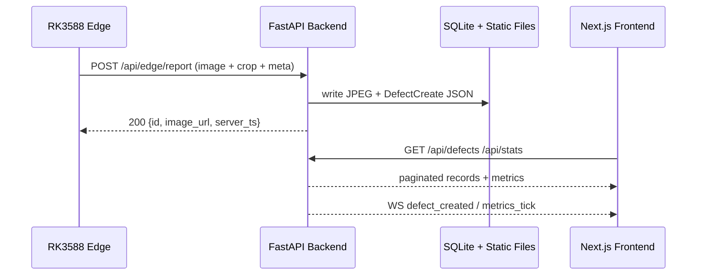

### 3.3 后端、前端、模拟器验收

Phase 4 轨道 A 已验证端云联调：

| 模块 | 验收结果 |
|---|---|
| FastAPI backend | `/api/health`、`/api/defects`、`/api/stats`、静态图片服务均 PASS |
| SQLite schema | `defects.trace_events` JSON 列存在，simulator 数据 78/78 含 trace_events |
| Python simulator | 20s 写入 78 条缺陷，覆盖 3 产线 × 2 变体 |
| WebSocket | POST 后收到 `defect_created` 广播 |
| Next.js frontend | Overview、Profile、AB Matrix 均通过视觉验收 |
| 自动化测试 | `pytest backend/tests/contract/ -v` 为 34/34 passed，`npm run build` 成功 |

这说明 Phase 8D 报告不是孤立的边端笔记，而是一个前后端、模拟器、API contract 和真实 RK3588 端侧 pipeline 串联后的项目叙事。

### 3.4 前端 Dashboard 截图

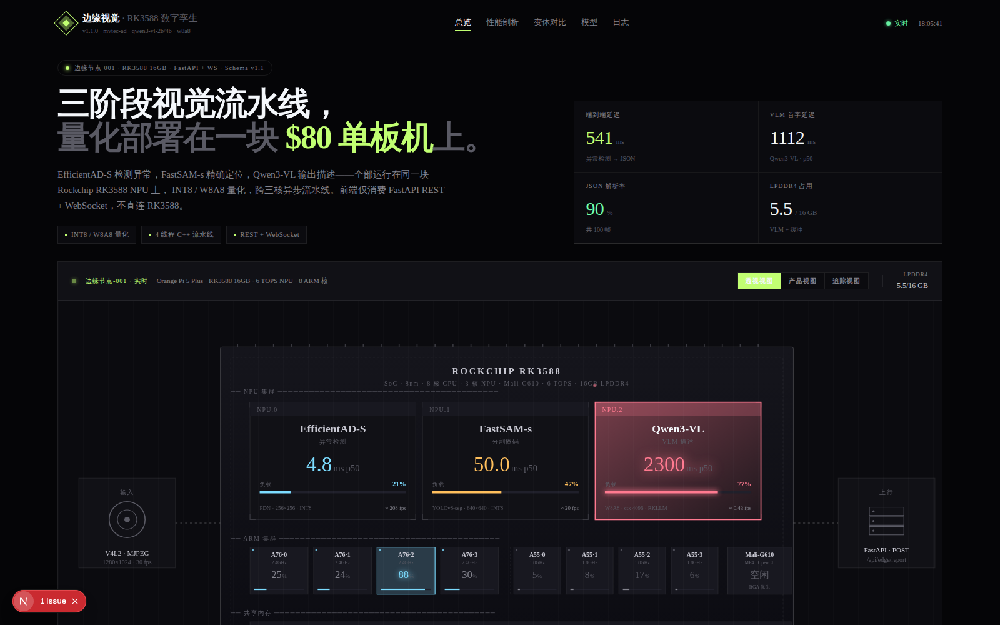

Overview 页面用于展示实时工业检测流、RK3588 数字孪生、关键性能指标和 WebSocket 实时状态。它适合在面试开场说明“系统已经端云联调，而不是只有单机模型脚本”。

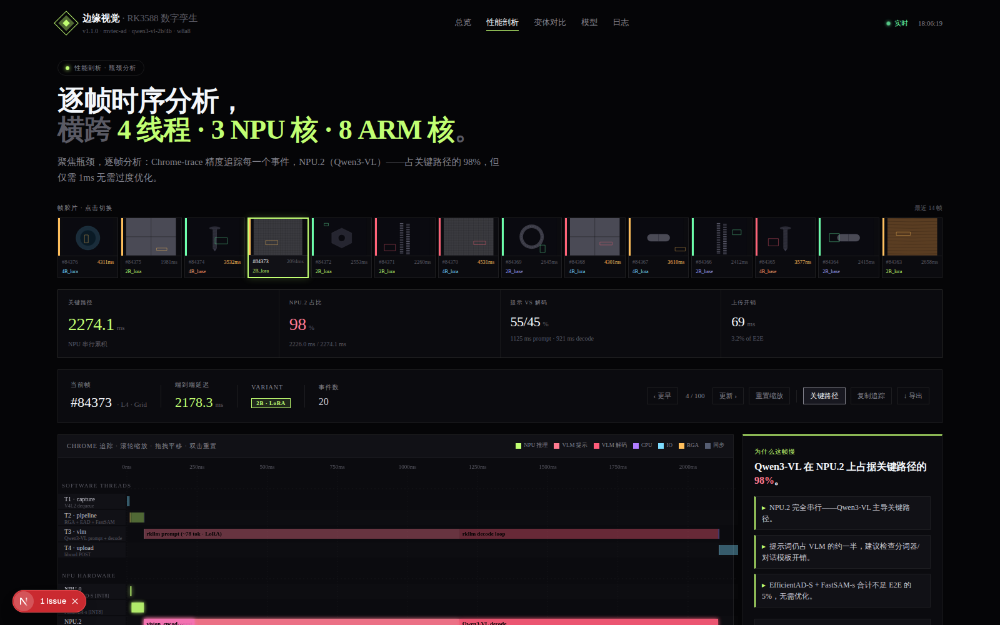

Profile 页面用于解释 trace_events 和端侧瓶颈：VLM 阶段占关键路径主要比例，EfficientAD/FastSAM 不是当前 E2E 延迟主因。这与 Phase 8C 的 beat_ms 压力测试结论一致。

## 4. RK3588 四线程端侧流水线

### 4.1 线程模型

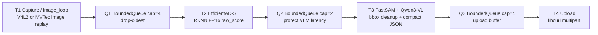

端侧固定四线程模型：

| 线程 | 职责 | 关键约束 |
|---|---|---|
| T1 Capture / image_loop | 采集或循环读取 MVTec 图像 | 不在板端运行 Python simulator |
| T2 EfficientAD | 计算 raw_score，并通过 threshold/pass_all gate 控制 T3 负载 | T2 是 load shedding gate |
| T3 FastSAM + Qwen3-VL | 生成 bbox proposal 与结构化 JSON | VLM 输出必须 parseable compact JSON |
| T4 Upload | 使用 libcurl multipart 上传原图、crop 和 meta | 失败指数退避重试 |

队列全部为 `BoundedQueue<T>`，采用 drop-oldest 语义。Q2 容量只有 2，是有意设计的保护性瓶颈：当 VLM 慢于输入节拍时优先丢旧帧，保证系统延迟不无限积压。

### 4.2 True E2E 验收

Phase 7 True E2E 在 RK3588 上完成 8 图 4 类、24 帧闭环：

| 指标 | 结果 |
|---|---|
| upload_ok | 24/24 |
| upload_fail | 0 |
| json_parse_ok | 100% |
| fallback_frames | 0 |
| dropped_count | 0 |
| Backend records | 24 条可查 |
| trace_events | 6/6 完整 |
| RSS | 约 3324MB，稳定无增长 |

## 5. 模型部署与排障主线

### 5.1 EfficientAD-S：FP16 Raw RKNN

EfficientAD-S 原始 Anomalib post-processor 路径在 RKNN 上不可直接使用：

| 问题 | 处理 |
|---|---|
| post-processor `Greater` 节点类型不兼容 | 导出 post-processor 前 raw tensor |
| INT8 raw RKNN 分布失真 | 切换 FP16/no-quant RKNN |
| `map_mean` 稀释局部缺陷 | Phase 8A-Fix 改用 `raw_score` |

当前 T2 使用 `/model/ReduceMax_output_0` 对应的 `raw_score`，并以 raw_score good_p95 作为 per-category threshold。ONNX vs RKNN AUROC 最大差异为 0.024（screw），说明 FP16/no-quant RKNN 与 PC ONNX 基本等价。

### 5.2 FastSAM：FP16 RKNN

FastSAM-s INT8 per-tensor quantization 将 YOLOv8 置信度压缩到近零，导致 raw candidates=0 和 100% fallback。最终采用 FP16/no-quant RKNN，输出 `fastsam_s_noquant.rknn`，并在 C++ 侧执行 bbox cleanup：

| 级别 | 处理 |
|---|---|
| L1 | clamp 到 [0,1] |
| L2 | 最小面积过滤 |
| L3 | 最大面积过滤 |
| L4 | IoU 去重 |
| L5 | max boxes 限制 |

当前报告将 FastSAM 定位为 bbox proposal 阶段；像素级 mask decode 尚未作为主线完成。

### 5.3 Qwen3-VL：RKLLM W8A8

Qwen3-VL 部署经历三类关键排障：

| 问题 | 根因 | 修复 |
|---|---|---|
| RKLLM runtime 版本不匹配 | 板上 v1.2.1，模型由 toolkit v1.2.3 导出 | 替换 `librkllmrt.so` |
| `n_image_tokens` 错误 | 误设为 784，RKLLM 期望 196 | 使用 patch_h × patch_w = 14 × 14 |
| JSON 截断 | `vlm_max_new_tokens=200` 不够 | 提升到 500，并使用 compact JSON prompt |

2B base W8A8 是当前主线。2B LoRA 和 4B base 都作为 Phase 8 评估对象，但不改变主线部署判断。

## 6. Phase 8A：EfficientAD Threshold Calibration

Phase 8A 的核心结论是：EfficientAD raw output 在当前部署链路下排序能力有限，因此 T2 gate 只能作为负载控制器。

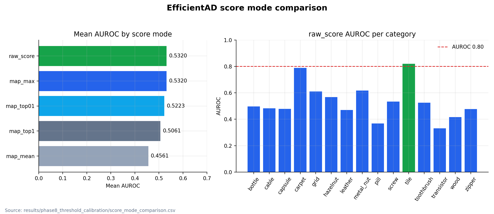

| Score Mode | Mean AUROC | 结论 |
|---|---:|---|
| raw_score | 0.5320 | 当前使用 |
| map_max | 0.5320 | 与 raw_score 数学等价 |
| map_top01 | 0.5223 | 次优 |
| map_top1 | 0.5061 | 接近随机 |
| map_mean | 0.4561 | 最差，被背景稀释 |

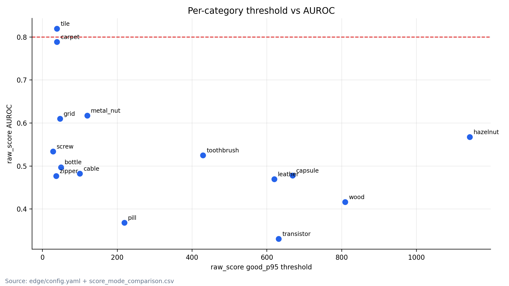

当前 `edge/config.yaml` 使用 raw_score good_p95 阈值。仅 tile 的 raw_score AUROC > 0.80；其余类别均低于 0.80，所有类别 good/defect 分布都有重叠。因此报告和前端演示都不能把 T2 描述成可靠 detection gate。

## 7. Phase 8B：VLM Variant Evaluation

### 7.1 固定样本集与 pass_all 原则

VLM A/B 使用 14 张固定样本：7 类 × 2 张（每类 1 good + 1 defect），覆盖 tile、carpet、grid、metal_nut、zipper、pill、screw。所有 VLM 质量评估使用 `pass_all`，避免低 AUROC 的 T2 threshold gate 非随机过滤样本，污染模型质量比较。

### 7.2 板端 2B base vs 2B LoRA

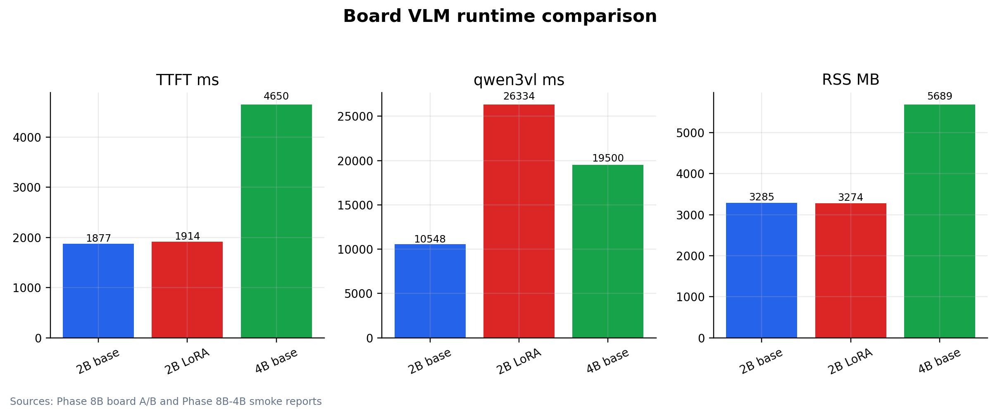

| 指标 | 2B base | 2B LoRA controlled rerun |
|---|---:|---:|
| defect_type_exact | 0/7 | 0/7 |
| TTFT mean | 1877ms | 1914ms |
| decode_tps | 9.7 | 9.9 |
| RSS mean | 3285MB | 3274MB |
| qwen3vl_ms mean | 10548ms | 约 26334ms，含 grid 退化帧 |
| repeated_bracket | 0 | 1 |

初始 LoRA A/B 只处理 11/14，不是 LoRA 不能处理，而是 grid/bent 图像触发 499 token repeated bracket，T3 被阻塞约 50s，在 beat=20s 下导致 Q2 overflow。controlled rerun 使用 beat=60s 后 LoRA 14/14、queue_drop=0。这个结果把“模型能力问题”和“调度问题”分开了。

### 7.3 PC LoRA 有效，板端 W8A8 坍塌

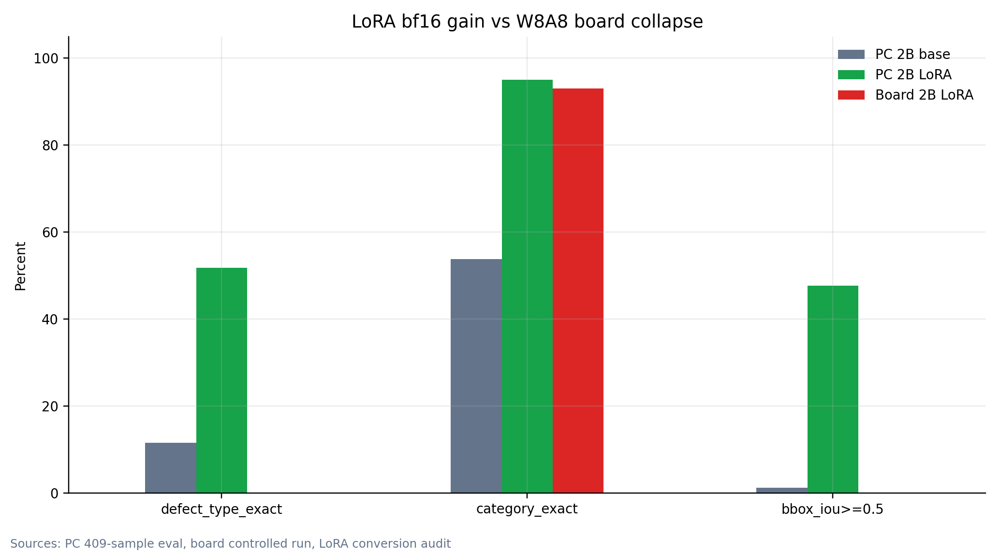

| 指标 | PC 2B base | PC 2B LoRA | Board 2B LoRA |
|---|---:|---:|---:|
| json_parse_ok | 95.6% | 96.1% | 100% |
| defect_type_exact | 11.5% | 51.8% | 0% |
| category_exact | 53.8% | 95.1% | 约 93% |
| bbox_iou>=0.5 | 1.2% | 47.7% | N/A |

LoRA 训练不是失败：PC bf16 上 defect_type_exact 从 11.5% 提升到 51.8%，bbox_iou>=0.5 从 1.2% 提升到 47.7%。但 RK3588 RKLLM/W8A8 上 defect_type_exact 归零，category_exact 基本保留。合理解释是 rank-32 LoRA delta 权重幅值小，W8A8 量化分辨率不足以保留细粒度 defect_type 知识，而粗粒度 category 知识因编码冗余更鲁棒。

### 7.4 LoRA merge-then-convert 审计

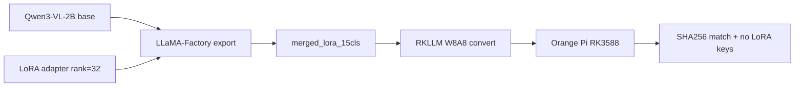

审计确认 LoRA 已正确 merge 后再转换，AutoDL 与 Orange Pi artifact SHA256 一致。第一次转换失败来自磁盘空间不足，重试成功。正确结论是 W8A8 部署链路破坏了 LoRA 细粒度增益，不是 missing merge 或上传错误。

### 7.5 4B base runtime extension

4B base runtime path 已真实实现，不再 fallback 到 2B。4B LoRA 未作为部署主线实现，当前应明确报错而不是静默回退。

| 指标 | 4B base | 相对 2B base |
|---|---:|---:|
| TTFT | 4650ms | 2.45× 慢 |
| decode_tps | 4.9 | 约半速 |
| RSS | 5689MB | 1.74× |
| qwen3vl_ms（tile） | 19500ms | 1.82× |
| json_parse_ok（非 carpet） | 27/27 | 与 2B 相同 |
| pass_all 安全 beat | >=35000ms | 约 2.7× |

4B 的已知问题是 vision encoder spatial patch merge。output[0] 为 `[784,1024]`，RKLLM 期望 196 image tokens 和 4096 embed dim。当前 contiguous reshape `[784,1024] -> [196,4096]` 对 6/7 类别有效，但 carpet 触发静默失败。正确修复路径是 `[28,28,1024] -> permute[14,2,14,2,1024] -> [196,4096]`。

## 8. Phase 8C：beat_ms Queue Pressure Testing

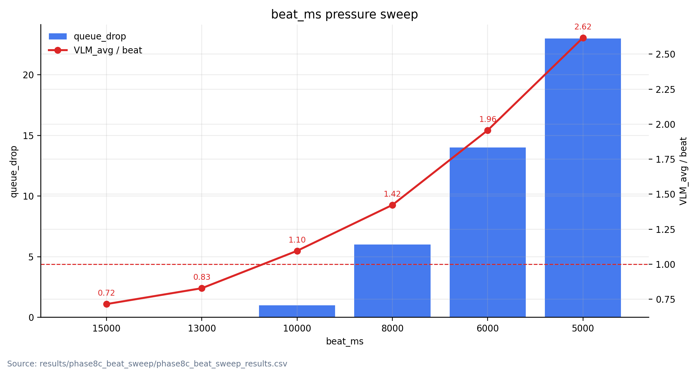

Phase 8C-mini 使用 2B base、pass_all、14 张固定样本做最坏情况压力扫描。

| beat_ms | queue_drop | stable | VLM_avg/beat | qwen3vl_avg |
|---:|---:|---|---:|---:|
| 15000 | 0 | YES | 0.71 | 10735ms |
| 13000 | 0 | YES | 0.83 | 10775ms |
| 10000 | 1 | 边界可用 | 1.10 | 10957ms |
| 8000 | 6 | NO | 1.42 | 11384ms |
| 6000 | 14 | NO | 1.96 | 11737ms |
| 5000 | 23 | NO | 2.62 | 13083ms |

设计公式：

```text
安全：beat_ms > VLM_p99_latency
推荐：beat_ms >= VLM_avg_ms / 0.85
```

所有 drop 都发生在 Q2。beat=5000ms 时 VLM avg 增加 21.9%，说明反压会引发延迟放大：VLM 慢导致 Q2 满，Q2 满又增加 NPU/调度竞争，使 VLM 更慢。生产 threshold 模式下，由于 T2 gate 会过滤大量 good 帧，5000-8000ms 可能可行，但这是由 pass rate 推算，不是本轮 Phase 8C 的实测结论。

## 9. Final Deployment Decision

| 场景 | 推荐 | 原因 |
|---|---|---|
| RK3588 当前部署 | 2B base W8A8 | 稳定、RSS 约 3.3GB、无 LoRA repeated bracket 退化 |
| PC 高质量离线推理 | 2B LoRA bf16 | defect_type_exact 51.8%，bbox_iou>=0.5 47.7% |
| RK3588 扩展候选 | 4B base | RSS 5.7GB 内存安全，但慢且需修复 carpet spatial merge |
| 不作为当前主线 | 2B LoRA W8A8 | fine-grained defect_type 增益坍塌 |
| 不作为当前主线 | 4B LoRA | 未形成可部署主线，且 W8A8 LoRA 风险已知 |

最终主线：

```text
EfficientAD-S FP16 raw RKNN
  -> FastSAM FP16/no-quant RKNN
  -> Qwen3-VL-2B base W8A8 RKLLM
  -> HTTP multipart POST /api/edge/report
```

## 10. Frontend Demo Narrative

### 10.1 简历描述

中文简历可写：

> 基于 RK3588 16GB 实现端侧三阶段工业视觉检测流水线（EfficientAD-S -> FastSAM -> Qwen3-VL），通过 FastAPI + WebSocket + Next.js 完成端云闭环展示；系统诊断 EfficientAD raw score 门控、LoRA W8A8 量化失效、2B/4B 延迟内存权衡与 beat_ms 队列背压边界，最终确定 Qwen3-VL-2B base W8A8 为当前稳定部署主线。

英文简历可写：

> Built an RK3588 edge-cloud industrial vision pipeline with EfficientAD-S, FastSAM, and Qwen3-VL, integrated with a FastAPI ingestion backend and a Next.js realtime dashboard. Diagnosed raw-score gating limits, LoRA W8A8 quantization collapse, 2B/4B latency-memory tradeoffs, and queue backpressure boundaries; selected Qwen3-VL-2B base W8A8 as the stable edge deployment.

### 10.2 面试 3 分钟讲法

1. **系统目标**：把工业缺陷检测从 PC 侧实验推进到 RK3588 16GB 真机端侧部署，并接入后端和前端 dashboard。
2. **架构选择**：端侧使用四线程 C++ pipeline，T1 采集，T2 EfficientAD raw_score gate，T3 FastSAM + Qwen3-VL，T4 multipart 上传；后端只负责 ingestion、存储、WebSocket，前端只消费 REST/WS。
3. **关键排障**：EfficientAD post-processor 与 RKNN 不兼容，切到 FP16 raw；FastSAM INT8 置信度坍塌，切到 FP16；Qwen3-VL 修复 runtime 版本、n_image_tokens 和 JSON 截断问题。
4. **Phase 8 发现**：T2 gate 是 load shedding，不是 reliable detector；LoRA 在 PC bf16 有效但在 RK3588 W8A8 细粒度能力坍塌；2B base pass_all 推荐 beat 为 13000ms；4B base 可运行但慢且有 carpet spatial merge issue。
5. **最终决策**：当前 RK3588 主线是 2B base W8A8，前端展示重点是实时可观测性和工程诊断，而不是夸大 defect_type 精确分类。

### 10.3 前端 Demo 讲解顺序

前端展示不应包装成“板端 defect_type 精确分类已经成功”。更合适的演示叙事是实时工业视觉流水线可观测性：

| 展示模块 | 面试讲法 |
|---|---|
| Overview 实时缺陷流 | WebSocket 展示后端收到的边端报告，验证端云闭环 |
| 图片 + bbox overlay | FastSAM proposal 与 VLM JSON 的可视化结果 |
| anomaly_score / threshold decision | 展示 T2 load shedding gate 如何控制 T3 压力 |
| Profile trace timeline | 展示 EfficientAD、FastSAM、Qwen3-VL、upload 的分阶段延迟 |
| VLM metrics | TTFT、decode_tps、RSS、json_parse_ok 可观测 |
| AB Matrix | 展示 2B base、2B LoRA、4B base 的质量-延迟-内存权衡 |
| queue_drop / upload 状态 | 展示 BoundedQueue 背压和边端上传可靠性 |

### 10.4 不应该说什么

| 错误说法 | 原因 |
|---|---|
| 板端 defect_type 精确分类已经成功 | Phase 8B 板端 defect_type_exact 为 0% |
| LoRA 是当前 RK3588 最优部署方案 | LoRA W8A8 细粒度能力坍塌，且有 repeated bracket 退化 |
| 4B 已全面替代 2B | 4B 只是扩展候选，仍有 carpet spatial merge issue |
| EfficientAD T2 是可靠 detector | raw_score mean AUROC 仅 0.5320，T2 是 load shedding gate |

面试一句话总结：

> 我完成了一个 RK3588 端侧三阶段工业视觉流水线，并把模型转换、量化失效、队列背压和端云 API 可观测性都做成了可验证的工程闭环。

## 11. Known Limitations

| 限制 | 当前影响 | 后续方向 |
|---|---|---|
| EfficientAD raw_score AUROC 低 | T2 只能做负载控制 | 实现 C++ post-processor，重新校准 |
| LoRA W8A8 fine-grained collapse | 板端不部署 LoRA | 等待更高精度 RKLLM 量化或改 PC 离线推理 |
| 4B carpet 静默失败 | 4B 不能作为主线 | 实现正确 spatial permutation |
| FastSAM mask decode 未实现 | 只输出 bbox | 补像素级 mask decode |
| calibration-on-test | 阈值不是生产认证指标 | 采集生产 good/defect 样本重做校准 |
| pass_all beat sweep 与 threshold 模式不同 | 5000-8000ms threshold 可行性是推算 | 做真实 threshold 长时间稳定性测试 |

## 12. Future Work

1. 修复 4B vision spatial patch merge，完成 carpet 类别复测。
2. 实现 EfficientAD C++ post-processor，比较 post-processed score 与 raw_score。
3. 增加 FastSAM mask decode，支持像素级缺陷区域展示。
4. 增加长时间 threshold 模式 soak test，记录 queue_drop、RSS、upload retry。
5. 后续安装 Pandoc 或 LibreOffice 后，将本 Markdown 导出 PDF/Word，用于简历附件或项目展示。

## Appendix A：环境与版本

| 项目 | 版本 / 状态 |
|---|---|
| Edge board | Orange Pi 5 Plus / RK3588 / 16GB RAM |
| Edge OS | Ubuntu 22.04 Jammy（Phase 7 报告记录） |
| C++ toolchain | GCC 11.4.0，C++20 |
| RKNN Runtime | `librknnrt.so` v2.2+ |
| RKLLM Runtime | `librkllmrt.so` v1.2.3 |
| Backend | FastAPI + SQLAlchemy 2.0 async + SQLite WAL |
| Frontend | Next.js 15 dashboard，REST + WebSocket |
| Local plotting | `.venv` Python，pandas 2.3.3，matplotlib 3.10.9 |
| API contract | `docs/API_CONTRACT.md` v1.2 |

## Appendix B：关键数据索引

| 文件 | 内容 |
|---|---|
| `docs/API_CONTRACT.md` | 边端、模拟器、后端、前端唯一接口契约 |
| `docs/ARCHITECTURE.md` | 系统架构与 Phase 8 架构修正 |
| `docs/ENGINEERING_FINDINGS.md` | 工程排错与发现记录 |
| `docs/experiments/phase4_track_a_e2e_acceptance_report.md` | 后端、前端、模拟器联调验收 |
| `docs/experiments/phase7_edge_pipeline_report.md` | RK3588 四线程真实流水线验收 |
| `docs/experiments/phase8_execution_report.md` | Phase 8A/8B/8C 综合实验报告 |
| `results/phase8_threshold_calibration/score_mode_comparison.csv` | 5 种 EfficientAD score mode AUROC |
| `results/phase8_vlm_ab/pc_2b_base_vs_lora_eval.md` | PC 409 样本 VLM 质量评估 |
| `results/phase8_vlm_ab/lora_conversion_audit.md` | LoRA merge-then-convert 审计 |
| `results/phase8_4b_smoke/phase8_4b_base_smoke_report.md` | 4B base smoke 报告 |
| `results/phase8c_beat_sweep/phase8c_beat_sweep_results.csv` | beat_ms 扫描原始数据 |

## Appendix C：工程发现索引

| 编号 | 主题 | 报告讲法 |
|---|---|---|
| F-EAD-01 | EfficientAD post-processor 与 RKNN 不兼容 | 能通过模型图和 runtime 错误定位算子兼容问题 |
| F-EAD-02 | EfficientAD INT8 分布失真 | 能用 ONNX/RKNN 对比决定 FP16/no-quant 回退 |
| F-EAD-03 | score mode 影响 AUROC | 能把 map_mean 误用修正为 raw_score |
| F-EAD-04 | recall@FPR 计算 bug | 能对评估脚本做单调性和运行时一致性校验 |
| F-FSM-01 | FastSAM INT8 置信度坍塌 | 能发现量化导致 proposal 全部 fallback |
| F-VLM-02 | n_image_tokens 错误 | 能理解 RKLLM image token 语义而非只调参数 |
| F-VLM-04 | LoRA W8A8 细粒度坍塌 | 能区分训练有效、转换正确、部署量化失效 |
| F-VLM-06 | 4B spatial patch merge | 能定位 4B vision embedding shape 与空间排列问题 |
| F-CPP-01 | beat_ms 与队列稳定 | 能用 VLM_avg/beat ratio 解释 Q2 drop |
| F-METHOD-01 | timeout / drain 误判 | 能用 controlled rerun 区分调度问题和模型问题 |

完整记录见 `docs/ENGINEERING_FINDINGS.md`。

## Appendix D：仓库目录结构

```text
backend/                  FastAPI backend, schemas, routers, WebSocket manager
frontend/                 Next.js dashboard and visual system
simulator/                Python MVTec line replay client
edge/                     RK3588 C++ four-thread pipeline
docs/API_CONTRACT.md      Edge/backend/frontend contract
docs/ARCHITECTURE.md      System architecture and Phase 8 architecture updates
docs/experiments/         Phase 4 / Phase 7 / Phase 8 reports
docs/reports/             Job-facing report and generated figures
results/phase8_*          Phase 8 calibration, VLM A/B, beat sweep, 4B smoke data
scripts/                  Training, conversion, evaluation and plotting scripts
```

## Appendix E：图表索引

| 图表 | 生成依据 |
|---|---|
| `figures/fig_score_mode_auroc.png` | `score_mode_comparison.csv` |
| `figures/fig_threshold_auroc_scatter.png` | `edge/config.yaml` + `score_mode_comparison.csv` |
| `figures/fig_vlm_variant_runtime.png` | Phase 8B board A/B + 4B smoke |
| `figures/fig_lora_w8a8_collapse.png` | PC eval + board LoRA + audit |
| `figures/fig_beat_sweep.png` | `phase8c_beat_sweep_results.csv` |
| `figures/fig_frontend_overview.png` | Phase 4 Playwright dashboard screenshot |
| `figures/fig_frontend_profile.png` | Phase 4 Playwright profile screenshot |

说明：PNG 图表由 `.venv` 中的 `pandas` + `matplotlib` 直接从 CSV、config 和 Phase 8 报告数据生成。SVG 版本保留在同目录，作为可编辑矢量备份。

## Appendix F：交付格式与工具决策

### F.1 远程仓库与本地结构核对

远程仓库 `https://github.com/2549227674/vlm-sam-industrial-vision-v2` 已核对：仓库公开，主分支包含 `.claude`、`backend`、`design-reference`、`docs`、`edge`、`frontend`、`logs`、`results`、`scripts`、`simulator`、`temp_docs` 等目录。GitHub About 描述与本报告一致：边缘端 RK3588 16GB 跑 EfficientAD-S -> FastSAM -> Qwen3-VL-2B，后端 FastAPI 收单与广播，前端 Next.js 仪表盘可视化。

本地工作区在 `main` 分支，当前本地 HEAD 为 `393e233`。远程 `docs/reports/edge_deployment_summary.md` 仍是草稿/TODO 版本；本地报告已补齐正文、图表、Phase 4/7/8 串联叙事和部署判断。

本地三层结构核对结果：

| 模块 | 路径 | 作用 |
|---|---|---|
| Backend | `backend/app`, `backend/tests/contract`, `backend/static/defects` | FastAPI ingestion、contract tests、图片落盘 |
| Frontend | `frontend/app`, `frontend/components`, `frontend/lib` | Next.js dashboard 和可视化组件 |
| Simulator | `simulator/` | PC 端 MVTec line replay 和契约测试客户端 |
| Edge | `edge/src`, `edge/include`, `edge/third_party`, `edge/phase8c_configs` | RK3588 C++ 四线程流水线、RKNN/RKLLM/RGA/libcurl 集成 |
| Docs | `docs/experiments`, `docs/reports` | 阶段报告、求职展示报告 |
| Results | `results/phase8_*` | Phase 8 阈值、VLM A/B、4B smoke、beat sweep 数据 |

### F.2 Markdown / Word / PDF 取舍

当前推荐：**先维护 Markdown 作为源文档，再导出 PDF/Word**。

原因：

1. Markdown 可直接引用 Mermaid、PNG 图表、代码块和 repo 相对路径，最适合作为版本化技术报告。
2. PDF 适合投递和分享，但不适合作为唯一源文件。
3. Word 适合简历附件二次排版，但会弱化 Mermaid、代码块和图表的可维护性。
4. 本机当前未安装 `pandoc`、`libreoffice` 或 `wkhtmltopdf`，因此本轮不生成伪导出的 PDF/Word。

后续导出建议：

```bash
pandoc docs/reports/edge_deployment_summary.md \
  -o docs/reports/edge_deployment_summary.pdf \
  --toc --number-sections

pandoc docs/reports/edge_deployment_summary.md \
  -o docs/reports/edge_deployment_summary.docx \
  --toc
```

### F.3 图表与生图策略

精确指标图只使用可复现数据源生成，不使用 AI 生图：

| 图类型 | 生成方式 | 原因 |
|---|---|---|
| AUROC / threshold / runtime / LoRA collapse / beat sweep | `.venv` + pandas + matplotlib | 数据可追溯、可复现、不会出现错误数值 |
| 系统拓扑 / 四线程 / sequence / audit flow | Mermaid | 文档内可维护，适合架构图 |
| 封面概念图 | 可选 AI image generation | 只做视觉封面，不承载指标或 API 结构 |

因此，本轮已经直接生成了数据图。没有使用 GPT image 生成指标图，因为这类图必须以 CSV/报告数据为准。若后续需要封面图，可生成一张“RK3588 edge-cloud industrial vision pipeline”概念图，但应放在封面或展示页，不应替代 Mermaid 架构图和 matplotlib 指标图。

### F.4 skills / MCP / plugins 判断

本轮不需要额外安装 skills / MCP / plugins。已有能力足够：

| 能力 | 用途 | 结论 |
|---|---|---|
| `rk3588-deployment` skill | 边端约束、RKNN/RKLLM、四线程模型 | 已覆盖 |
| `shadcn` skill | 前端 dashboard UI 维护 | 仅当前端改 UI 时使用，本轮未改前端 |
| Playwright MCP / 本地截图资产 | 前端视觉验收 | Phase 4 已用，本轮报告引用即可 |
| GitHub / web 读取 | 远程仓库事实核对 | 已核对远程公开仓库与草稿状态 |
| image generation | 概念封面图 | 可选，不用于精确指标 |

不建议新增：

- 不需要用 diagram AI 画 API 或数据流图；Mermaid 更准确。
- 不需要用 GPT image 画 AUROC、runtime、beat sweep；matplotlib 更可靠。
- 不需要为了文档任务引入新的 frontend/backend/code MCP。
