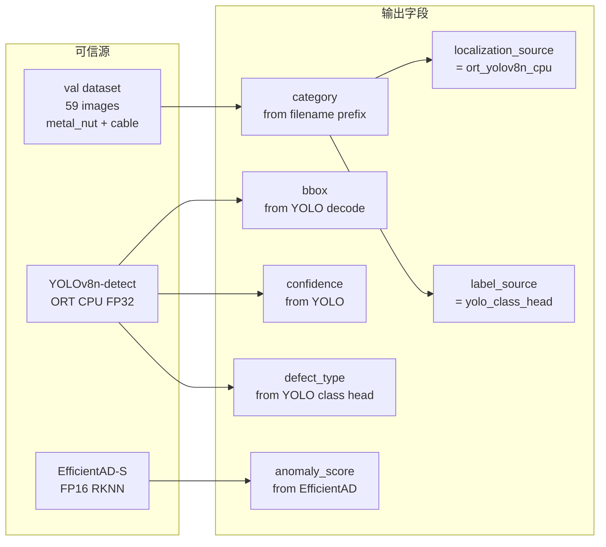
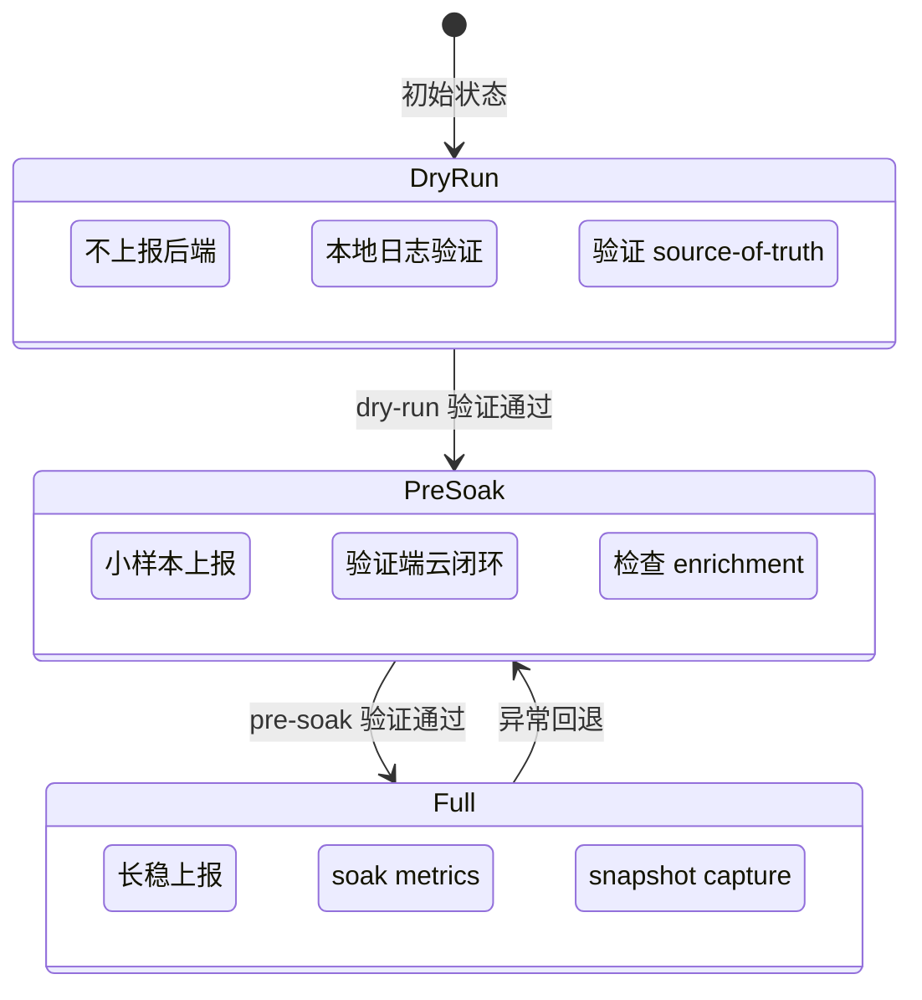
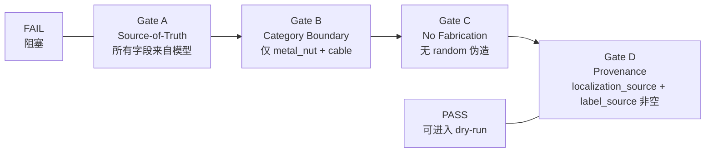
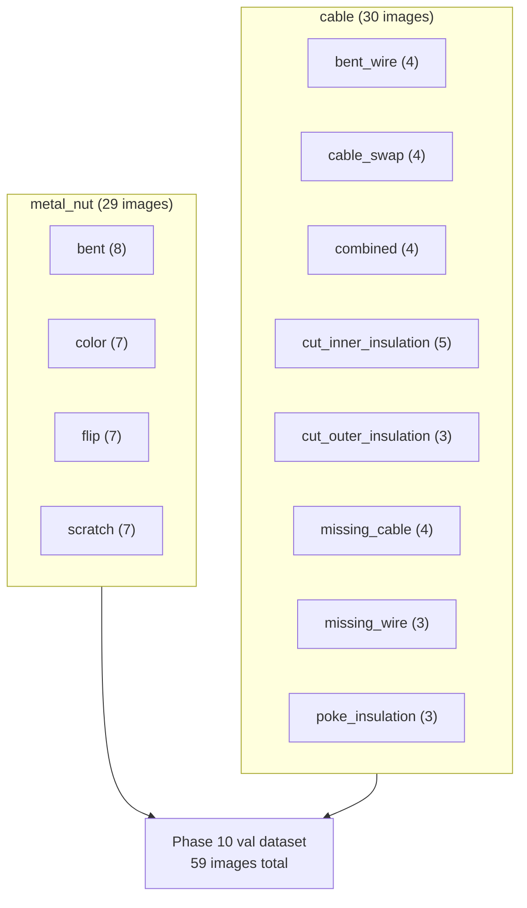

# Phase 10 Runner Gate Diagrams

> 机制图，使用 Mermaid，不生成 PNG。
> 基于 `docs/experiments/phase10_1b_5d_soak_runner_production_yolo_fix.md`。

## 0. 与报告图表的关系

本文件描述 Phase 10.1b runner 的 safety gates 和 source-of-truth 设计。相关内容已通过以下报告图表在其他文档中可视化：

- **fig03**（ORT snapshot 分布）和 **fig04**（ORT pipeline 延迟）展示 Phase 10 ORT snapshot 和 latency，与 runner 的 source-of-truth 直接相关。
- **fig05**（Phase 9 vs Phase 10 演进）展示系统演进，runner gate diagrams 解释 Phase 10.1b 如何避免 fabricated bbox / confidence / defect_type。
- runner gate diagrams 的 mode state（dry-run → pre-soak → full）和 validation gates A-D 是 Phase 10.1b 的机制设计，不等同于 completed soak。

**边界**：Phase 10.1b pre-soak NOT RUN / READY FOR DRY-RUN。No 200/500 full soak。

---

## 1. Runner Source-of-Truth

**边界**：所有字段必须来自模型推理，禁止 `random.uniform()` / `random.choice()` 伪造。

## 2. Mode State Diagram

**边界**：当前状态 = pre-soak NOT RUN / READY FOR DRY-RUN。No 200/500 full soak。

## 3. Validation Gates

## 4. Explicit Not Done

| 项目 | 状态 |
|------|------|
| 200/500 full soak | NOT DONE |
| Public snapshot capture | NOT DONE |
| Backend/frontend behavior change | NOT DONE |
| Schema change | NOT DONE |
| Pre-soak run | NOT RUN / READY FOR DRY-RUN |
| Phase 10.1b full soak completed | NOT DONE |

## 5. Curated Val Image Class Pool

